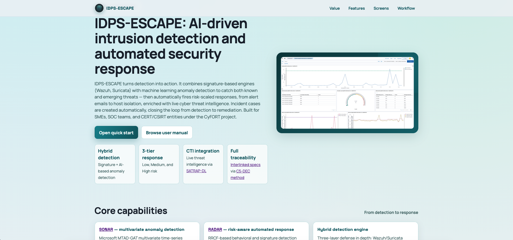
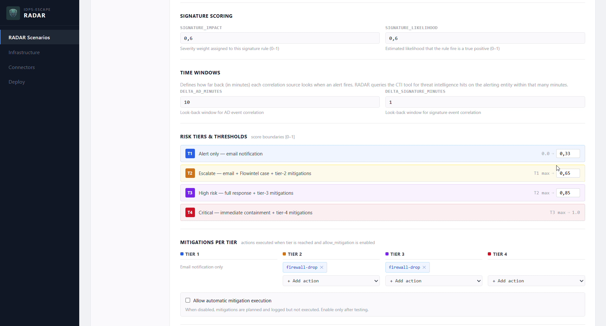
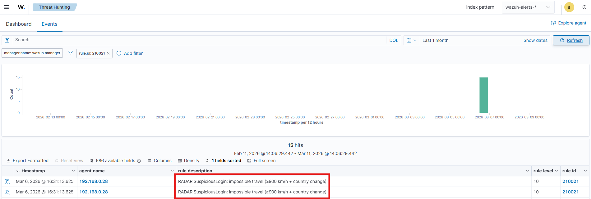
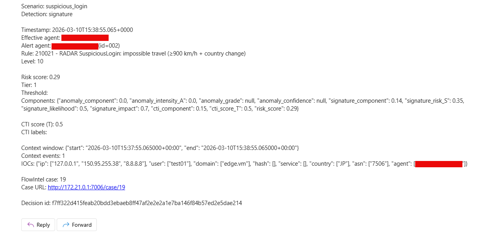
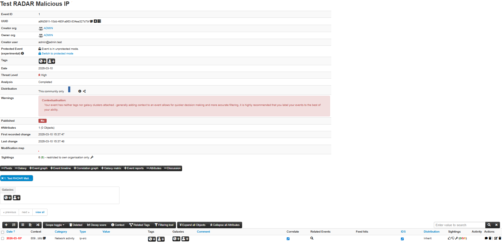
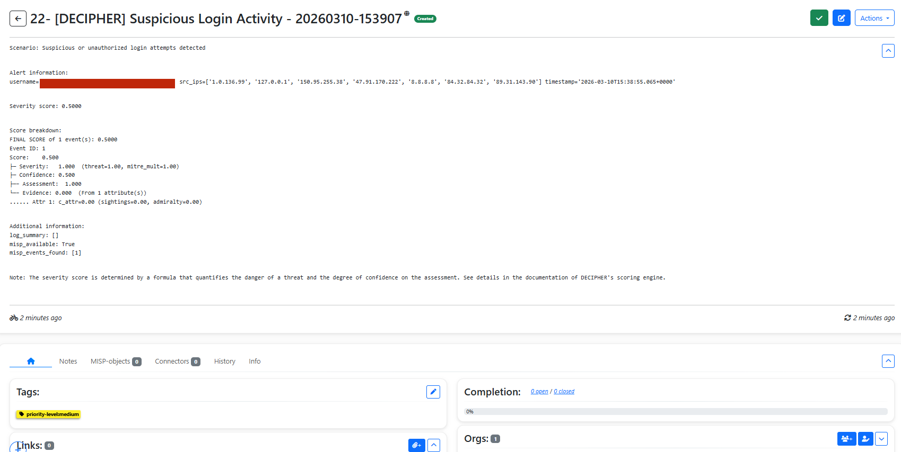
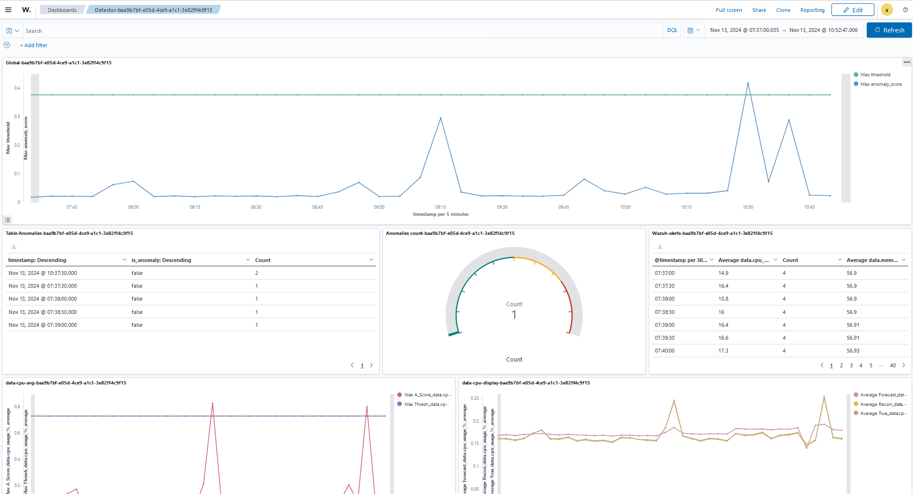

# IDPS-ESCAPE

IDPS-ESCAPE (Intrusion Detection and Prevention System - Enhanced Security through a Cooperative Anomaly Prediction Engine) is a sub-project of [CyFORT](https://abstractionslab.com/index.php/research-and-development/cyfort/) implementing a **MAPE-K**-based (Monitor, Analyze, Plan, Execute, Knowledge) Security Orchestration, Automation, and Response (**SOAR**) system. Developed in the context of [IPCEI-CIS](https://ec.europa.eu/commission/presscorner/detail/en/ip_23_6246), it targets SMEs, CERT/CSIRT entities, SOC managers, system administrators, security engineers and cloud deployments.


**Core components:**
- [**RADAR**](/radar/README.md) - Risk-aware hybrid detection and automated response, deployed and managed end-to-end from a point-and-click web GUI (backed by an API — no manual config editing needed)
- [**SONAR**](/sonar/README.md) - SIEM-oriented multivariate anomaly detection with pluggable detectors (deep learning by default), measured on labelled data
- [**ADBox**](/docs/manual/adbox_docs/adbox.md) - Legacy research framework
- **Wazuh integration and management**: all components integrate fully with Wazuh, with RADAR additionally providing Wazuh management and orchestration

**Built on:** [Wazuh](https://wazuh.com/), [OpenSearch](https://opensearch.org/), [SATRAP-DL](https://github.com/AbstractionsLab/satrap-dl), [PyFlowintel](https://github.com/AbstractionsLab/PyFlowintel), [Flowintel](https://github.com/flowintel/flowintel), [MISP](https://www.misp-project.org/), [Suricata](https://suricata.io/)

We adopt a **hybrid detection approach** for defense-in-depth against known and emerging threats, combining signature-based engines (Wazuh, Suricata) and machine learning (ML) algorithms for ML-based anomaly detection (AD) through RADAR and SONAR, relying respectively on [random cut forests](https://proceedings.mlr.press/v48/guha16.pdf) (RCF) for streaming data, and on pluggable multivariate detectors, by default a graph-attention deep model in the line of [MTAD-GAT](https://arxiv.org/pdf/2009.02040). Both can run on the same Wazuh data and be scored against the same labelled anomalies.

This repository contains complete [documentation](./docs/manual/README.md), user manual, **[interlinked technical specifications](https://abstractionslab.github.io/idps-escape/traceability/index.html)** for traceability, and validation test results, all based on the [C5-DEC](https://abstractionslab.github.io/c5dec/website/product-presentation.html) method.

For a visual user-oriented tour of IDPS-ESCAPE, visit the **[product presentation page](https://abstractionslab.github.io/idps-escape/website/product-presentation.html)**.



## Table of contents

- [IDPS-ESCAPE suite](#idps-escape-suite)
- [Quick start](#quick-start)
- [Documentation](#documentation)
- [Development](#development)
- [Testing](#testing)
- [Disclaimer](#disclaimer)
- [License](#license)
- [Contact](#contact)

## IDPS-ESCAPE suite

### RADAR - Risk-aware AD-based Automated Response

[**RADAR**](/docs/manual/radar_docs/README.md) enhances Wazuh with hybrid detection and intelligent automated response through a fully API-based steering and management layer, following a scenario-based paradigm. Its browser-based GUI provides the complete deployment and operations experience on top of that API:

- **Hybrid detection**: Signature-based (Wazuh, Suricata) + ML-based anomaly detection ([random cut forest](https://proceedings.mlr.press/v48/guha16.pdf), RCF), with signature and anomaly alerts for the same user combined in the risk score when they occur close in time ([fusion](/docs/manual/radar_docs/radar-tuning.md#combining-signature-and-anomaly-alerts-fusion), enabled for suspicious login)
- **Risk-aware actions**: Tiered response (low/medium/high risk) with email notification, incident case creation and automated mitigations: blocking the source IP (`firewall-drop`), locking the implicated Linux account (`lock_user_linux.sh`) and terminating an allow-listed service (`terminate_service.sh`)
- **Automatic case creation**: Incident case creation via integration with the [DECIPHER](https://github.com/AbstractionsLab/satrap-dl/blob/main/decipher/README.md) subsystem of [SATRAP-DL](https://github.com/AbstractionsLab/satrap-dl), [PyFlowintel](https://github.com/AbstractionsLab/PyFlowintel) and [Flowintel](https://github.com/flowintel/flowintel)
- **Flexible deployment**: Local/remote manager and agent configurations
- **Production scenarios**: Default baseline detection, GeoIP detection, log volume monitoring, Linux resource utilization, suspicious login, web scanning detection
- **Web-based GUI**: provides a browser-based control panel covering the full deployment, orchestration and configuration lifecycle



See [RADAR README](/docs/manual/radar_docs/README.md), [GUI user manual](/docs/manual/radar_docs/radar-gui-user-manual.md), [scenarios](/radar/scenarios/README.md), [adversarial ML guidance](/docs/manual/radar_docs/adversarial-ml-guidance.md) and [developer README](/radar/README.md).

### SONAR - SIEM-Oriented Neural Anomaly Recognition via multivariate AD

[**SONAR**](/sonar/README.md) provides a standalone SIEM-oriented anomaly detection solution for Wazuh data:

- **Multivariate time-series AD with pluggable detectors**: [`mvad`](/docs/manual/sonar_docs/scenario-guide.md#backend) (default), a graph-attention deep model in the line of [MTAD-GAT](https://arxiv.org/pdf/2009.02040) (Microsoft's multivariate anomaly detector); `pca`, a linear multivariate model that trains in under a second without torch; and `ewma`, a per-feature baseline
- **Measured detection quality**: [`sonar evaluate`](/docs/manual/sonar_docs/evaluation-guide.md) reports event-level precision, recall, F1, detection delay and false alarms per day on labelled data, and calibrates each scenario's threshold and `anomaly_confidence`
- **Side by side with RADAR**: the `radar_linux_resource_utilization` scenario reads the events and features of RADAR's Linux resource-utilization detector, with one model per host (`--agent`); [`sonar export`](/docs/manual/sonar_docs/radar-comparison-guide.md) captures a labelled live window so both detectors are scored on the same data
- **Wazuh and RADAR integration**: [anomalies become Wazuh alerts](/docs/manual/sonar_docs/data-shipping-guide.md#the-wazuh-sink) (rules 100500–100519) that carry `anomaly_grade` and `anomaly_confidence`, so Wazuh active responses and RADAR can act on them; each anomaly is delivered once per sink
- **Scenario-based**: YAML configuration for repeatable workflows, with realtime, batch and historical modes
- **Debug mode**: offline runs on packaged synthetic data (no infrastructure required)
- **Standalone package**: a wheel with the example scenarios and their debug data; models are plain directories (no pickles)

See [SONAR README](/docs/manual/sonar_docs/README.md), [scenario guide](/docs/manual/sonar_docs/scenario-guide.md), [architecture](/docs/manual/sonar_docs/architecture.md) and [developer README](/sonar/README.md).

### Fully GUI-based deployment and management

RADAR provides a browser-based control panel for production-ready deployment and ongoing management of the Wazuh Manager, Wazuh Agents, and the full RADAR stack — no manual config files or CLI orchestration required. The GUI covers scenario deployment, agent onboarding, configuration, anomaly-detector setup, health checks, and teardown, giving full control over the stack from one place. See the [GUI user manual](/docs/manual/radar_docs/radar-gui-user-manual.md) for details.

## Documentation

See our [user manual](./docs/manual/README.md) for comprehensive documentation on [RADAR](/docs/manual/radar_docs/README.md), and [SONAR](/docs/manual/sonar_docs/README.md). Visit our [traceability page](https://abstractionslab.github.io/idps-escape/traceability/index.html) for interlinked requirements, technical specifications such as architecture diagrams, and test reports.

### ADBox (Legacy)

> **⚠️ Legacy System**: maintained for research continuity only. **Use SONAR for deployments requiring deep learning.**

See the [ADBox manual](/docs/manual/adbox_docs/adbox.md) for documentation.

## Quick start

### RADAR: full-stack GUI deployment and management

**Prerequisites:**

Ensure your environment meets the [resource and network requirements](#requirements) specified below, and then proceed as follows:

1. Create `radar/.env` and update relevant fields (use a copy [env.example](/radar/env.example)):
   - OpenSearch URL, username, password
   - Wazuh API credentials and manager address
   - SMTP settings for email alerts
   - FlowIntel API key (optional, for incident case creation)
   - Webhook URL (default: `http://localhost:8080/notify`; use this host's address instead when the indexer runs on another host)
2. Start the RADAR GUI using the `radar.sh` script from within the `radar/` directory (after making it executable `chmod +x ./radar.sh`):

```bash
./radar.sh gui
```

Then open the displayed local URL and use the **Deployment** page to deploy the
full stack, onboard agents, configure scenarios, start anomaly detection, run
health checks, and manage teardown. See the [RADAR GUI user manual](/docs/manual/radar_docs/radar-gui-user-manual.md) and [getting started](/docs/manual/radar_docs/radar-getting-started.md) page for full details.

> **Before deploying beyond a test machine**, read RADAR's [security assumptions and recommendations](/radar/README.md#security-assumptions-and-recommendations). It covers how to reach the GUI safely (through an SSH tunnel from your workstation), which ports to restrict by firewall, and the settings to review for your site.

Screenshots depicting the various stages in a Suspicious Login detection and response event flow are provided below.

**Suspicious login detection shown on the Wazuh dashboard:**



**Email notification sent by RADAR automated response:**



**DECIPHER lookup in MISP to compute CTI score (used in RADAR risk score):**



**Automatic incident case created in Flowintel using DECIPHER (subsystem of SATRAP-DL):**



### SONAR usage

SONAR provides scenario-based anomaly detection with flexible execution modes:

```bash
# Install
poetry install --with sonar

# Check the connection to the Wazuh indexer
poetry run sonar check --config sonar.yaml

# Load SONAR's rules into the Wazuh manager (once), so anomalies become Wazuh alerts
poetry run sonar wazuh install-rules --config sonar.yaml --restart

# Run a complete scenario (train + detect); anomalies go to the Wazuh manager
poetry run sonar scenario --use-case sonar/scenarios/brute_force_detection.yaml --config sonar.yaml

# Debug mode (offline, on the scenario's packaged synthetic data)
poetry run sonar scenario --use-case sonar/scenarios/linux_resource_monitoring.yaml --debug

# Also keep the anomalies in a data stream for dashboards
poetry run sonar scenario --use-case sonar/scenarios/brute_force_detection.yaml --config sonar.yaml --ship

# Measure detection quality on labelled data and calibrate the scenario
poetry run sonar evaluate --scenario linux_resource_monitoring --train-file F --validation-file F --validation-labels F --test-file F --test-labels F
```

See the [SONAR documentation](/docs/manual/sonar_docs/README.md) for details.

**Where anomalies go:**

- By default, the `wazuh` sink sends one event per anomaly to the Wazuh manager, which raises it as an alert of SONAR's rules (100500–100519). RADAR and Wazuh active responses act on those alerts.
- `--ship` (or `shipping.enabled`) adds the scenario's data stream in the Wazuh indexer, with index templates and a retention policy, for dashboards and history.
- Local files (`jsonl`) and standard output are also available; debug runs print the events instead of delivering them.

See the [anomaly output guide](/docs/manual/sonar_docs/data-shipping-guide.md) for configuration details and the [dashboard tutorial](/docs/manual/adbox_docs/dashboard_tutorial.md) for building a dashboard on the data stream (same process for SONAR and ADBox).



### Trying SONAR (5 minutes)

No infrastructure required — debug mode runs the full train → detect → report workflow offline with synthetic data:

```bash
poetry install --with sonar
poetry run sonar scenario --use-case sonar/scenarios/example_scenario.yaml --debug
```

To measure how well a scenario detects, rather than watch it run, see the [evaluation guide](/docs/manual/sonar_docs/evaluation-guide.md).

### Comparing SONAR with RADAR

On a deployment where RADAR's `linux_resource_utilization` scenario runs, SONAR can model the same CPU and memory events per host and both detectors can be scored on one labelled window:

```bash
poetry run sonar train --scenario radar_linux_resource_utilization --config sonar.yaml --agent web-01
poetry run sonar export --scenario radar_linux_resource_utilization --config sonar.yaml --agent web-01 \
  --start 2026-11-19T00:00:00Z --end 2026-11-20T00:00:00Z --output-dir cmp/test \
  --radar-results 'opensearch-ad-plugin-result-linux-resource-utilization*' \
  --event cpu_load,2026-11-19T09:00:00Z,2026-11-19T09:05:00Z
```

The [RADAR comparison guide](/docs/manual/sonar_docs/radar-comparison-guide.md) covers the prerequisites, the simulation runs, the training export and both evaluations.

### Requirements

#### Resource requirements by component

| Component | RAM | Storage | CPU |
|-----------|-----|---------|-----|
| **Wazuh Manager** | 8 GB minimum | ~15 GB | 4 cores |
| **SONAR** | 4 GB | ~2 GB (models) | 2 cores |
| **RADAR** | 2 GB | ~1 GB | 2 cores |
| **Wazuh Agents** | 512 MB each | ~500 MB each | 1 core |
| **Full Stack** | 16 GB+ | ~26 GB total | 8+ cores |

See the [custom deployment guides](./docs/manual/custom_deployments/README.md) for optional network requirements and multi-node setups.

### Docker deployment

**Build and run with convenience scripts:**

```bash
# Build images
./build.sh all              # All components
./build.sh sonar            # SONAR only

# Run SONAR
./sonar/sonar.sh check            # Check Wazuh connection
./sonar/sonar.sh scenario --use-case sonar/scenarios/example_scenario.yaml --debug

# Run ADBox (legacy, see the ADBox manual)
./adbox/adbox.sh -u 1
```

**Note**: Docker-based execution requires building the images first with `build.sh`.

## Development

```bash
# Install dependencies
poetry install --with sonar,radar,adbox,test

# Run tests
poetry run pytest tests/sonartests/  # SONAR (-m "not slow" skips the real MVAD library)
poetry run pytest tests/             # All
./radar/test.sh                      # RADAR

# SONAR CLI
poetry run sonar check
poetry run sonar scenario --use-case sonar/scenarios/example_scenario.yaml --debug

# Docker builds
./build.sh all
```

See [SONAR README](/sonar/README.md) and [RADAR README](/radar/README.md) for component-specific development guides.

## Testing

See our test report (TRP) in the list of published documents on the [technical specifications traceability page](https://abstractionslab.github.io/idps-escape/traceability/index.html) detailing the validation test campaign results. Unit tests are available in the `tests` folder.

## Disclaimer

RADAR has been validated in controlled environments and is released as stable. SONAR is at most at TRL 6. Conduct a thorough security assessment before deploying either component in production. **Use at your own risk.**

## License

Copyright © itrust Abstractions Lab and itrust consulting. Licensed under [GNU AGPL v3.0](LICENSE). See [AUTHORS](/AUTHORS) for contributors.

## Acknowledgment

Co-funded by the Ministry of the Economy of Luxembourg in the context of the CyFORT project.

## Contact

Abstractions Lab: info@abstractionslab.lu