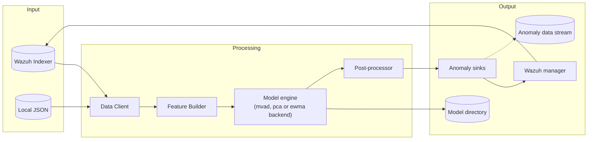
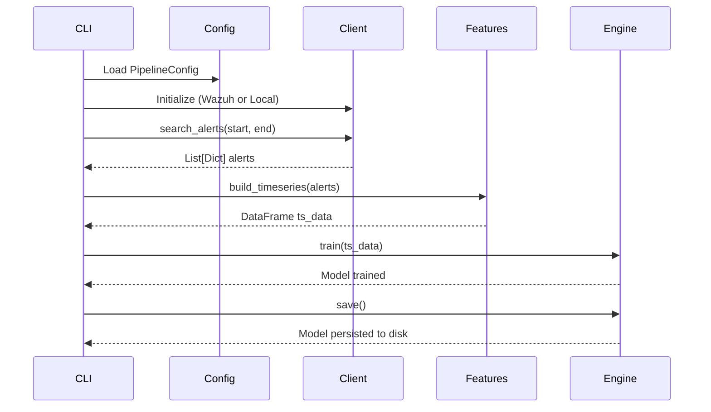
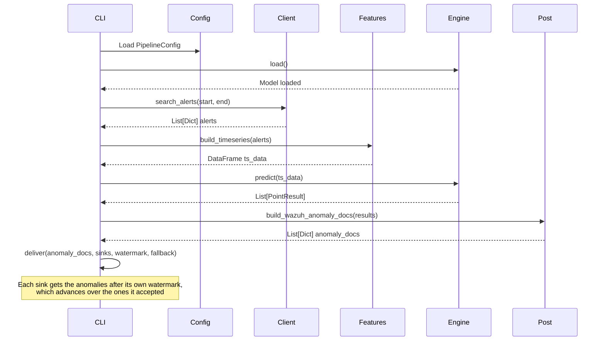
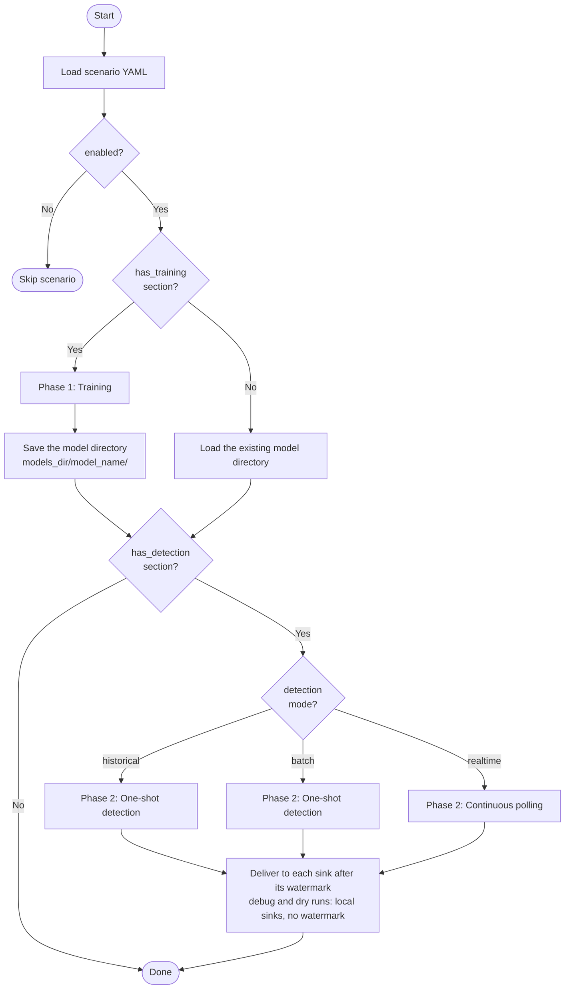
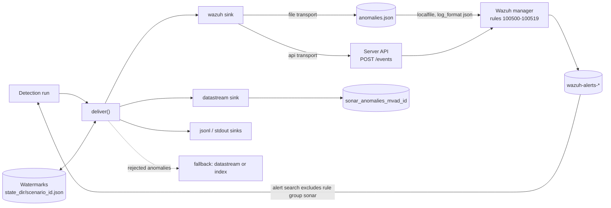

# SONAR architecture guide

This document provides a comprehensive overview of SONAR's (SIEM-Oriented Neural Anomaly Recognition) software architecture, design principles, and implementation patterns. It serves as the authoritative reference for understanding and extending the system.

## Table of contents

1. [Introduction](#introduction)
2. [Design principles](#design-principles)
3. [System architecture](#system-architecture)
4. [Module structure](#module-structure)
5. [Data flow](#data-flow)
6. [Configuration system](#configuration-system)
7. [Scenario-based execution](#scenario-based-execution)
8. [Extension points](#extension-points)
9. [Anomaly output architecture](#anomaly-output-architecture)
10. [Diagrams](#diagrams)

---

## Introduction

### Purpose

SONAR (SIEM-Oriented Neural Anomaly Recognition) is a multivariate time-series anomaly detection subsystem for IDPS-ESCAPE. It analyzes Wazuh security alerts to identify unusual patterns that may indicate security threats.

### Key capabilities

- **Multivariate anomaly detection**: Analyzes multiple features simultaneously using Microsoft's MVAD algorithm, behind a detector backend interface that also offers a linear multivariate `pca` backend and a cheap `ewma` baseline
- **Wazuh integration**: Reads alerts from the Wazuh Indexer and reports anomalies to the Wazuh manager, which raises them as Wazuh alerts (SONAR rules 100500–100519)
- **Flexible execution**: YAML-based scenarios supporting training-only, detection-only, or combined workflows
- **Debug mode**: Local testing without Wazuh infrastructure using JSON test data; debug runs print the SONAR events on standard output instead of delivering them
- **Measured detection quality**: `sonar evaluate` scores a scenario, or another detector's exported results, against labelled data and calibrates the decision rule; `sonar export` captures a labelled live window, including RADAR's detector results, for that comparison
- **Per-host models**: `--agent` trains and runs one model per `agent.name`, like RADAR's per-entity detectors
- **Production-ready**: Optimized for CPU execution with minimal resource requirements

### Technology stack

| Component | Technology |
|-----------|------------|
| Anomaly detection | [time-series-anomaly-detector](https://pypi.org/project/time-series-anomaly-detector/) (Microsoft MVAD, on PyTorch); the `pca` and `ewma` backends need only pandas and NumPy |
| Data processing | pandas, NumPy |
| Alert storage | OpenSearch (Wazuh Indexer) |
| Configuration | YAML, Python dataclasses |
| CLI | argparse |
| Package management | Poetry (`sonar` dependency group) |

---

## Design principles

### 1. Separation of concerns

Each module has a single, well-defined responsibility:

```
Data Ingestion → Feature Engineering → Model Training/Prediction → Post-processing → Result Storage
```

This separation enables:
- Independent testing of each component
- Easy replacement of individual modules
- Clear interfaces between layers

### 2. Configuration-driven behavior

All operational parameters are externalized to configuration:
- **PipelineConfig**: Runtime configuration for all components
- **UseCase scenarios**: YAML files defining complete workflows
- No hardcoded values in business logic

### 3. Interface compatibility

The `LocalDataProvider` implements the same interface as `WazuhIndexerClient`, enabling:
- Transparent switching between live and debug modes
- No code changes required for testing
- Dependency injection pattern
- Support for multiple data formats (JSON array, single object, OpenSearch API response)

### 4. Defensive programming

All external interactions include:
- Input validation with meaningful error messages
- Graceful handling of missing or malformed data
- Comprehensive logging at appropriate levels

### 5. Stateless operations

Each operation (training, detection) is self-contained:
- Models are persisted to disk after training, as a directory of JSON and tensor files
- Detection loads the model fresh each time
- No path depends on the working directory: paths in a configuration or scenario file are relative to that file, and unset ones default to the SONAR home (`sonar/paths.py`; see [Where SONAR keeps its files](./model-naming-guide.md#where-sonar-keeps-its-files))
- No in-memory state between CLI invocations; the only state detection keeps between runs is on disk, the per-sink delivery watermarks in `output.state_dir` (see [Sinks and delivery](#sinks-and-delivery))

---

## System architecture



The Wazuh manager writes SONAR's alerts to the same indexer SONAR reads from; alert search leaves them out (rule group `sonar`).

---

## Module structure

### Core modules

| Module | File | Purpose | Key classes/functions |
|--------|------|---------|----------------------|
| **Configuration** | `config.py` | Dataclass definitions for all settings | `PipelineConfig`, `WazuhIndexerConfig`, `MVADConfig`, `PCAConfig`, `EWMAConfig`, `FeatureConfig`, `DebugConfig`, `ShippingConfig`, `OutputConfig`, `WazuhSinkConfig` |
| **Paths** | `paths.py` | The SONAR home, file-relative path resolution, model directories, packaged examples | `sonar_home`, `resolve`, `model_dir`, `slug`, `packaged_scenario` |
| **Scenarios** | `scenario.py` | YAML-based workflow definitions | `UseCase`, `TrainingScenario`, `DetectionScenario` |
| **Indexer connection** | `indexer.py` | The one OpenSearch client factory (URL, credentials, TLS, timeout) used by alert search and the indexer sinks | `build_opensearch_client`, `tls_options`, `json_safe` |
| **Data ingestion** | `wazuh_client.py` | Alert search (paged, point-in-time, SONAR's own alerts excluded), RADAR detector results (scroll) and plain anomaly indexing | `WazuhIndexerClient` |
| **Delivery state** | `watermark.py` | Per-scenario, per-sink delivery watermarks and anomaly identity | `Watermark`, `anomaly_id` |
| **Sinks** | `sinks/` | Delivery to every configured sink, with per-sink watermarks and fallback | `deliver`, `DeliveryResult`, `WazuhSink`, `DataStreamSink`, `IndexSink`, `JsonlSink`, `StdoutSink` |
| **SONAR event** | `sinks/events.py` | The event sent to the Wazuh manager | `wazuh_event`, `severity_band` |
| **Wazuh manager assets** | `wazuh/` | SONAR's rules, the `<localfile>` block, the Docker compose overlay | – |
| **Debug provider** | `local_data_provider.py` | Local JSON file loader | `LocalDataProvider` |
| **Feature engineering** | `features.py` | Time-series construction | `WazuhFeatureBuilder` |
| **Training plan** | `training_plan.py` | Reproduces the MVAD library's window arithmetic so training that would perform no update is refused before fitting; validates `extra_params` | `plan_training`, `required_samples`, `validate_mvad_params`, `InsufficientTrainingDataError` |
| **Model engine** | `engine.py` | Trains, saves, loads and runs a backend under the feature contract; the model directory format | `ModelEngine` (alias `MVADModelEngine`), `IncompatibleModelError` |
| **Detector backends** | `backends/` | The backend contract and its implementations: `mvad` (Microsoft MVAD), `pca` (linear multivariate) and `ewma` (baseline) | `DetectorBackend`, `PointResult`, `MVADBackend`, `PCABackend`, `EWMABackend`, `new_backend` |
| **Post-processing** | `pipeline.py` | Anomaly documents from `PointResult` verdicts; the decision rule shared with evaluation | `MVADPostProcessor`, `select_anomalies` |
| **Evaluation** | `evaluation.py` | Label files, alarms, event-level metrics, calibration, external detector results | `Labels`, `score`, `calibrate`, `load_external_detections` |
| **Data stream management** | `shipper/wazuh_data_shipper.py` | Index templates, ISM policy and bulk writes for the data stream sink | `WazuhDataShipper`, `TemplateHandler` |
| **CLI** | `cli.py` | Command-line interface; the one place scenario keys and `--agent` reach the configuration | `main()`, `cmd_train()`, `cmd_detect()`, `cmd_scenario()`, `cmd_evaluate()`, `cmd_export()`, `cmd_wazuh_install_rules()`, `apply_scenario_to_config()`, `apply_agent()` |

### Module dependencies

```
cli.py
├── config.py
├── paths.py
├── scenario.py
├── wazuh_client.py OR local_data_provider.py
├── features.py
├── engine.py
├── pipeline.py
├── training_plan.py (InsufficientTrainingDataError)
├── evaluation.py (sonar evaluate)
├── watermark.py
├── sinks/ (deliver, the sinks)
└── shipper/wazuh_data_shipper.py (after training, when the data stream is enabled)

sinks/
├── watermark.py
├── wazuh.py → config.py, requests (Wazuh server API)
├── indexer.py → config.py, shipper/wazuh_data_shipper.py (IndexSink writes through the WazuhIndexerClient it is given)
├── local.py → events.py
└── events.py → indexer.py (json_safe), watermark.py

engine.py
├── config.py
├── features.py (schema version, vocabulary)
└── backends/
    ├── base.py (DetectorBackend, PointResult)
    ├── mvad.py → training_plan.py, time-series-anomaly-detector, torch (external)
    ├── pca.py → pandas, NumPy
    └── ewma.py → pandas, NumPy

config.py
└── paths.py

features.py
├── config.py
└── pandas

wazuh_client.py
├── config.py
└── indexer.py

indexer.py
├── config.py
└── opensearchpy

pipeline.py
├── config.py
└── backends/base.py (PointResult)

shipper/wazuh_data_shipper.py
├── config.py
├── indexer.py
└── shipper/wazuh_base_template.py
```

### Sinks and data stream modules

`sinks/` delivers anomalies: `deliver()` and the sink contract, the `wazuh` sink with its `file` and `api` transports, the indexer sinks (`datastream`, `index`) and the local sinks (`jsonl`, `stdout`). `shipper/` manages the data stream: index templates, the ISM policy and the bulk writes `DataStreamSink` uses. `wazuh/` holds the files deployed on the Wazuh side. See [Anomaly output architecture](#anomaly-output-architecture).

---

## Data flow

### Training workflow



### Detection workflow



### Alert retrieval

`WazuhIndexerClient.search_alerts` reads every alert in the window, not just one page. It opens a point-in-time on `alerts_index_pattern` (kept alive for 2 minutes between pages), pages through it with `search_after` (10,000 hits per page) sorted on `timestamp` and then the alert `id` as a tiebreaker, newest first, closes the point-in-time when done (also on error), and returns the alerts oldest first. It logs `Fetched N of M matching alerts.`

- **Source filtering**: the CLI asks only for the fields the features read: `timestamp`, the numeric, max and categorical fields, and the fields of the enabled derived features (`rule.groups`, `rule.level`, `data.cpu_usage_%`, `data.memory_usage_%`, `data.1min_loadAverage`). A new derived feature must list the fields it reads in `DERIVED_FEATURE_FIELDS` in `features.py`, or it sees them as missing.
- **Cap**: a search stops at `wazuh.max_alerts` (default 2,000,000), keeping the most recent alerts, and logs a warning with the number of matches and the cap.
- **Feedback-loop guard**: alerts whose `rule.groups` include one of `wazuh.exclude_rule_groups` (default `["sonar"]`) are excluded with a `must_not` clause, so SONAR never reads its own alerts.
- **Permissions**: the indexer user must be allowed to create and delete a point-in-time (`indices:data/read/point_in_time/create` and `indices:data/read/point_in_time/delete`). Wazuh's `admin` user has them; a restricted read-only role may not.

`search_detector_results` reads the OpenSearch anomaly detection plugin's results (RADAR's detectors) for `sonar export`. It uses a scroll rather than a point-in-time: results of several hosts share a `data_start_time` and the result index has no keyword tiebreaker. It filters a host through a `nested` query on the plugin's `entity` list.

Alert search and the indexer sinks get their OpenSearch client from `indexer.py`, so `base_url`, credentials, `verify_ssl` and `timeout_seconds` apply the same way to both.

### Data transformation pipeline

```
Raw Wazuh Alerts (JSON)
    │
    ▼
┌─────────────────────────────────────┐
│ Parse timestamps (ISO 8601)         │
│ Extract numeric fields (rule.level) │
│ Extract categorical fields          │
└─────────────────────────────────────┘
    │
    ▼
┌─────────────────────────────────────┐
│ Bucket by time interval (5 min),    │
│   empty buckets included            │
│ Count alerts, derived features and  │
│   category values (vocabulary)      │
│ Mean (+ max) of numeric fields      │
└─────────────────────────────────────┘
    │
    ▼
pandas DataFrame (time-indexed, numeric columns)
    │
    ▼
┌─────────────────────────────────────┐
│ Backend scoring (mvad, pca or ewma) │
│ Verdict, severity (0-1) per bucket  │
└─────────────────────────────────────┘
    │
    ▼
Anomaly Results (scores, timestamps, is_anomaly flags)
    │
    ▼
┌─────────────────────────────────────┐
│ Keep is_anomaly with severity ≥     │
│ threshold, in runs ≥ min_consecutive│
│ Generate Wazuh-compatible documents │
│ Add metadata (scenario, threshold)  │
└─────────────────────────────────────┘
    │
    ▼
Delivered to the sinks: by default the Wazuh manager
(debug runs print the events instead)
```

---

## Configuration system

### Configuration hierarchy

```
PipelineConfig
├── wazuh: WazuhIndexerConfig
│   ├── base_url: str
│   ├── username: str
│   ├── password: str
│   ├── verify_ssl: bool | str (CA bundle path)
│   ├── alerts_index_pattern: str
│   ├── anomalies_index: str
│   ├── timeout_seconds: float
│   ├── max_alerts: int
│   └── exclude_rule_groups: List[str] (default ["sonar"])
├── mvad: MVADConfig
│   ├── sliding_window: int
│   ├── device: str (cpu|cuda)
│   ├── extra_params: Dict
│   └── min_gradient_steps: int
├── pca: PCAConfig
│   ├── window: int (default 3)
│   ├── variance: float (default 0.95)
│   └── z_threshold: float (default 4.0)
├── ewma: EWMAConfig
│   ├── alpha: float (default 0.5)
│   └── z_threshold: float (default 4.0)
├── features: FeatureConfig
│   ├── numeric_fields: List[str]
│   ├── bucket_minutes: int
│   ├── categorical_fields: List[str]
│   ├── categorical_top_k: int
│   ├── derived_features: bool | List[str]
│   ├── alert_filter: Optional[Dict]
│   ├── max_numeric_fields: Sequence[str]
│   ├── numeric_fill: str
│   └── count_transform: str
├── debug: DebugConfig
│   ├── enabled: bool
│   ├── data_dir: str (default: the packaged test_data/synthetic_alerts)
│   ├── training_data_file: str
│   └── detection_data_file: str
├── shipping: ShippingConfig
│   ├── enabled: bool
│   ├── install_templates: bool
│   ├── scenario_id: Optional[str]
│   ├── rollover_days: int
│   └── retention_days: int
├── output: OutputConfig
│   ├── sinks: List[str] (default [wazuh])
│   ├── fallback: str (none|datastream|index)
│   ├── debug_sinks: List[str] (default [stdout])
│   ├── jsonl_path: Optional[str] (default: <SONAR home>/anomalies.jsonl)
│   ├── wazuh: WazuhSinkConfig
│   │   ├── transport: str (file|api)
│   │   ├── file_path, max_file_bytes, backup_count
│   │   ├── api_url, api_username, api_password, verify_ssl, timeout_seconds
│   │   └── severity_medium, severity_high
│   └── state_dir: Optional[str] (default: <models_dir>/state)
├── backend: str (mvad|pca|ewma, default mvad)
├── models_dir: Optional[str] (default: <SONAR home>/models)
├── model_name: str (default sonar)
└── model_path: property, <models_dir>/<model_name> (setting it splits a path into both)
```

### Configuration loading

1. **Default**: `default_config.yaml` (auto-loaded if no --config specified)
2. **Custom**: Specified via `--config` CLI argument
3. **Scenario**: Merged from scenario YAML over the `--config` base (the two combine; `--scenario` does not replace `--config`)
4. **CLI args**: Override specific values (e.g., `--lookback-hours`)

`sonar scenario --use-case`, `sonar train --scenario` and `sonar detect --scenario` apply the same scenario keys: the `wazuh:`, `debug:`, `shipping:` and `output:` sections, `model_name`, `models_dir`, `training.backend`, `training.pca` and `training.ewma`, and every `training:` feature and window key (`derived_features`, `alert_filter`, `max_numeric_fields`, `sliding_window`, ...), which detection reuses.

Path values from a file (`models_dir`, `debug.data_dir`, `output.state_dir`, `output.jsonl_path`, `output.wazuh.file_path`, and a scenario's `detection.payload_dir`) are made absolute relative to that file when it is loaded (`cli._resolve_file_paths`). A scenario's model name is its `model_name`, else `slug(name)`; the default scenario ID is `slug(model_name)`. `train`/`detect --scenario` take the query window from the scenario's `lookback_hours` / `lookback_minutes` unless `--lookback-hours` / `--lookback-minutes` is given.

### Example infrastructure configuration

```yaml
# default_config.yaml
wazuh:
  base_url: "https://localhost:9200"
  username: "admin"
  password: "SecretPassword"
  verify_ssl: false  # or true, or a CA bundle path such as the Wazuh root-ca.pem
  alerts_index_pattern: "wazuh-alerts-*"
  anomalies_index: "wazuh-anomalies-mvad"
  timeout_seconds: 30
  max_alerts: 2000000
  exclude_rule_groups: ["sonar"]

mvad:
  sliding_window: 200
  device: "cpu"
  extra_params:
    interval: 1
  min_gradient_steps: 500

features:
  numeric_fields: ["rule.level"]
  bucket_minutes: 5
  categorical_fields: []
  categorical_top_k: 10
  derived_features: true

debug:
  enabled: false
  data_dir: "test_data/synthetic_alerts"  # relative to this file
  training_data_file: "normal_baseline.json"
  detection_data_file: "with_anomalies.json"

output:
  sinks: [wazuh]
  fallback: none
  debug_sinks: [stdout]
  wazuh:
    transport: file
    file_path: /var/log/sonar/anomalies.json

# models_dir: /var/lib/sonar/models   # default: models/ in the SONAR home
model_name: sonar
backend: mvad
pca:
  window: 3
  variance: 0.95
  z_threshold: 4.0
ewma:
  alpha: 0.5
  z_threshold: 4.0
```

### Example scenario configuration

```yaml
# sonar/scenarios/brute_force_detection.yaml (illustrative)
name: "Brute Force Detection"
description: "Detect authentication attack patterns"
enabled: true
model_name: "brute_force_baseline_v1"  # Optional; default: the name, slugged (brute_force_detection)

training:
  backend: mvad  # or pca, ewma
  lookback_hours: 168
  numeric_fields: ["rule.level"]
  categorical_fields: ["agent.id", "rule.groups"]
  bucket_minutes: 5
  sliding_window: 200
  device: "cpu"
  # Optional: restrict which alerts are fetched from OpenSearch
  # (ignored in --debug mode)
  alert_filter:
    bool:
      should:
        - match: {"rule.groups": "authentication"}

detection:
  mode: "historical"
  lookback_minutes: 1440  # Window to score; earlier context is fetched automatically
  threshold: null  # Minimum severity (0-1) on top of MVAD's own decision; null = none
  min_consecutive: 2  # Minimum run of consecutive qualifying buckets
  anomaly_confidence: null  # Measured precision (0-1), sent to Wazuh; null sends 0.5
```

A bucket is reported only when the backend's own `is_anomaly` decision flags it, its severity (0–1) is at least `threshold` (when one is set), and it belongs to a run of at least `min_consecutive` such buckets. `threshold` is compared with the severity, not the raw score. For MVAD, the raw score is a mean over all feature columns, so columns unrelated to an attack dilute it, and a focused feature list keeps it meaningful. A threshold outside [0, 1] is rejected when the scenario loads.

Detection scores the complete buckets of the last `lookback_minutes`, ending at the start of the current, still filling bucket, or one bucket earlier while the last bucket ended less than `ingest_delay_seconds` (default 60) ago. SONAR also fetches the `input_size + threshold_window − 1` buckets of context the loaded model needs before the first scored bucket, so any lookback of at least one bucket works. When there is too little data to score (no alerts, or fewer buckets than the model needs), a one-shot run logs a warning and exits with status 2.

Overlapping windows find the same anomalous bucket again, but each is delivered once to each sink: per-sink watermarks skip buckets a sink already accepted, and the indexer sinks also store each document under a deterministic `anomaly_id`. A sink that fails keeps its watermark and catches up on the next run; the run exits with status 1 only when every sink that had anomalies failed and no fallback stored them. See [Delivery and the watermark](./scenario-guide.md#delivery-and-the-watermark) and [SWD-024](../../specs/swd/SWD-024.md).

---

## Scenario-based execution

### Detection modes

| Mode | Behavior | Use case |
|------|----------|----------|
| **historical** | One-shot on recent data | Ad-hoc investigation |
| **batch** | Same as `historical` (one run) | Kept for compatibility |
| **realtime** | Continuous polling loop, one poll per bucket; failed polls are retried with backoff | Production monitoring |

Training is not controlled by the mode: `sonar scenario` trains whenever the YAML has a `training:` section, then runs detection in the selected mode.

### Execution flow



### Feature contract

Training and detection always build the same feature columns. The column set depends only on the feature settings and the categorical vocabulary, never on the alerts in a window. The model's `metadata.json` stores the feature settings, the vocabulary (the top-k values of each categorical field in the training data) and the column list. Detection builds its features from the model's stored settings and vocabulary, so a category first seen at detection time is counted in `<field>__other`. If the scenario's feature settings changed after training, detection warns and keeps the model's. A column difference at prediction time is an error, and a model trained with a different feature schema version is refused with a request to retrain. See [SWD-023](../../specs/swd/SWD-023.md).

### Detector backends

`ModelEngine` (`engine.py`) owns everything that does not depend on the detector: the feature contract, the column check at prediction time and the model directory. The detector itself is a backend (`backends/`) implementing the `DetectorBackend` protocol:

| Member | Purpose |
|--------|---------|
| `name` | Registry name (`mvad`, `pca`, `ewma`), stored as `backend` in `metadata.json` |
| `metadata` | How it was trained (JSON-serialisable), merged into `metadata.json` |
| `min_points` | Fewest buckets `predict` needs; verdicts start at bucket `min_points - 1`, so detection fetches `min_points - 1` context buckets |
| `fit(df)` / `predict(df)` | Train on a feature matrix; return one `PointResult` per scored bucket |
| `save_state(dir)` / `from_state(dir, metadata)` | Write and rebuild the trained state without pickle |

`PointResult` holds `timestamp`, `is_anomaly`, `severity` (0–1, 0 when not anomalous, comparable across backends), `raw_score` (the backend's own scale) and `contributors` (features with their share of the score). Post-processing consumes only `PointResult`, so the documents and events are the same for every backend; their `mvad_score` (`raw_score`) and `mvad_severity` fields keep their names for compatibility.

The `mvad` backend wraps Microsoft MVAD and stores the library's configuration as JSON and the network's weights as a tensor dictionary read with `torch.load(weights_only=True)`. A regression test checks that it gives the same verdicts as the engine before the backend interface, on a fixed seed and dataset. The `pca` backend is a probabilistic PCA of short windows scored by Mahalanobis distance, and the `ewma` backend a per-feature EWMA with a robust z-score (see [backend](./scenario-guide.md#backend)). The model directory format and its trust boundary are described in the [model guide](./model-naming-guide.md#model-file-format).

---

## Extension points

### Adding a detector backend

1. Write a class in `backends/` that implements `DetectorBackend` (see [Detector backends](#detector-backends)). `save_state` must not pickle, and `predict` must return severities between 0 and 1.
2. Register its name in `BACKEND_NAMES` and `backend_class()` in `backends/__init__.py`, and pass it its settings in `new_backend()` (a config dataclass in `config.py`, like `EWMAConfig`).
3. Add a test class for it in `tests/sonartests/test_backends.py` that inherits `BackendContract`, the contract tests all three shipped backends pass.

### Adding new feature types

1. **Modify `FeatureConfig`** in [config.py](../../../sonar/config.py):
   ```python
   @dataclass
   class FeatureConfig:
       # Existing fields...
       new_feature_fields: Sequence[str] = field(default_factory=list)
   ```

2. **Update `WazuhFeatureBuilder`** in [features.py](../../../sonar/features.py): add the columns to `columns()` (they must depend only on the configuration and vocabulary) and compute them in `build_timeseries`. A new condition on single alerts is simpler: add it to the `DERIVED_FEATURES` registry.

3. **Bump `FEATURE_SCHEMA_VERSION`** in `features.py` whenever the columns built from the same alerts and settings change, so that models trained on the old layout are refused instead of misapplied.

### Adding new detection modes

1. **Update `DetectionScenario`** in [scenario.py](../../../sonar/scenario.py):
   ```python
   mode: Literal["historical", "batch", "realtime", "new_mode"] = "historical"
   ```

2. **Add handler in `cli.py`**:
   ```python
   def _execute_detection_phase(cfg, detection, args, mode):
       ...
       if mode == "new_mode":
           return _run_new_mode_detection(cfg, client, engine, detection, args)
   ```

### Adding new data sources

Create a new provider implementing the same interface as `WazuhIndexerClient`:

```python
class NewDataProvider:
    def search_alerts(self, start: datetime, end: datetime,
                      query: Optional[Dict] = None,
                      source_fields: Optional[Sequence[str]] = None) -> List[Dict]:
        """Return every alert in [start, end) matching the optional query, oldest first.

        source_fields lists the alert fields the features read; a provider may
        return only those fields, or whole alerts.
        """
        pass
    
    def check_connection(self) -> bool:
        """Return True if data source is accessible."""
        pass
    
    def index_anomaly(self, doc: Dict) -> str:
        """Create the document under doc["anomaly_id"] and return that ID.

        A document that already exists counts as success; raise on any other failure.
        """
        pass
```

`index_anomaly` is only needed for the `index` sink, which writes through the provider. [local_data_provider.py](../../../sonar/local_data_provider.py), the debug-mode provider, has none, so the `index` sink cannot be a debug sink.

### Adding new sinks

1. Write a class with a `name` (its configuration name and its key in the watermark file) and an `emit(docs) -> DeliveryResult` method. `emit` receives the documents oldest first and returns how many it accepted from the start of the batch; it reports failures in the result instead of raising them. If the destination cannot recognise duplicates, nothing else is needed: the per-sink watermark keeps it free of them.
2. Add the name to `SINK_NAMES` in `sinks/__init__.py` (and to `FALLBACK_NAMES` if it may serve as fallback), and build it in `cli._make_sink()`.

### Adding new CLI commands

```python
def cmd_new_command(args: argparse.Namespace) -> int:
    """Implementation of new command."""
    cfg = load_config(args.config)  # main() calls args.func(args): load the configuration here
    # Your logic here
    return EXIT_OK  # 0; EXIT_ERROR (1) on failure

def main():
    parser = argparse.ArgumentParser()
    subparsers = parser.add_subparsers()
    
    # Add new command
    new_parser = subparsers.add_parser("new_command", help="Description")
    new_parser.add_argument("--config", type=str, default=None, help="Path to config YAML (optional)")
    new_parser.add_argument("--option", help="Option description")
    new_parser.set_defaults(func=cmd_new_command)
```

---

## Anomaly output architecture

### Overview

Detection hands its anomaly documents to the sinks in `output.sinks`. The default sink, `wazuh`, sends each anomaly to the Wazuh manager as a SONAR event; the manager decodes it, matches SONAR's rules (100500–100519) and raises an ordinary Wazuh alert, which reaches the indexer, the dashboards, active responses and integrations such as RADAR. The other sinks write to the indexer directly (`datastream`, `index`) or locally (`jsonl`, `stdout`). See the [anomaly output guide](./data-shipping-guide.md) for configuration and formats, and [SWD-037](../../specs/swd/SWD-037.md) for the design.



### Sinks and delivery

A sink is any object with a `name` and an `emit(docs)` method that returns a `DeliveryResult`: how many documents it accepted **from the oldest on**, out of how many, and the error that stopped it. A sink reports failures in its result rather than raising them.

`sinks.deliver()` offers each sink the documents after that sink's watermark, advances the watermark over the accepted prefix, and collects the documents a sink rejected for the fallback sink (`output.fallback`), if one is configured and is not itself among the sinks. One sink's failure never stops the others. `DeliveryReport.all_failed` is true when every sink that had documents failed and no fallback took them all; only then does the run exit with status 1.

Per-sink watermarks exist because sinks deduplicate differently: the indexer sinks store each document under its `anomaly_id` and refuse a second copy, but the Wazuh manager accepts every event. With one shared watermark, a failure of one sink would force a retry to all of them and duplicate the manager's alerts.

`cli._build_delivery()` builds the sinks once per detection phase (every realtime poll reuses them):

| Run | Sinks | Fallback | Watermark |
|-----|-------|----------|-----------|
| Normal | `output.sinks`, plus `datastream` with `--ship` or `shipping.enabled` | `output.fallback` | Yes |
| `--debug` or `debug.enabled: true` | `output.debug_sinks` | No | No |
| `--dry-run` | `jsonl` at `<payload_dir>/anomalies.jsonl` | No | No |

`--print-payloads` adds `stdout`. Unknown names raise `ValueError` before any alert is read.

### The wazuh sink

`WazuhSink` turns each document into a SONAR event (`sinks/events.py`) and hands the lines to a transport:

- `FileTransport` appends all lines in one write, flushes and syncs it, and rotates the file by size. SONAR runs on the manager host or shares a volume with the manager container.
- `ApiTransport` posts batches of up to 100 events to `POST /events` through `WazuhApi`, a minimal client with JWT authentication, token renewal (every 850 s and on HTTP 401) and backoff on HTTP 429. SONAR runs on a dedicated host. The client is self-contained: SONAR does not import RADAR's Wazuh API client.

SONAR never runs on monitored endpoints, so no Wazuh agent is involved in either transport.

The event carries `anomaly_grade` (severity) and `anomaly_confidence` at the top level, because these are the alert fields (`data.anomaly_grade`, `data.anomaly_confidence`) RADAR's active response reads for anomaly-detection scenarios. `sonar.severity_band` exists because Wazuh rules match strings and cannot compare numbers.

Alert search adds `must_not: terms rule.groups` for `wazuh.exclude_rule_groups` (default `["sonar"]`), so SONAR's own alerts never become training or detection input.

### ShippingConfig and the data stream

`ShippingConfig` holds the scenario ID and the data stream settings:

| Field | Default | Purpose |
|-------|---------|---------|
| `enabled` | `false` | Adds the `datastream` sink |
| `install_templates` | `true` | Install the index templates and the ISM policy after training |
| `scenario_id` | `null` | Scenario ID; the model name in lower case (`slug(model_name)`) when unset |
| `rollover_days` | `7` | ISM policy: roll the write index over after this age |
| `retention_days` | `30` | ISM policy: delete backing indices after this age |

After training with the data stream enabled (`--ship`, `shipping.enabled`, or `datastream` in `output.sinks`), `_create_scenario_stream()`:

1. Installs, if `install_templates` is true, the base template, the MVAD component and template, and the ISM policy `sonar_anomalies_policy`, whose `ism_template` attaches it to every new `.ds-sonar_anomalies_*` backing index. An existing policy is left unchanged.
2. Creates the scenario's index template, whose pattern is the exact stream name `sonar_anomalies_mvad_{scenario_id}`.

It does not create the stream: OpenSearch does on the first document. Documents carry no per-feature columns, so all scenarios share the MVAD component's mapping:

```
sonar_stream_template                     priority 1, pattern sonar_anomalies_*
sonar_stream_template_mvad                priority 2, pattern sonar_anomalies_*
  └── composed of component_template_sonar_mvad
sonar_stream_template_mvad_{scenario_id}  priority 3, pattern sonar_anomalies_mvad_{scenario_id}
  └── composed of component_template_sonar_mvad
```

The base and MVAD templates are independent templates on the same pattern; OpenSearch applies the higher-priority one. The scenario template's pattern is the exact stream name and its priority is above both, so a scenario's stream gets the scenario template. Streams without one get `sonar_stream_template_mvad`.

`DataStreamSink` writes each batch with one bulk request of `create` actions, each under its `anomaly_id`; HTTP 409 (already stored) counts as accepted, and the first other failure ends the accepted prefix. See [Document structure](./data-shipping-guide.md#document-structure) for the document shape.

---

## Diagrams

For detailed UML diagrams including:
- Complete class diagram with all relationships
- Component diagram showing module interactions
- Sequence diagrams for training, detection, and scenario workflows
- State diagram for scenario execution
- Deployment diagram for production setup

See [uml-diagrams.md](./uml-diagrams.md).
