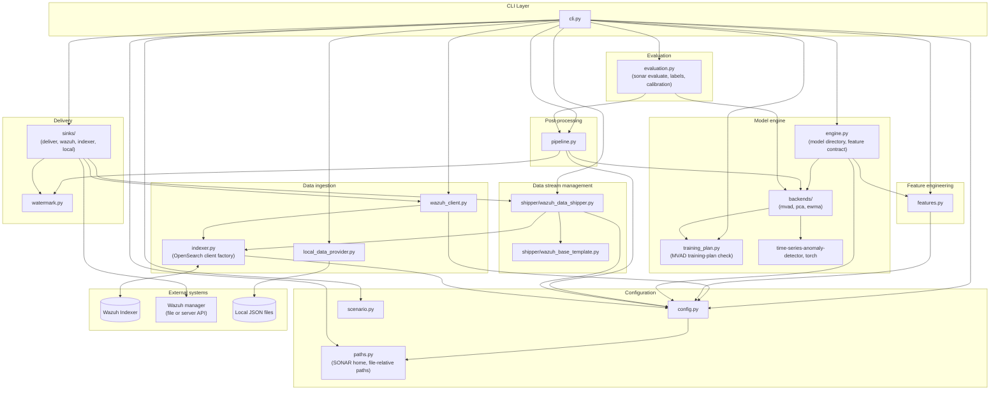
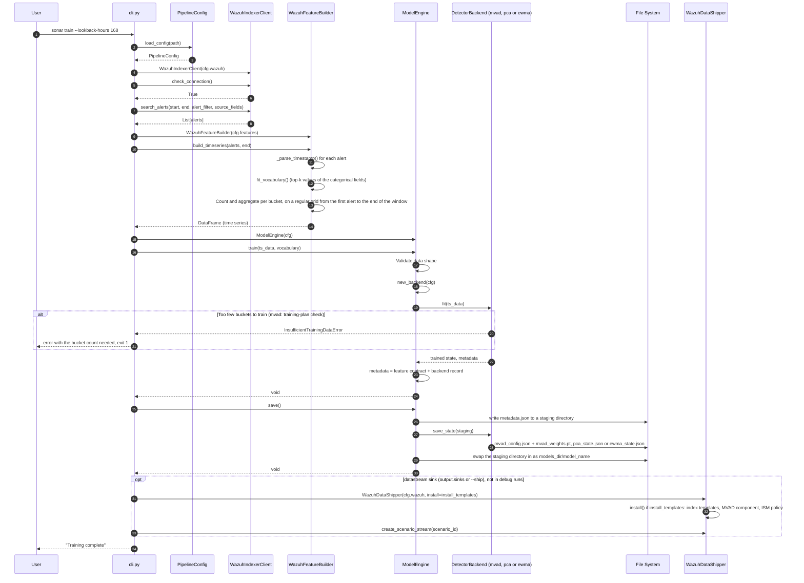
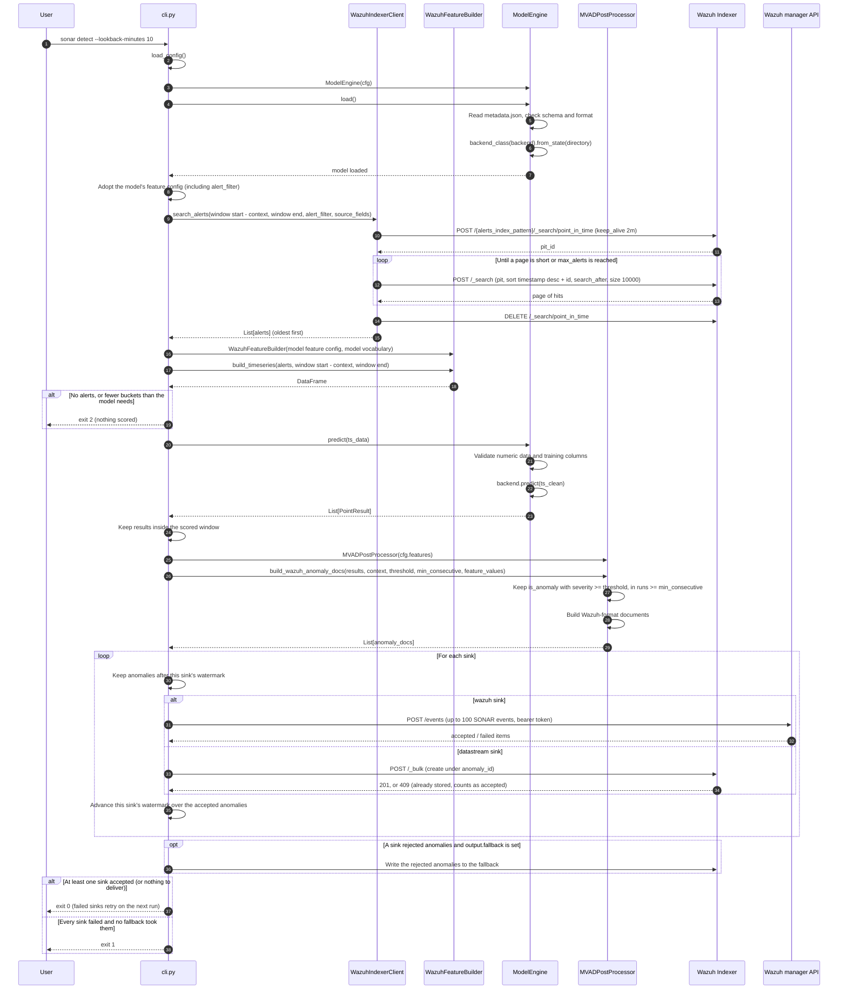
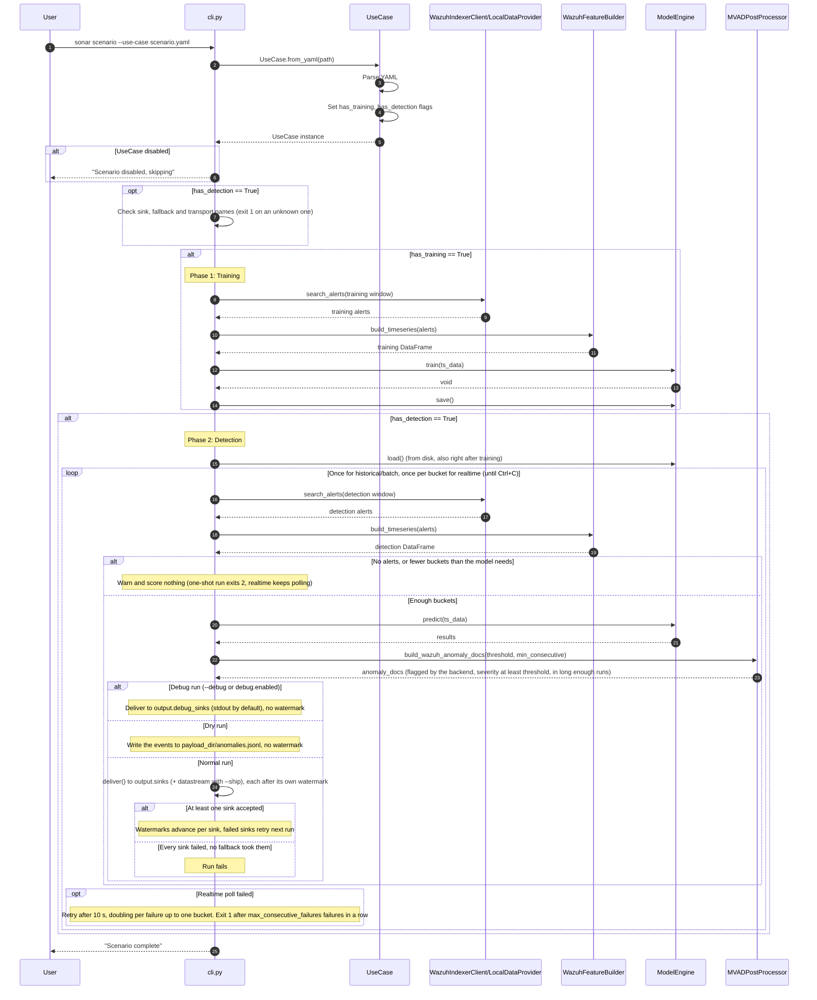
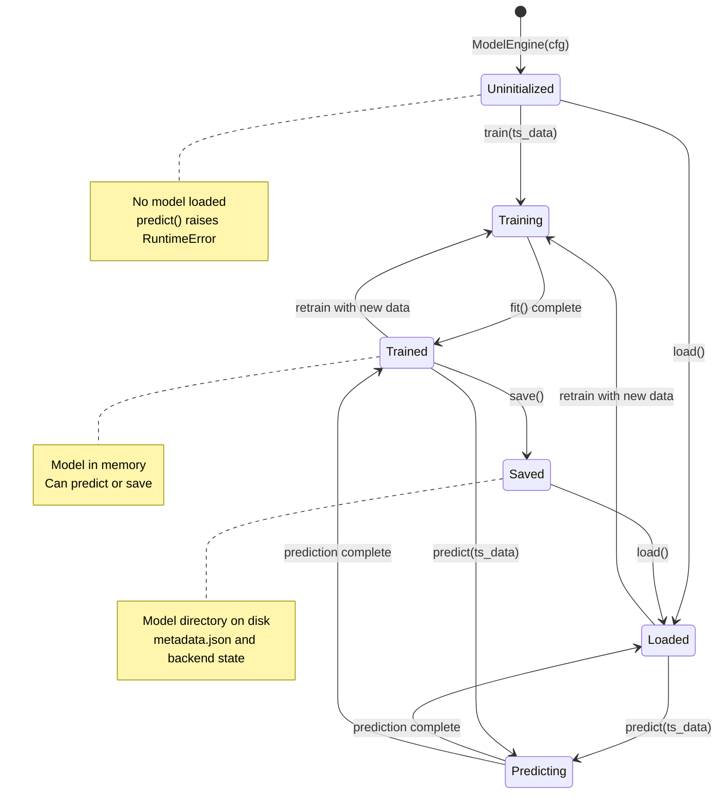
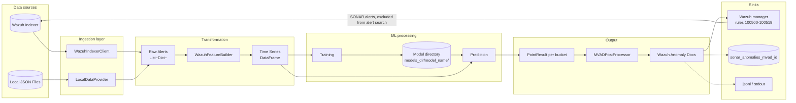
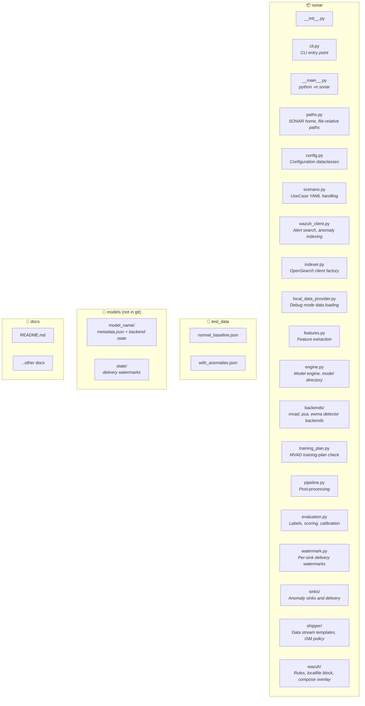
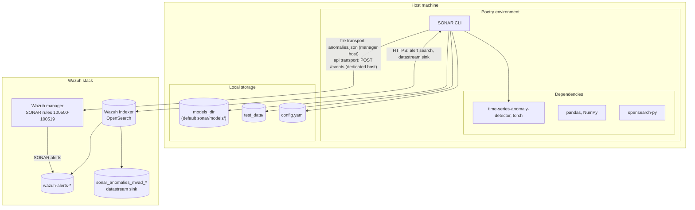

# SONAR UML diagrams

This document contains UML diagrams describing the software design of SONAR (SIEM-Oriented Neural Anomaly Recognition), rendered in Mermaid format for GitHub/GitLab compatibility.

## Design features

- **Unified scenario format**: Config files (infrastructure) separated from scenario files (detection logic)
- **Feature contract**: the model stores its feature settings and categorical vocabulary, and detection builds exactly the training columns
- **Debug mode**: Local data provider with configurable test data files
- **Flexible execution**: Training-only, detection-only, or combined workflows
- **Default configuration**: `default_config.yaml` automatically loaded when no `--config` specified
- **Anomaly sinks**: anomalies go to configurable sinks, by default the Wazuh manager, each with its own delivery watermark
- **Detector backends**: `ModelEngine` runs a `DetectorBackend` (`mvad`, `pca` or the `ewma` baseline); post-processing consumes only `PointResult`
- **Model directory**: a model is `<models_dir>/<model_name>/` with `metadata.json` and the backend's state, loaded without unpickling
- **Path independence**: paths in configuration and scenario files are relative to those files; unset ones default to the SONAR home (`sonar/paths.py`)
- **Per-host models**: `--agent NAME` trains and runs one model per host (`<model_name>-<NAME>`), with its own scenario ID
- **Evaluation**: `sonar evaluate` scores a backend's verdicts against labelled data and calibrates `threshold` and `min_consecutive` (`evaluation.py`); `sonar export` writes a live window, its labels and RADAR's detector results for it

## Table of contents

1. [Class diagram](#class-diagram)
2. [Component diagram](#component-diagram)
3. [Sequence diagrams](#sequence-diagrams)
   - [Training workflow](#training-workflow)
   - [Detection workflow](#detection-workflow)
   - [Scenario execution](#scenario-execution)
4. [State diagram](#state-diagram)
5. [Data flow diagram](#data-flow-diagram)

---

## Class diagram

The core classes and their relationships in SONAR:

```mermaid
classDiagram
    direction TB

    %% Configuration Classes
    class PipelineConfig {
        +WazuhIndexerConfig wazuh
        +MVADConfig mvad
        +FeatureConfig features
        +DebugConfig debug
        +ShippingConfig shipping
        +OutputConfig output
        +EWMAConfig ewma
        +PCAConfig pca
        +str backend
        +Optional~str~ models_dir
        +str model_name
        +Optional~str~ agent
        +model_path() str
    }

    class WazuhIndexerConfig {
        +str base_url
        +str username
        +str password
        +bool|str verify_ssl
        +str alerts_index_pattern
        +str anomalies_index
        +float timeout_seconds
        +int max_alerts
        +List~str~ exclude_rule_groups
    }

    class MVADConfig {
        +int sliding_window
        +str device
        +Dict extra_params
        +int min_gradient_steps
        +to_params() Dict
    }

    class EWMAConfig {
        +float alpha
        +float z_threshold
    }

    class PCAConfig {
        +int window
        +float variance
        +float z_threshold
    }

    class FeatureConfig {
        +Sequence~str~ numeric_fields
        +int bucket_minutes
        +Sequence~str~ categorical_fields
        +int categorical_top_k
        +bool|List derived_features
        +Optional~Dict~ alert_filter
        +Sequence~str~ max_numeric_fields
        +str numeric_fill
        +str count_transform
    }

    class DebugConfig {
        +bool enabled
        +str data_dir
        +str training_data_file
        +str detection_data_file
    }

    class ShippingConfig {
        +bool enabled
        +bool install_templates
        +Optional~str~ scenario_id
        +int rollover_days
        +int retention_days
    }

    class OutputConfig {
        +List~str~ sinks
        +str fallback
        +List~str~ debug_sinks
        +Optional~str~ jsonl_path
        +WazuhSinkConfig wazuh
        +Optional~str~ state_dir
    }

    class WazuhSinkConfig {
        +str transport
        +str file_path
        +int max_file_bytes
        +int backup_count
        +str api_url
        +str api_username
        +str api_password
        +bool|str verify_ssl
        +float timeout_seconds
        +float severity_medium
        +float severity_high
    }

    %% Scenario Classes
    class UseCase {
        +str name
        +str description
        +Optional~str~ model_name
        +TrainingScenario training
        +DetectionScenario detection
        +bool enabled
        +bool has_training
        +bool has_detection
        +from_yaml(path) UseCase
        +to_yaml(path) void
    }

    class TrainingScenario {
        +int lookback_hours
        +List~str~ numeric_fields
        +List~str~ categorical_fields
        +int categorical_top_k
        +int bucket_minutes
        +int sliding_window
        +str device
        +Dict extra_params
        +bool|List derived_features
        +Optional~Dict~ alert_filter
        +List~str~ max_numeric_fields
        +str numeric_fill
        +str count_transform
        +int min_gradient_steps
        +Optional~str~ backend
        +Dict ewma
        +Dict pca
    }

    class DetectionScenario {
        +str mode
        +int lookback_minutes
        +Optional~int~ polling_interval_seconds
        +int ingest_delay_seconds
        +int max_consecutive_failures
        +bool print_payloads
        +bool dry_run
        +Optional~str~ payload_dir
        +Optional~float~ threshold
        +int min_consecutive
        +Optional~float~ anomaly_confidence
    }

    %% Core Service Classes
    class WazuhIndexerClient {
        -WazuhIndexerConfig cfg
        -OpenSearch client
        -int max_alerts
        -bool print_payloads
        -bool dry_run
        -str payload_dir
        +search_alerts(start, end, query, source_fields, page_size) List~Dict~
        +search_detector_results(index, start, end, entity) List~Dict~
        +index_anomaly(doc) str
        +check_connection() bool
    }

    class LocalDataProvider {
        -Path data_dir
        -Optional~str~ data_file
        -List~Path~ alert_files
        -List~Dict~ _alerts
        +search_alerts(start, end, query, ignore_time_range) List~Dict~
        +check_connection() bool
        +get_all_alerts() List~Dict~
        +get_stats() Dict
        -_load_alerts() void
        Note: Supports JSON array, single object,
        and OpenSearch API response formats
    }

    class WazuhFeatureBuilder {
        -FeatureConfig cfg
        +FeatureVocabulary vocabulary
        +build_timeseries(alerts, start, end) DataFrame
        +fit_vocabulary(alerts) FeatureVocabulary
        +required_source_fields() List~str~
        +columns() List~str~
        -_parse_timestamp(ts) datetime
    }

    class ModelEngine {
        -PipelineConfig cfg
        -DetectorBackend backend
        -List~str~ training_columns
        -Dict metadata
        +train(ts_data, vocabulary) void
        +predict(ts_data) List~PointResult~
        +save() void
        +load() void
        +feature_config() FeatureConfig
        +vocabulary() FeatureVocabulary
        +context_buckets() int
    }

    class DetectorBackend {
        <<interface>>
        +str name
        +Dict metadata
        +min_points() int
        +fit(df) void
        +predict(df) List~PointResult~
        +save_state(directory) void
        +from_state(directory, metadata)$ DetectorBackend
    }

    class MVADBackend {
        -MVADConfig cfg
        +sliding_window() int
    }

    class EWMABackend {
        -EWMAConfig cfg
        -Dict center
        -Dict scale
    }

    class PCABackend {
        -PCAConfig cfg
        -List~str~ columns
        +window_buckets() int
    }

    class PointResult {
        +Timestamp timestamp
        +bool is_anomaly
        +float severity
        +float raw_score
        +List~Contributor~ contributors
    }

    class MVADPostProcessor {
        -FeatureConfig feature_cfg
        +build_wazuh_anomaly_docs(results, context, threshold, min_consecutive, feature_values) List~Dict~
    }

    class Watermark {
        +str scenario_id
        +Path path
        +load(sink) Optional~Timestamp~
        +advance(sink, bucket_start) Timestamp
    }

    %% Delivery
    class AnomalySink {
        <<interface>>
        +str name
        +emit(docs) DeliveryResult
    }

    class DeliveryResult {
        +int accepted
        +int total
        +Optional~str~ error
        +bool ok
    }

    class WazuhSink {
        +WazuhSinkConfig cfg
        +transport
        +emit(docs) DeliveryResult
    }

    class FileTransport {
        +Path path
        +int max_bytes
        +int backup_count
        +send(lines) Tuple
    }

    class ApiTransport {
        +WazuhApi api
        +send(lines) Tuple
    }

    class WazuhApi {
        +str url
        +request(method, path) Response
    }

    class DataStreamSink
    class WazuhDataShipper {
        +create_documents(stream_name, documents) Tuple
        +install() void
        +create_scenario_stream(scenario_id, scenario_name) str
    }
    class IndexSink
    class JsonlSink
    class StdoutSink

    %% Relationships
    PipelineConfig *-- WazuhIndexerConfig : contains
    PipelineConfig *-- MVADConfig : contains
    PipelineConfig *-- FeatureConfig : contains
    PipelineConfig *-- DebugConfig : contains
    PipelineConfig *-- ShippingConfig : contains
    PipelineConfig *-- OutputConfig : contains
    PipelineConfig *-- EWMAConfig : contains
    PipelineConfig *-- PCAConfig : contains
    OutputConfig *-- WazuhSinkConfig : contains

    UseCase *-- TrainingScenario : contains
    UseCase *-- DetectionScenario : contains

    WazuhIndexerClient --> WazuhIndexerConfig : uses
    LocalDataProvider ..|> WazuhIndexerClient : compatible interface
    WazuhFeatureBuilder --> FeatureConfig : uses
    ModelEngine --> PipelineConfig : uses
    ModelEngine o-- DetectorBackend : runs
    DetectorBackend <|.. MVADBackend
    DetectorBackend <|.. EWMABackend
    DetectorBackend <|.. PCABackend
    MVADBackend --> MVADConfig : uses
    EWMABackend --> EWMAConfig : uses
    PCABackend --> PCAConfig : uses
    DetectorBackend ..> PointResult : returns
    MVADPostProcessor --> FeatureConfig : uses
    MVADPostProcessor ..> PointResult : consumes

    AnomalySink <|.. WazuhSink
    AnomalySink <|.. DataStreamSink
    AnomalySink <|.. IndexSink
    AnomalySink <|.. JsonlSink
    AnomalySink <|.. StdoutSink
    AnomalySink ..> DeliveryResult : returns
    WazuhSink --> WazuhSinkConfig : uses
    WazuhSink --> FileTransport : file
    WazuhSink --> ApiTransport : api
    ApiTransport --> WazuhApi : uses
    IndexSink --> WazuhIndexerClient : index_anomaly
    DataStreamSink --> WazuhDataShipper : create_documents
```

`sinks.deliver()` offers each sink the documents after that sink's watermark and advances the watermark by `DeliveryResult.accepted`. `MVADModelEngine` remains an alias of `ModelEngine`.

---

## Component diagram

High-level component architecture showing the main modules and their dependencies:

`features.py` imports only `sonar.config`, and `pipeline.py` only `sonar.config`, the `PointResult` type of `backends/` and `anomaly_id` from `watermark.py`. They receive alert lists and DataFrames from `cli.py` and never call `wazuh_client.py` or `local_data_provider.py` directly. `scenario.py` and `local_data_provider.py` import no other SONAR module. `evaluation.py` scores verdicts against label files with the same decision rule as detection (`select_anomalies` in `pipeline.py`).

`wazuh_client.py` (alert search and the `index` sink) and the shipper (the `datastream` sink) both get their OpenSearch client from `indexer.py`, so URL, credentials, TLS (`verify_ssl`) and timeout behave the same for both. The `wazuh` sink talks to the manager on its own: through a file the manager reads, or through the server API with its own `output.wazuh` settings.

---

## Sequence diagrams

### Training workflow

Complete training workflow from CLI invocation to model persistence:

### Detection workflow

Detection workflow showing anomaly detection and delivery to the sinks (here `wazuh` with the `api` transport, and `datastream`):

### Scenario execution

Complete scenario execution with flexible phase detection:

---

## State diagram

Model lifecycle states in ModelEngine:

---

## Data flow diagram

End-to-end data transformation pipeline:

---

## Package structure

---

## Deployment view

SONAR runs on the manager host or on a dedicated host, never on monitored endpoints; no Wazuh agent is needed on the SONAR host.

---

## Notes

- All diagrams are in [Mermaid](https://mermaid.js.org/) format
- GitHub and GitLab render Mermaid diagrams natively in markdown
- For local rendering, use VS Code with Mermaid extension or [Mermaid Live Editor](https://mermaid.live/)
