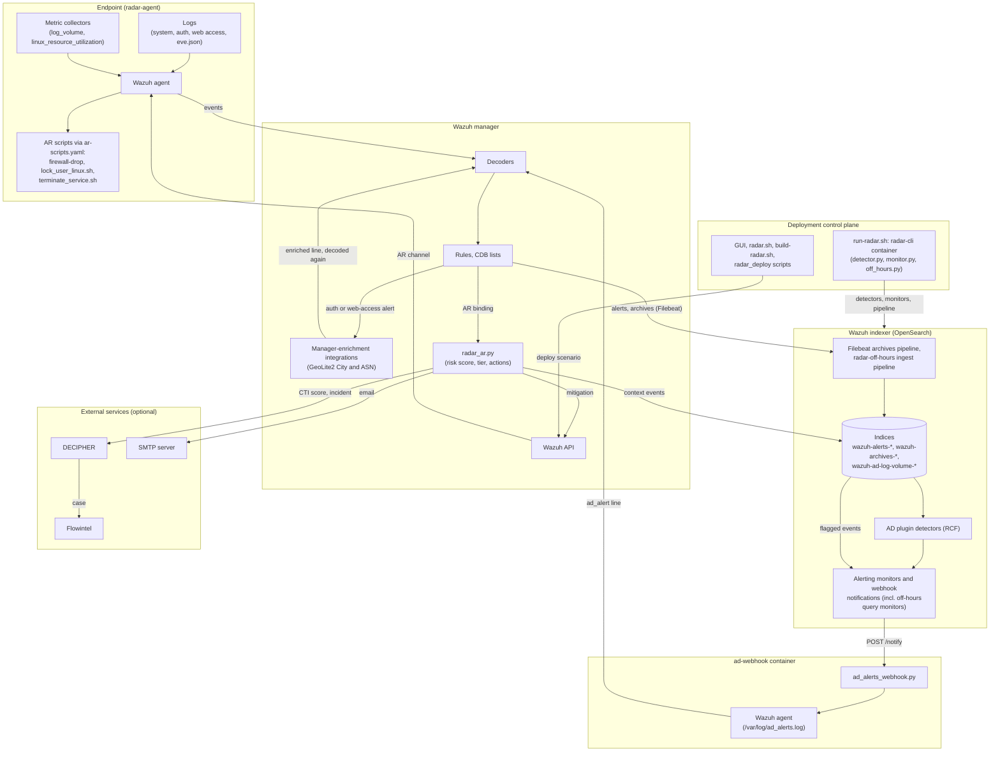

# RADAR architecture

RADAR (Risk-aware Anomaly Detection-based Automated Response) is a security orchestration subsystem within IDPS-ESCAPE that combines signature-based detection with anomaly detection, and drives both into a single risk-scored, tiered automated response.

## Core technologies

- **Wazuh** (4.14.1 images in `radar/docker-compose.core.yml`): manager, agents, indexer and dashboard; the manager's decoders, rules, integrations and active-response framework carry every RADAR scenario.
- **OpenSearch plugins** of the Wazuh indexer: the Anomaly Detection plugin (Random Cut Forest) for the anomaly-based scenarios, and the Alerting plugin, whose monitors notify RADAR's webhook.
- **Docker / Docker Compose**: the core stack (indexer, manager, dashboard), the webhook container (`radar/docker-compose.webhook.yml`), and the short-lived `radar-cli` image (`radar/Dockerfile.radar-cli`) that creates detectors and monitors and seeds history.
- **MaxMind GeoLite2** City and ASN databases, downloaded by the manager at deployment, for manager-side enrichment.
- **Optional external services**: SATRAP-DL **DECIPHER** (CTI score, and Flowintel case creation through its incident endpoint) and an **SMTP** server for notifications. RADAR runs without either.

## Design principles

**Modularity.** Each detection use case is packaged as a scenario — decoders, rules, CDB lists, agent and manager configuration snippets, an optional detector/monitor definition, active-response bindings and risk parameters — that can be deployed independently of the others and coexists with them on the same manager. Artifacts are grouped by type, then by scenario (`radar/scenarios/<artifact type>/<scenario>/`). A new scenario is added without modifying the core framework (SWD-034, SWD-027).

**Idempotency.** Deployment goes through the Wazuh REST API and idempotent Docker operations (SWD-042): rule, decoder and list files are uploaded only when their content differs, marked configuration blocks are replaced rather than appended, and detectors and monitors are looked up by name before being created. Re-running a deployment step produces the same end state.

**Separation of concerns.** The architecture separates data collection (Wazuh agents and RADAR's metric collectors), data enrichment (manager-side, for the scenarios that need it — SWD-030), detection logic (rules and anomaly detectors — SWD-026, SWD-028, SWD-034), response execution (SWD-027), and orchestration (SWD-042, SWD-041).

**Hybrid detection.** Signature-based rules give fast, deterministic matching for known patterns without a training period; anomaly detection gives behavioural coverage for patterns no rule anticipates. A scenario may use either or both; the risk engine (HARC-012) combines whichever sources a scenario configures, and for a scenario with a `fusion` block it combines a signature alert with an anomaly alert for the same entity that arrived within a time window.

**Configuration-driven deployment.** Scenario parameters — index patterns, features, thresholds, detector settings, off-hours schedules, ingest settings — are centralised in `radar/config.yaml`; risk weights, tiers, fusion and mitigations in `radar/scenarios/active_responses/ar.yaml`. Neither requires a code change to retune (SWD-032).

## System architecture

RADAR consists of the following components:

| Component | Role | Key functions |
|-----------|------|----------------|
| Wazuh agents | Endpoint monitoring | Log collection, RADAR metric collectors (`log_volume`, `linux_resource_utilization`), execution of dispatched active-response scripts |
| Wazuh manager | Central control | Decoding, manager-side enrichment, rule evaluation, `radar_ar.py` risk scoring and response dispatch |
| Wazuh indexer (OpenSearch) | Data platform | Storage of alerts and archived events, ingest pipelines, anomaly detectors (RCF) and monitors |
| Webhook container | Alert routing | Receives a monitor's HTTP notification and writes it as a log line that its own Wazuh agent forwards to the manager |
| `radar-cli` jobs | Detector lifecycle | Create or update detectors, monitors and the off-hours pipeline; seed detector history |
| RADAR scripts / GUI | Orchestration | Deployment automation, scenario and agent lifecycle management, connector configuration |
| DECIPHER (external, optional) | CTI and case management | CTI score for the risk engine; Flowintel case creation (SWD-038) |

{width="70%"}

## Module structure

**Wazuh agent.** Collects logs and executes dispatched active-response commands. Agents forward logs unmodified; enrichment, where a scenario needs it, happens centrally on the manager, not on the endpoint (SWD-030, HARC-014). Everything RADAR installs on an endpoint — metric collectors, versioned active-response scripts and their catalogue — lives in `radar/radar-agent/` and is installed by `radar/radar-agent/bootstrap-agent.sh`.

**Wazuh manager.** The central control plane: manager-side enrichment integrations (SWD-030) for `suspicious_login` and `geoip_detection`, decoders and rules (SWD-034), and the active response `radar_ar.py`, which scores every RADAR alert and dispatches the tier's actions (SWD-026, SWD-027). Anomaly alerts re-enter the manager through the webhook (below).

**Wazuh indexer.** Storage and search for alerts and archived events, and the Anomaly Detection plugin used by the anomaly-based scenarios (SWD-028). The Filebeat archives pipeline routes `log_volume` metrics to `wazuh-ad-log-volume-*` and calls the `radar-off-hours` ingest pipeline that flags off-hours activity. Detector and monitor lifecycle for a scenario is managed by `run-radar.sh` and the `radar/anomaly_detector/` modules (`detector.py`, `monitor.py`, `webhook.py`, `off_hours.py`) it runs inside the `radar-cli` container.

**Webhook endpoint.** A small HTTP service (`radar/webhook/`) that receives an OpenSearch monitor's POST notification, authenticated by a shared secret, and writes one log line per anomalous entity to a file monitored by the Wazuh agent installed in the same container. The manager decodes and evaluates that line like any other event, closing the loop from anomaly detection back into the rule engine and, from there, into active response. `radar_ar.py` accepts anomaly alerts only from that agent and file. Brought up by `build-radar.sh` alongside the rest of the stack.

**Deployment control plane.** The entry-point scripts (`radar.sh`, `build-radar.sh`, `run-radar.sh`, `health-radar.sh`, `stop-radar.sh` in `radar/`, and `radar/radar-agent/bootstrap-agent.sh` on endpoints), the `radar/radar_deploy/` manager-side scripts, the `radar/wazuh_api/` Wazuh REST API layer and CLI, and the GUI (`radar/gui/`). Specified in SWD-042 and SWD-041.

## Scenarios

Five scenarios and a default rule set ship in the current codebase (`radar/config.yaml`, `radar/scenarios/active_responses/ar.yaml`):

| Scenario | Detection | Configured mitigations |
|---|---|---|
| `geoip_detection` | Signature, on manager-enriched SSH and web-access events (country whitelist) | `firewall-drop` (tiers 2 and 3) |
| `suspicious_login` | Signature (failed-login bursts, impossible travel on manager-enriched SSH events, Office 365 login failures) and anomaly (off-hours activity: rule mode or per-user RCF model mode), fused per user | `firewall-drop` (tier 2); `firewall-drop` and `lock_user_linux.sh` (tier 3) |
| `scanning_detection` | Signature (web-layer scanning) | `firewall-drop` (tiers 2 and 3), disabled by default |
| `log_volume` | Anomaly (RCF on log growth, per agent) | `terminate_service.sh` (tier 3) |
| `linux_resource_utilization` | Anomaly (RCF on CPU and memory use, per agent) | `terminate_service.sh` (tier 3) |
| `default` | Signature (selected stock Wazuh rules and RADAR rules 100400–100405) | none; notification and case only |

Every tier at or above tier 1 sends an email and, when DECIPHER is reachable, creates a Flowintel case. Mitigations run only for a scenario whose `allow_mitigation` is `true`, and `terminate_service.sh` and `lock_user_linux.sh` are further bounded by allowlists and protected-user lists on manager and endpoint.

Earlier design material referenced additional demo scenarios (insider threat, DDoS detection, C2 malware communication). Their archived code was removed in v2.0.0 (CHANGELOG), and none of them can be deployed.