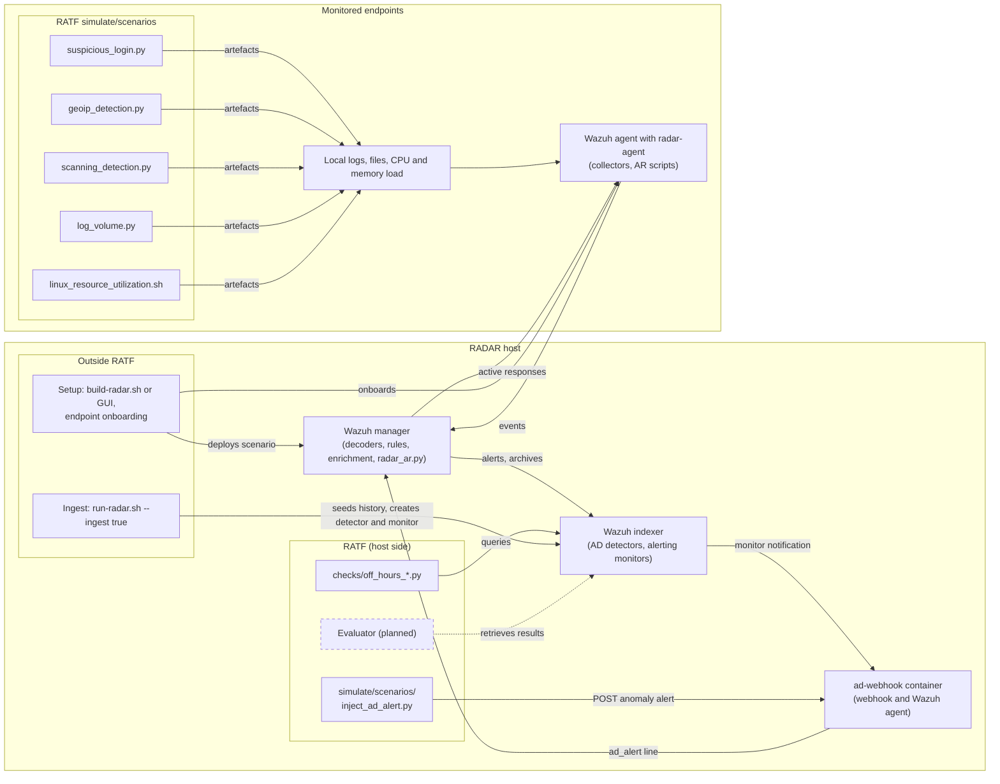

# RADAR Automated Test Framework architecture

The RADAR Automated Test Framework (RATF, `radar/radar-test-framework/`) validates a deployed RADAR scenario end to end by producing, on a monitored endpoint, the artefacts that the scenario detects. The artefacts then travel the production pipeline: Wazuh agent, manager decoders and rules, manager-side enrichment, the OpenSearch anomaly detector and webhook where the scenario uses one, the risk engine (`radar_ar.py`) and the active responses.

The framework covers four phases. Only one of them is implemented inside RATF:

| Phase | Implemented by | Location |
|---|---|---|
| Setup | `build-radar.sh` or the GUI's Scenario Management, then endpoint onboarding with `radar-agent/bootstrap-agent.sh` | Outside RATF (deployment control plane, SWD-042) |
| Ingest | `run-radar.sh <scenario> --ingest true` or the GUI's Anomaly Detector tab, which seeds detector history and creates the detector and monitor | Outside RATF (`radar/scenarios/ingest_scripts/`) |
| Simulate | One standalone script per scenario, copied to and run on the endpoint; `inject_ad_alert.py` runs on the manager host and posts an anomaly to the webhook | `radar/radar-test-framework/simulate/scenarios/` |
| Evaluate | Not implemented (see planned extensions) | — |

Besides the simulation scripts, `radar/radar-test-framework/checks/` holds live checks that run from the RADAR host against the indexer. They currently cover off-hours activity detection (`suspicious_login`).

The framework has no controller process and no remote dispatch: there is no SSH, inventory or orchestration layer between the RADAR host and the endpoints. Each script carries its parameters in a `CONFIG` block at its top. The operator verifies the outcome on the Wazuh dashboard, in the active-response log, in the alert email and, if DECIPHER is configured, in the FlowIntel case. See: `radar/radar-test-framework/README.md` and `radar/radar-test-framework/simulate/README.md`.

{width="70%"}

## Planned extensions

> **Status: planned.** Not implemented as of v2.2.0. The extensions below specify intended behaviour; no code implements them yet.

- **Evaluator**: retrieve the detection results of a simulation run from the indexer, compare them with the injected ground truth and compute detection metrics, written to a result file (SWD-021).
- **Single controller**: one entry point that sequences setup, ingest, simulation and evaluation for a scenario without manual steps.