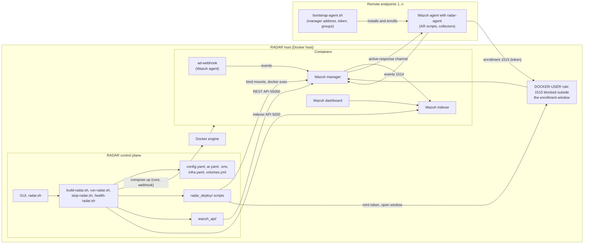

# RADAR deployment topology: local manager, remote agents

RADAR supports one deployment topology. The Wazuh manager, indexer and dashboard containers, the RADAR webhook container and the RADAR control plane (`radar/radar.sh`, the entry-point scripts, `radar/radar_deploy/`, `radar/wazuh_api/` and the GUI) all run on one Docker host, the RADAR host. Monitored endpoints are separate hosts that run a native Wazuh agent.

- **Manager side.** `build-radar.sh` brings up `docker-compose.core.yml` (Wazuh 4.14.1 manager, indexer, dashboard), overlaid with the bind mounts of `volumes.yml`, unless a manager container is already running. A pre-existing Wazuh installation running in containers on the same host can be used instead; its components are registered in `infra.yaml` through the GUI's Infrastructure page, and several manager nodes of one cluster can be registered. Manager-side files are written on the host side of the bind mounts, and `docker exec` is used only for ownership, permissions and package installs, so the manager containers must run on the RADAR host. Everything else goes through the Wazuh REST API (port 55000) and the indexer API (port 9200).
- **Webhook.** `docker-compose.webhook.yml` runs the `ad-webhook` container, which receives OpenSearch monitor notifications on port 8080 and is itself a Wazuh agent enrolled with the manager.
- **Endpoints.** An endpoint is onboarded by copying the `radar/radar-agent/` folder to it and running `bootstrap-agent.sh` with the manager address, a short-lived enrollment token and the target groups. The script installs a pinned Wazuh agent package, enrolls through port 1515 while the enrollment window is open, installs the active-response dispatchers and the scenario's metric collectors, and starts the agent. No container runtime is needed on the endpoint, and the RADAR host never connects to the endpoint.
- **Run time.** Agents send events to the manager on port 1514. Scenario configuration reaches them through their Wazuh agent groups. Active responses decided by `radar_ar.py` on the manager run on the endpoint through the Wazuh active-response channel.

There is no remote-manager mode and no containerised-agent mode (see HARC-006 and HARC-008, both obsolete). See: `docs/manual/radar_docs/radar-getting-started.md`.

{width="70%"}