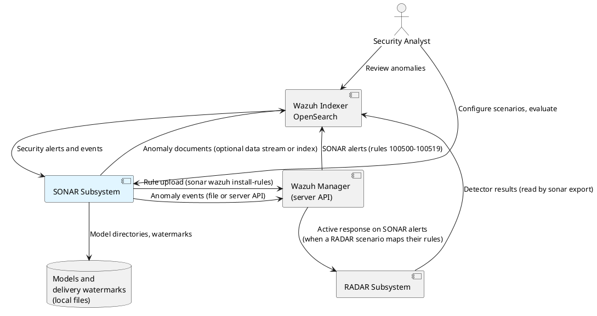

# SONAR subsystem context

The diagram below depicts the system context of the SONAR (SIEM-Oriented Neural Anomaly Recognition) subsystem within the IDPS-ESCAPE architecture.

SONAR is a multivariate anomaly detection engine that analyzes Wazuh security alerts to identify unusual patterns that may indicate security threats. It reads alerts (or, for scenarios such as `radar_linux_resource_utilization`, archived events) from the Wazuh Indexer (OpenSearch), scores them with a trainable detector backend, and reports each anomaly to the Wazuh manager as an event, so that Wazuh rules raise SONAR alerts that active responses, including RADAR's, can act on. It can also store anomaly documents in the indexer for dashboards.

SONAR runs on the Wazuh manager host or on a dedicated machine, never on monitored endpoints, whose resources may be limited; no Wazuh agent is needed on the SONAR host.

## System boundary

## Key interfaces

| Interface | Direction | Protocol | Purpose |
|-----------|-----------|----------|---------|
| Wazuh Indexer API | Inbound | HTTPS/REST | Alert retrieval (SONAR's own alerts excluded); for `sonar export`, also RADAR's anomaly detection results |
| Wazuh manager log file | Outbound | JSON lines read by `<localfile>` | Anomaly events, SONAR on the manager host |
| Wazuh server API `POST /events` | Outbound | HTTPS/REST, JWT | Anomaly events, SONAR on a dedicated host |
| Wazuh server API `PUT /rules/files` | Outbound | HTTPS/REST, JWT | Installation of SONAR's rules (`sonar wazuh install-rules`) |
| Wazuh Data Streams, anomalies index | Outbound | HTTPS/REST | Anomaly documents for dashboards (optional) |
| Local file system | Local | Files | Model directories, per-scenario delivery watermarks, evaluation reports, debug datasets |

RADAR has no direct interface with SONAR: it acts on the Wazuh alerts that SONAR's events raise, reading `data.anomaly_grade` and `data.anomaly_confidence` like for any other anomaly scenario. For comparisons only, `sonar export` reads the results of RADAR's detectors from the indexer and `sonar evaluate` scores them with SONAR's own metrics.

SONAR runs as a command-line process, from a Python installation or from the SONAR container image (`sonar/Dockerfile.sonar`, started with `sonar/sonar.sh`).

## Related documentation

- Technical architecture: `docs/manual/sonar_docs/architecture.md`
- UML diagrams: `docs/manual/sonar_docs/uml-diagrams.md`