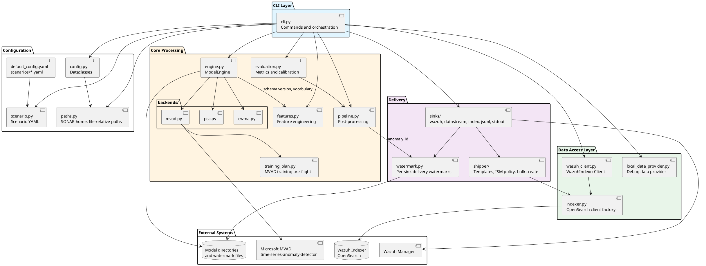

# SONAR component architecture

The diagram below depicts the high-level component architecture of the SONAR subsystem.

## Component diagram

`cli.py` orchestrates every command (`train`, `detect`, `scenario`, `evaluate`, `export`, `check`, `wazuh install-rules`); the other modules do not call each other except where shown. The detector is pluggable: `engine.py` owns the feature contract and the model directory, and the backends behind the `DetectorBackend` interface only fit, predict and save their own state.

## Component responsibilities

| Component | Responsibility |
|-----------|---------------|
| **cli.py** | Command-line interface, argument parsing, configuration building (`apply_scenario_to_config`, `apply_agent`), workflow orchestration of training, detection, realtime polling, evaluation and export |
| **config.py** | Configuration dataclasses |
| **scenario.py** | Scenario YAML loading and validation |
| **paths.py** | SONAR home and resolution of paths relative to the configuration or scenario file, never to the working directory |
| **features.py** | Feature extraction: regular time grid, per-bucket counts and means, categorical vocabulary |
| **engine.py** | `ModelEngine`: backend selection, feature contract, model directory (save and load) |
| **backends/** | Detector backends behind `DetectorBackend`: `mvad` (default), `pca`, `ewma`; each returns one `PointResult` per bucket |
| **training_plan.py** | Reproduces the MVAD library's training arithmetic and refuses training that would perform no update |
| **pipeline.py** | Post-processing: decision rule (`threshold`, `min_consecutive`) and the anomaly document schema |
| **evaluation.py** | Event-level precision, recall, F1, delay and false alarms against label files; calibration |
| **wazuh_client.py** | Alert retrieval from the Wazuh Indexer (point-in-time paging), anomalies index, RADAR detector results |
| **local_data_provider.py** | Debug mode data provider (local JSON files) |
| **indexer.py** | The single OpenSearch client factory (TLS, credentials, timeout) |
| **sinks/** | Anomaly delivery: Wazuh manager events (`file` or `api` transport), data stream, plain index, JSON lines, standard output |
| **watermark.py** | Per-scenario, per-sink delivery watermarks and the deterministic `anomaly_id` |
| **shipper/** | Data stream index templates, ISM policy, bulk document creation |

## Related documentation

- Detailed architecture: `docs/manual/sonar_docs/architecture.md`
- Component diagram: `docs/manual/sonar_docs/uml-diagrams.md#component-diagram`