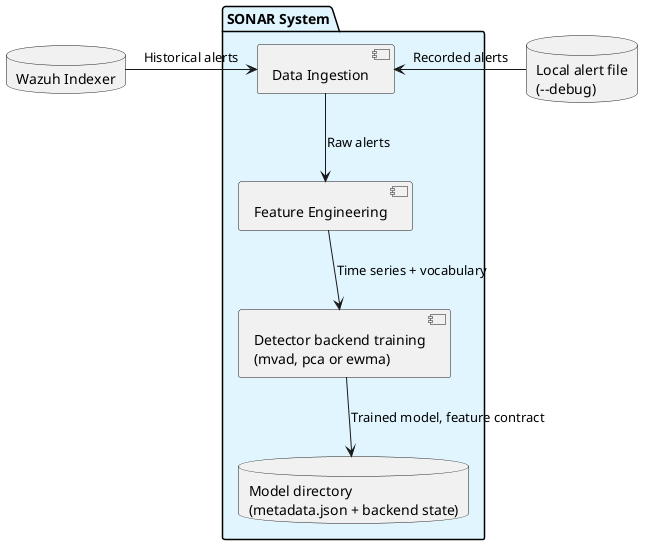
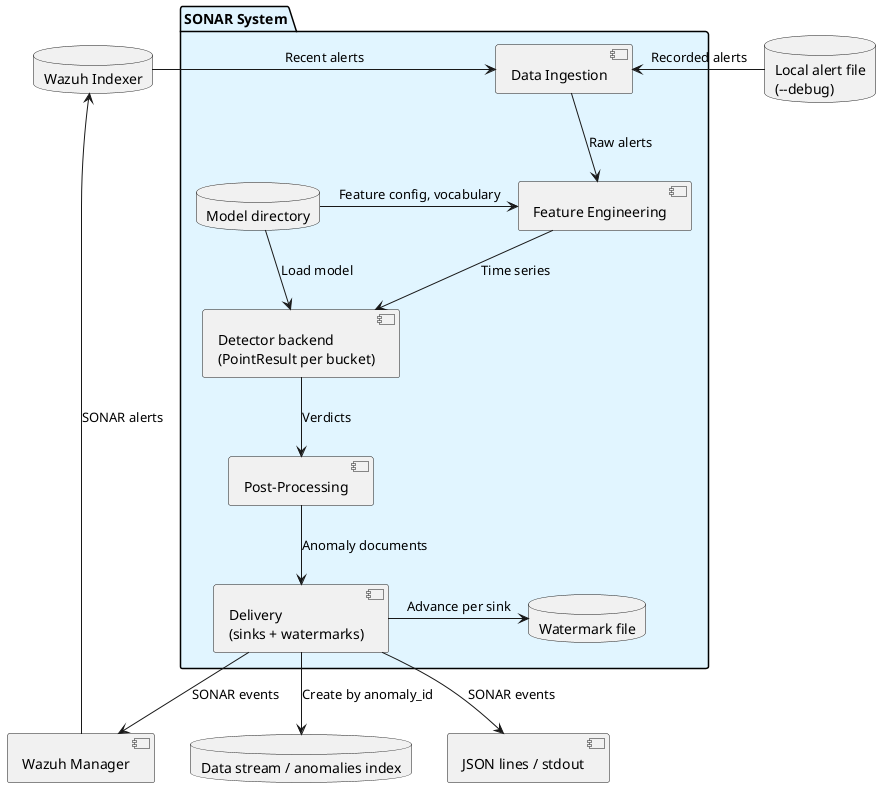
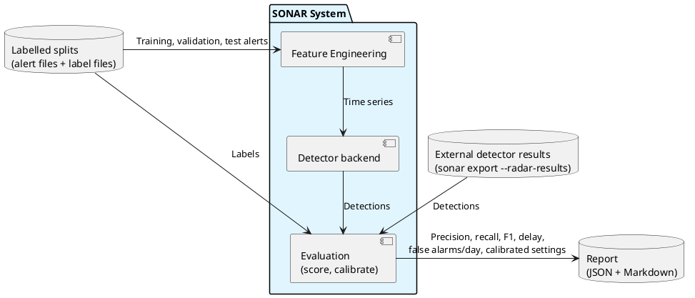

# SONAR data flow architecture

The diagram below illustrates the high-level data flow through the SONAR subsystem for training and detection operations.

## Training data flow

Training fetches the scenario's history, builds the feature matrix, fits the scenario's detector backend (`mvad` by default, or `pca`, `ewma`) and stores the model directory. With the data stream enabled, it also prepares the scenario's index templates and ISM policy.

## Detection data flow

Detection fetches the scored window plus the context the model needs, builds features with the model's feature contract, scores each bucket, selects anomalies and delivers each new anomaly once to every configured sink.

## Evaluation data flow

`sonar evaluate` trains a scenario's backend on a training file and scores labelled validation and test files, or scores another detector's exported results (for example RADAR's, written by `sonar export`), with the same metrics and the same decision rule as detection.

## Data transformations

| Stage | Input | Output | Transformation |
|-------|-------|--------|----------------|
| **Ingestion** | Wazuh alerts (JSON) from the indexer or a local file | Raw alert list | Time range, scenario `alert_filter`, optional agent filter, exclusion of SONAR's own alerts; only the fields the features read |
| **Feature Engineering** | Raw alerts | Time-series matrix | Regular time grid, per-bucket counts and means, categorical vocabulary |
| **Detector backend** | Time-series matrix | One verdict per bucket | `is_anomaly`, severity (0–1), raw score, feature contributions |
| **Post-Processing** | Verdicts | Anomaly documents | Minimum severity, minimum run length, deterministic `anomaly_id`, model and scenario metadata |
| **Delivery** | Anomaly documents | SONAR events, indexed documents, local lines | Per-sink watermark filtering, Wazuh event derivation, create-only indexing |
| **Evaluation** | Detections, label files | Report | Alarm-level scoring, calibration of threshold and run length |

## Related documentation

- Data flow diagram: `docs/manual/sonar_docs/uml-diagrams.md#data-flow-diagram`
- Architecture details: `docs/manual/sonar_docs/architecture.md#data-flow`