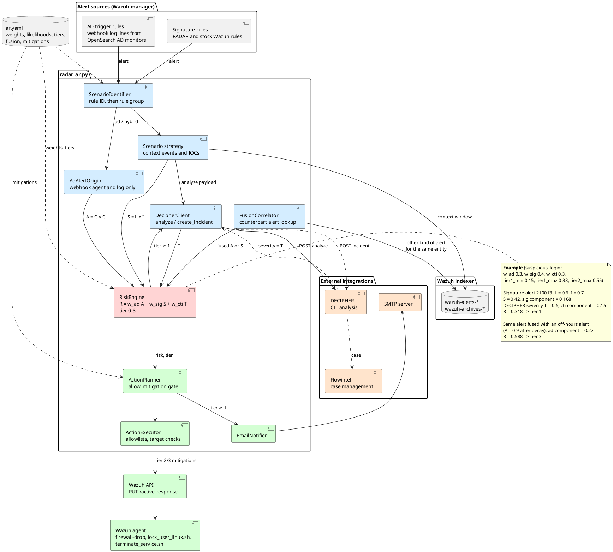

# RADAR risk engine architecture

The RADAR risk engine is part of the active response `radar_ar.py` (`radar/scenarios/active_responses/radar_ar.py`), which the Wazuh manager runs for every alert bound to a RADAR scenario. It combines anomaly detection outputs, signature-based detection data and a CTI score into one risk score, maps the score to a tier, and drives the tier's actions.

The risk engine has three inputs:

- **Anomaly intensity (A)**: $A = G \times C$, from the alert's `data.anomaly_grade` and `data.anomaly_confidence`. These come from an OpenSearch RCF detector through the monitor and webhook, or are fixed values for the off-hours rule mode of `suspicious_login`. Only alerts whose rule is listed under the scenario's `ad.rule_ids` carry A, and only if they come from the webhook agent's log.
- **Signature risk (S)**: $S = L \times I$, where the likelihood $L$ is looked up in the scenario's `signature_likelihood` table (by rule ID or rule group) and the impact $I$ is the scenario's `signature_impact`. An anomaly-only alert has $S = 0$.
- **CTI score (T)**: the `severity` returned by DECIPHER's analyze endpoint for the scenario (SWD-038), clamped to [0, 1]. It is 0 when DECIPHER is not configured or unreachable, or when no analyze endpoint exists for the scenario.

For a scenario with a `fusion` block, the term an alert cannot carry itself is filled with the strongest alert of the other kind for the same entity within the fusion window, discounted linearly by the time gap; fusion can only raise A or S.

The weighted combination $R = w_{ad} A + w_{sig} S + w_{cti} T$, clamped to [0, 1], drives tier-based response actions. Weights are set per scenario in `ar.yaml`. Four tiers are delimited by the three configurable boundaries `tier1_min`, `tier1_max` and `tier2_max`; the normative tier semantics are specified in SRS-061.

- **Tier 0** (`R < tier1_min`, default boundary 0.0): the decision is logged; no notification, case or mitigation
- **Tier 1** (`tier1_min ≤ R < tier1_max`, default boundary 0.33): email notification and, when DECIPHER is reachable, Flowintel case creation
- **Tier 2** (`tier1_max ≤ R < tier2_max`, default boundary 0.66): tier 1 actions plus the scenario's `mitigations_tier2`, subject to `allow_mitigation`
- **Tier 3** (`R ≥ tier2_max`): tier 1 actions plus the scenario's `mitigations_tier3`, subject to `allow_mitigation`; in the shipped `ar.yaml` this list repeats the tier 2 mitigations and adds the stronger containment actions

Every decision, including withheld mitigations and the reason they were withheld, is written to the manager's `active-responses.log`.

## Architecture diagram

