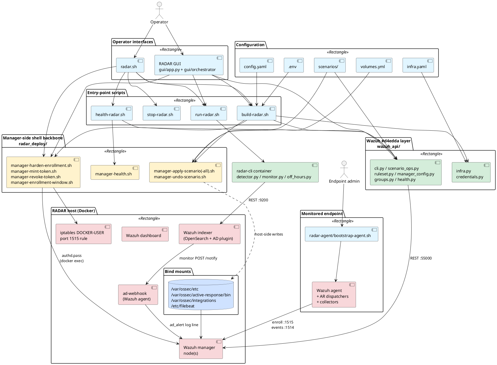

# RADAR deployment automation architecture

RADAR's deployment automation (the deployment control plane) is made of shell entry points, a manager-side shell backbone and a Python Wazuh API layer, driven either from the command line or from the RADAR GUI. It replaced the Ansible-based automation, which was removed in v2.0.0. SWD-042 specifies its design.

Key architectural decisions:

- **One privileged host, no remote execution.** The control plane runs on the Docker host that runs the Wazuh manager containers. Nothing is pushed to endpoints over SSH, and there is no inventory or vault. `sudo` is needed only to bring up the containers, to write under the bind-mounted manager directories and to manage the `iptables` rule guarding the enrollment port.
- **API first, files second.** Whatever the Wazuh REST API can do (agent groups and their `agent.conf`, decoders, rules, CDB lists, `ossec.conf` blocks, agent assignment and deregistration, health) goes through `radar/wazuh_api/`. Files the API cannot place (`radar_ar.py`, `ar.yaml`, the manager's copy of `.env`, enrichment integrations, GeoLite2 databases, Filebeat pipeline patches) are written by `radar/radar_deploy/` on the host side of the bind mounts listed in `radar/volumes.yml`.
- **Marker-delimited, idempotent changes.** `ossec.conf` is changed only inside `<!-- RADAR: <name> BEGIN/END -->` blocks. Re-applying a scenario converges to the same state, and undoing a scenario keeps everything another deployed scenario still needs.
- **Self-onboarding endpoints.** An endpoint runs `radar/radar-agent/bootstrap-agent.sh` with a short-lived enrollment token. Enrollment is hardened (`use_password=yes`, `purge=no`, port 1515 closed outside a timed window).
- **Runtime address resolution.** `radar/infra.yaml` registers the manager node(s), indexer, dashboard and webhook. `wazuh_api/infra.py` tries a component's declared host first and falls back to its container name, so the same scripts serve a stack RADAR deployed itself and a pre-existing containerised Wazuh installation.

## Architecture diagram

See: `docs/manual/radar_docs/radar-operations.md`.