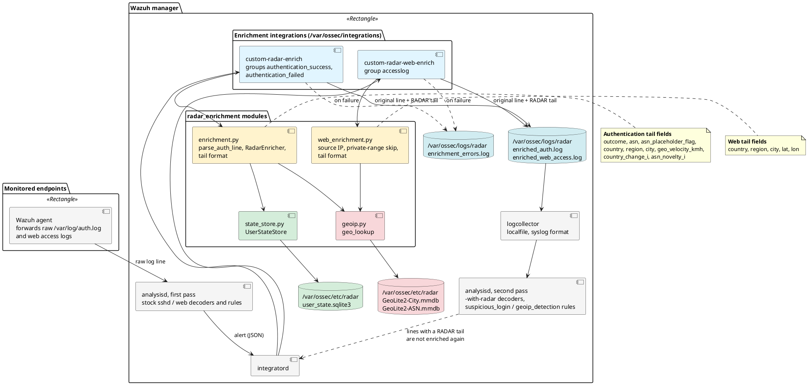

# RADAR manager-side enrichment architecture

The diagram below depicts the high-level architecture of RADAR's log enrichment, which runs on the Wazuh manager as two `integratord` integrations. It replaced the earlier RADAR helper, a per-endpoint enrichment daemon with its own virtual environment, service and GeoIP databases, which was removed in v2.0.0 (CHANGELOG, "Manager Enrichment & Architecture").

Enrichment adds geographic and behavioural context to authentication and web-access events so that the `suspicious_login` and `geoip_detection` rules can match on it (impossible travel, country change, country whitelist). Because the manager receives the events of every endpoint, it keeps one history per user, so geo-velocity and ASN novelty are computed across all endpoints a user reaches (SRS-068). Endpoints run only the Wazuh agent and forward their raw logs.

Key architectural components (`radar/manager-enrichment/`):

- **`custom-radar-enrich`**: integration entry point for authentication events. Wazuh calls it for alerts in the `authentication_success` and `authentication_failed` groups. It parses the user, source IP, outcome and timestamp from the original log line, enriches them and appends the line with a `RADAR …` tail to `/var/ossec/logs/radar/enriched_auth.log`.
- **`custom-radar-web-enrich`**: integration entry point for web-access events (`accesslog` group), writing `/var/ossec/logs/radar/enriched_web_access.log`.
- **`enrichment.py`**: authentication log parsing, `RadarEnricher` (geo-velocity, country change, ASN novelty) and the tail format.
- **`web_enrichment.py`**: source-IP extraction from access-log lines, private-address filtering and the web tail format.
- **`geoip.py`**: stateless lookup of country, region, city, coordinates and ASN in the MaxMind GeoLite2 City and ASN databases.
- **`state_store.py`**: `UserState` and `UserStateStore`, the per-user history (last time, position and country, 90-day ASN history) in one SQLite database on the manager.

The manager reads both enriched files through `<localfile>` entries, so each enriched line is decoded a second time by the scenario's `-with-radar` decoders, and the scenario rules evaluate the `radar_*` fields. Failures are written to `/var/ossec/logs/radar/enrichment_errors.log` and never suppress the original alert. The design is specified in LARC-025 and SWD-030.

## Architecture diagram

