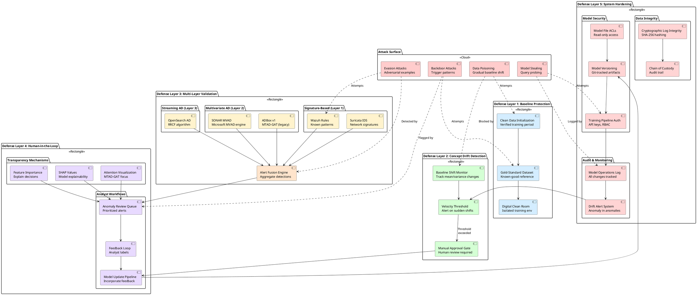

# RADAR adversarial ML defense architecture

> **Status: planned.** Not implemented as of v2.2.0. This item specifies intended behaviour; no code implements it yet.

The diagram below depicts the intended defense-in-depth architecture for protecting RADAR's anomaly detection against adversarial machine learning attacks (data poisoning, evasion, backdoors, model stealing).

The architecture is to provide five defensive layers:

**Layer 1: Baseline Protection**

- Clean data initialization from verified periods
- Gold-standard training dataset management
- Digital clean room exercises for pristine baselines

**Layer 2: Concept Drift Detection**

- Baseline shift velocity monitoring
- Automated alerts on sudden baseline changes
- Manual approval gates for model updates

**Layer 3: Multi-Layer Validation**

- Signature-based detection (Wazuh, Suricata)
- Multivariate AD (SONAR MVAD, ADBox MTAD-GAT)
- Streaming AD (OpenSearch RRCF)
- Cross-layer anomaly correlation

**Layer 4: Human-in-the-Loop (HITL)**

- Transparent model reasoning exposure
- Analyst review workflows
- Feedback loops for model improvement
- Alert fusion and enrichment

**Layer 5: System Hardening**

- Cryptographic log integrity (SHA-256 hashing)
- Model file access controls and versioning
- Training pipeline authentication
- Audit logging of all model operations

## Relation to the current implementation

None of the five layers exists as specified: RADAR has no gold-standard baseline management, drift monitor, approval gate, analyst feedback loop, log hashing or model access control. Some existing mechanisms reduce the same risks and would be building blocks for it:

- Hybrid scoring: a scenario can weight signature, anomaly and CTI evidence together, and `suspicious_login` fuses a signature alert with an anomaly alert for the same user (HARC-012, `radar/scenarios/active_responses/radar_ar.py`).
- Alert origin checks: anomaly alerts are accepted only from the webhook container's agent and log file, and the webhook requires a shared secret (`radar/webhook/ad_alerts_webhook.py`).
- Bounded mitigation: mitigation is opt-in per scenario and its targets are validated against allowlists on manager and endpoint.

Practitioner guidance on these attacks is in `docs/manual/radar_docs/adversarial-ml-guidance.md`.

## Defense architecture diagram

