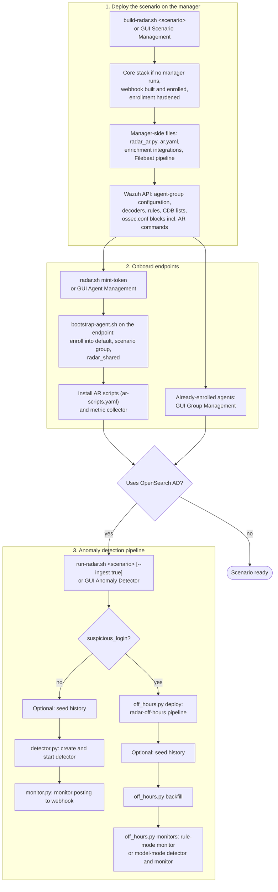

# RADAR scenario setup flow

Setting up a RADAR scenario takes the following steps, in this order. Each one can be run from the command line or from the GUI's Deployment page.

1. **Deploy the scenario on the manager** (`build-radar.sh <scenario>`, GUI Scenario Management). Bring up the core stack if no manager is running, build and enroll the webhook, harden enrollment, then place the manager-side files (risk engine `radar_ar.py`, `ar.yaml`, enrichment integrations, Filebeat pipeline changes) and deploy, through the Wazuh API, the scenario's agent-group configuration, decoders, rules, CDB lists and `ossec.conf` blocks, including the active-response commands.
2. **Onboard endpoints** (`radar.sh mint-token` or GUI Agent Management, then `radar-agent/bootstrap-agent.sh` on the endpoint). Install and enroll the Wazuh agent into `default`, the scenario's group and, for shared scenarios, `radar_shared`. Install the active-response scripts listed in `radar-agent/ar-scripts.yaml` and the scenario's metric collector, if it has one. Already-enrolled agents are assigned to the scenario's groups from the manager instead (GUI Group Management).
3. **Create the anomaly detection pipeline**, only for scenarios that use the OpenSearch AD plugin (`run-radar.sh <scenario> [--ingest true]`, GUI Anomaly Detector). Optionally seed the indices with synthetic history, then create and start the detector and create the monitor that posts to the webhook. For `suspicious_login`, `off_hours.py` deploys the off-hours pipeline, backfills it and creates the rule-mode monitor or the model-mode detector and monitor instead.

The thresholds that trigger the monitors come from `radar/config.yaml`, and the risk tiers and mitigations that decide the response come from `radar/scenarios/active_responses/ar.yaml`.

{width="60%"}

Related: HARC-004, HARC-005.