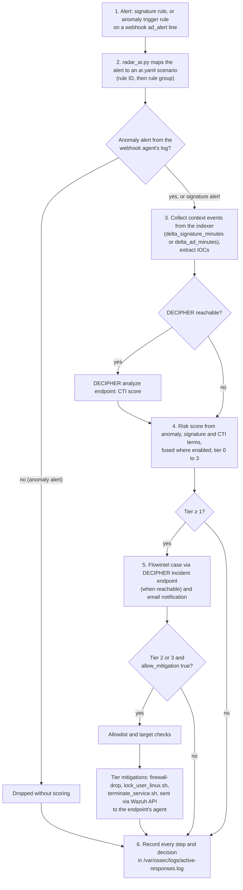

# RADAR active response flow

Every RADAR scenario ends in the same active response, `radar_ar.py` (`radar/scenarios/active_responses/radar_ar.py`), which the Wazuh manager runs on the manager itself (`<location>server</location>`) for each alert whose rule is bound to it in the scenario's `ossec.conf` snippet (`radar/scenarios/ossec/`).

1. **Alert.** A signature rule fires on a decoded event, or an anomaly trigger rule fires on the log line the webhook wrote for an OpenSearch monitor notification (`/var/log/ad_alerts.log` in the webhook container, forwarded by that container's Wazuh agent).
2. **Scenario and trust.** `radar_ar.py` maps the alert to a scenario in `ar.yaml` by rule ID, then by rule group. An anomaly alert that does not come from the webhook agent's log is dropped without scoring.
3. **Context and CTI.** It collects the scenario's context events from the indexer for a window that ends at the alert's timestamp (`delta_signature_minutes` or `delta_ad_minutes`), extracts IOCs, and, when DECIPHER is reachable, asks DECIPHER's analyze endpoint for a CTI score (SWD-038).
4. **Risk and tier.** It computes the risk score from the anomaly, signature and CTI terms, fused with a counterpart alert where the scenario enables fusion, and maps it to tier 0 to 3 (HARC-012, SRS-061).
5. **Actions.** From tier 1: a Flowintel case through DECIPHER's incident endpoint (when reachable) and an email notification. At tiers 2 and 3, and only when the scenario's `allow_mitigation` is true: the tier's mitigations (`firewall-drop`, `lock_user_linux.sh`, `terminate_service.sh`), sent through the Wazuh API to the affected endpoint's agent (for a per-agent anomaly, the agent the anomaly names), after allowlist and target checks.
6. **Record.** Every step and decision, including withheld mitigations, is written to `/var/ossec/logs/active-responses.log`.

The detailed decision pipeline is specified in LARC-026 and SWD-027.

The diagram below summarises this flow.

{width="50%"}

Related: HARC-004, HARC-005.