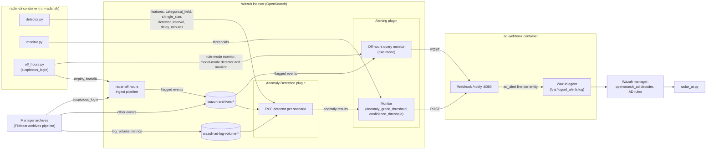

# RADAR integration with OpenSearch modules

RADAR uses two OpenSearch plugins shipped with the Wazuh indexer: Anomaly Detection, which runs a random cut forest (RCF) detector per scenario, and Alerting, which runs the monitor that reports anomalies to RADAR.

- **Configuration.** `run-radar.sh` runs `detector.py` and `monitor.py` (or, for `suspicious_login`, `off_hours.py`) in the throwaway `radar-cli` container. They create the detector from the scenario's features, `categorical_field`, `shingle_size`, `detector_interval` and `delay_minutes` in `radar/config.yaml`, and a monitor with the scenario's `anomaly_grade_threshold` and `confidence_threshold`.
- **Input indices.** `log_volume` reads `wazuh-ad-log-volume-*`, filled through the patched Filebeat archives pipeline. `linux_resource_utilization` reads `wazuh-archives-*`. The off-hours model mode of `suspicious_login` reads `wazuh-archives-*` events flagged by the `radar-off-hours` ingest pipeline.
- **Output path.** When the monitor's trigger condition holds, it POSTs to the `ad-webhook` container at `/notify` on port 8080. The webhook writes one `ad_alert` line per anomalous entity to a log file read by its own Wazuh agent. The manager decodes the line with the `opensearch_ad` decoder, matches the scenario's AD rules, and runs `radar_ar.py`.

See: `docs/manual/radar_docs/radar-run-ad.md`.

{width="90%"}

Related: HARC-004, HARC-005.