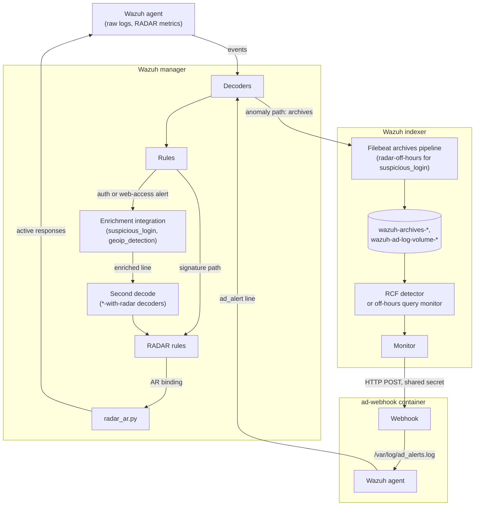

# RADAR logical flow

RADAR has two detection paths, which converge on the same active-response pipeline (LARC-026).

## Overall pipeline

```
Wazuh agent (raw logs, RADAR metrics) -> Wazuh manager (decode -> rules)
    |
    [Enrichment, suspicious_login and geoip_detection only]
                        stock rule alert -> enrichment integration -> enriched log line -> Wazuh manager (decode again -> RADAR rules)
    |
    [Signature path]    Wazuh manager (RADAR rules) -> Active response
    |
    [Anomaly path]      Wazuh indexer (archives) -> Detector or query monitor -> Monitor -> Webhook -> Webhook container's agent -> Wazuh manager (rules) -> Active response
```

Both paths terminate in the same place: a Wazuh rule firing an active-response command bound to `radar_ar.py` (SWD-027). The anomaly path exists to get an anomaly result into that same rule-firing mechanism; it does not bypass it.


{width="60%"}

## Signature-based detection flow

1. **Collection**: the Wazuh agent forwards a raw log line to the manager, unmodified.
2. **Decoding and first rule match**: decoders parse the line into structured fields and rules evaluate them.
3. **Enrichment** (only `suspicious_login` and `geoip_detection`): an alert in an authentication or web-access group triggers a manager-side integration, which writes the original line plus a `RADAR` tail (GeoIP, ASN, velocity) to a file the manager monitors. The manager decodes that enriched line a second time, and the scenario's rules match on the `radar_*` fields (SWD-030).
4. **Rule matching**: a RADAR rule matches and generates an alert at its configured level.
5. **Active response**: the alert's active-response binding invokes `radar_ar.py`, which scores the alert and dispatches the tier-appropriate response (SWD-027, SRS-061). The outcome is written to `/var/ossec/logs/active-responses.log`.

## Anomaly-based detection flow

1. **Collection**: the agent forwards raw logs and, for `log_volume` and `linux_resource_utilization`, the metric lines written by RADAR's collectors on the endpoint.
2. **Indexing**: the manager archives every event, and the Filebeat archives pipeline indexes it into `wazuh-archives-*`, except `log_volume` metrics, which it routes to `wazuh-ad-log-volume-*`. For `suspicious_login`, the pipeline also calls the `radar-off-hours` ingest pipeline, which flags events of listed users that fall outside their declared working hours.
3. **Detection**: on its configured interval, an RCF anomaly detector queries the index, extracts feature values per entity (agent, or user for the off-hours model mode), and stores an anomaly grade and confidence per entity and interval. The off-hours rule mode of `suspicious_login` uses no detector: a query monitor counts flagged events directly.
4. **Monitoring**: on its own interval, a monitor selects results above the scenario's `anomaly_grade_threshold` and `confidence_threshold` (up to `monitor_max_entities`) and sends an HTTP POST, authenticated with a shared secret, to the webhook.
5. **Webhook**: the webhook service validates the notification and writes one log line per anomalous entity to `/var/log/ad_alerts.log` in its container; the Wazuh agent installed in that container forwards the lines to the manager.
6. **Re-entry into the rule engine**: the manager decodes and evaluates the line like any other event. A scenario's trigger rule matches, and `radar_ar.py` scores and responds, accepting the anomaly alert only because it comes from the webhook agent's log.

Related: HARC-004.