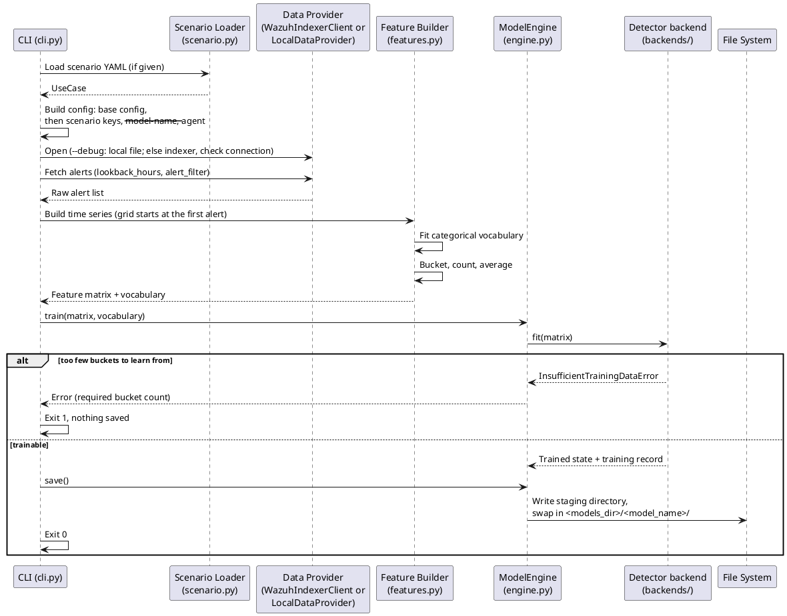

# SONAR training pipeline sequence

## Training workflow sequence diagram

The training pipeline retrieves historical alerts, builds the feature matrix and its categorical vocabulary, trains the scenario's detector backend (`mvad` by default, or `pca`, `ewma`) and saves the model directory. Every training command (`sonar train` with or without a scenario, and the training phase of `sonar scenario`) runs this one sequence (`_execute_training_phase` in `sonar/cli.py`).

With the `datastream` sink or shipping enabled (and not in debug mode), training then installs the data stream's index templates and ISM policy for the scenario ([SWD-024](../swd/SWD-024.md)).

## Key operations

| Component | Operation | Input | Output |
|-----------|-----------|-------|--------|
| **Scenario Loader** | Parse and validate YAML | Scenario file path | `UseCase` |
| **Data Provider** | Fetch alerts | Time range, `alert_filter` | Raw alerts (JSON); only the fields the features read, SONAR's own alerts excluded |
| **Feature Builder** | Build features | Raw alerts | Time-series matrix, categorical vocabulary |
| **ModelEngine** | Train | Feature matrix, vocabulary | Trained backend, metadata (feature contract, training record) |
| **Detector backend** | Fit | Feature matrix | Backend state (`mvad`: training pre-flight with `sonar/training_plan.py`) |
| **File System** | Persist model | Metadata and backend state | Model directory (no pickle) |

## Error handling

- **Insufficient data**: no alerts with a valid timestamp, or fewer buckets than the backend needs (for `mvad`: one optimiser update and a validation window under the configured parameters; for `pca` and `ewma`: a fixed minimum): training fails, saves nothing and exits with status 1, stating the required bucket count. For `mvad`, fewer updates than `min_gradient_steps` only warns.
- **Invalid parameters**: an unknown key in `extra_params` is an error; unknown keys elsewhere in configuration and scenario files are ignored with a warning.
- **Indexer failures**: every indexer request has a timeout (`wazuh.timeout_seconds`); a failed connection check or search ends training with status 1. Training does not retry.
- **Model persistence**: the model is written to a staging directory and swapped in only when complete, so a failed save leaves the previous model in place.

## Related documentation

- Training sequence diagram: `docs/manual/sonar_docs/uml-diagrams.md#training-workflow`