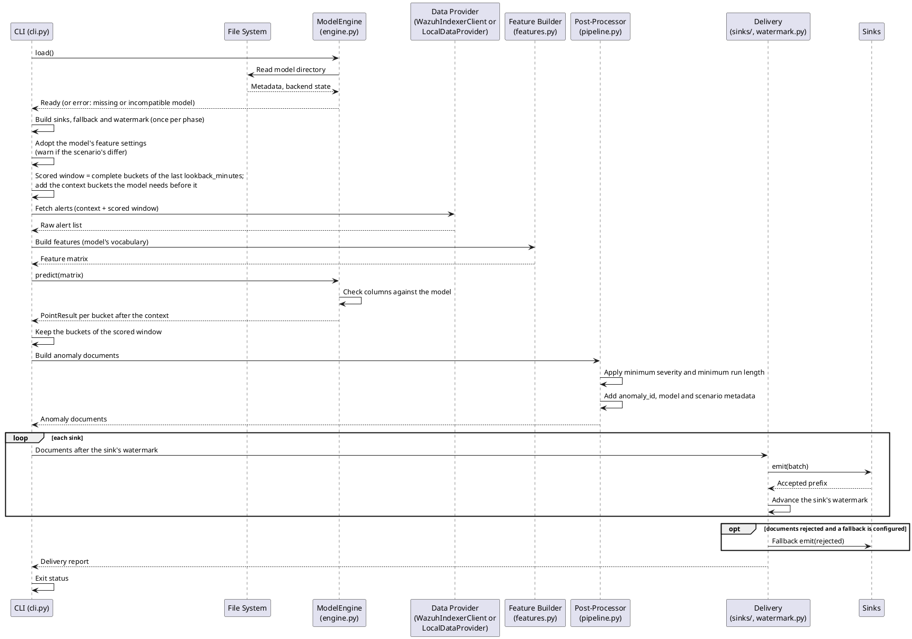

# SONAR detection pipeline sequence

## Detection workflow sequence diagram

The detection pipeline loads a trained model, scores the complete buckets of the detection window, and delivers the new anomalies to the configured sinks. Every detection command (`sonar detect` with or without a scenario, and the detection phase of `sonar scenario`) runs this one sequence (`_run_single_detection` in `sonar/cli.py`); realtime mode repeats it once per bucket.

## Detection modes

`detection.mode` is read only by `sonar scenario`; `sonar detect` always runs once.

| Mode | Behavior |
|------|----------|
| **historical**, **batch** | One detection run over the window, then exit |
| **realtime** | Repeat the run once per bucket, after the bucket has ended plus `ingest_delay_seconds` (or every `polling_interval_seconds` if set), until stopped |

In realtime mode a failed run is retried after 10 s, doubling per consecutive failure and capped at one bucket; after `max_consecutive_failures` consecutive failures SONAR exits with status 1. A run with too little data is not a failure. SONAR itself does not schedule periodic one-shot runs; a scheduler (cron, a container restart policy) may.

## Scored window

Detection scores the complete time buckets of the last `lookback_minutes`; the current bucket, still filling, is never scored, nor is one that ended less than `ingest_delay_seconds` ago. The model needs a fixed number of earlier buckets as context before the first bucket it can score (derived from its backend's window), so the pipeline fetches them as well and reports only buckets inside the scored window. In debug mode the local file is scored as a whole, without a time range.

## Post-processing steps

1. **Thresholding**: Keep buckets that the backend flags and whose severity (0–1) reaches the configured minimum (`threshold`), if one is set
2. **Consecutive filtering**: Keep only runs of at least `min_consecutive` such buckets, evaluated over the whole scored window before the watermarks are applied
3. **Enrichment**: Add `anomaly_id` (from the scenario ID and bucket start), scenario and model names, severity, raw score, top contributors with their values, and `anomaly_confidence`
4. **Delivery**: Each sink receives the documents after its own watermark; the `wazuh`, `jsonl` and `stdout` sinks send the SONAR event derived from the document, the indexer sinks store the document ([SWD-024](../swd/SWD-024.md)). Debug runs (`output.debug_sinks`) and dry runs (a JSON-lines file) use no watermark

## Exit status

A one-shot run exits with 0 when the window was scored and its new anomalies delivered, 2 when there was too little data to score it (no alerts, or fewer buckets than the model needs), and 1 on an error, including a delivery in which every sink with anomalies to deliver failed and no fallback took them all. When some sinks fail and others succeed, the run logs a warning and exits with 0; the failed sinks catch up on a later run.

## Related documentation

- Detection sequence diagram: `docs/manual/sonar_docs/uml-diagrams.md#detection-workflow`