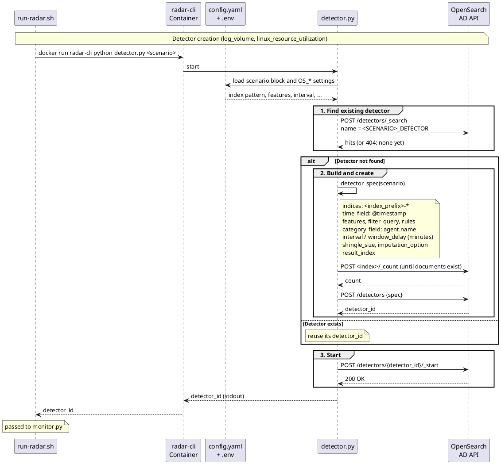

# RADAR detector creation workflow

The diagram below depicts the sequence of operations for creating and starting an OpenSearch anomaly detector with `radar/anomaly_detector/detector.py`. `run-radar.sh` runs it, inside the `radar-cli` container, for the scenarios with a generic detector: `log_volume` and `linux_resource_utilization`. The `suspicious_login` model-mode detector is managed by `radar/anomaly_detector/off_hours.py` instead (SRS-062).

## Workflow stages

### 1. Configuration loading
- Read the scenario block from `config.yaml` (`scenarios.<name>`).
- Load `.env` (`OS_URL`, `OS_USER`, `OS_PASS`, `OS_VERIFY_SSL`, `OS_TIMEOUT`); `OS_URL` is required.

### 2. Detector existence check
- `POST /_plugins/_anomaly_detection/detectors/_search` for the exact name `<SCENARIO>_DETECTOR` (scenario name in upper case, e.g. `LOG_VOLUME_DETECTOR`).
- A 404 (AD system index not created yet) means no detector exists.

### 3. Detector specification building (only if none exists)
The specification is built from the scenario block:

- **indices**: `log_index_pattern`, else `<index_prefix>-*` (e.g. `wazuh-ad-log-volume-*`, `wazuh-archives-*`)
- **time_field**: `time_field` (`@timestamp`)
- **feature_attributes**: the `features` aggregations (e.g. max of `data.log_bytes`)
- **filter_query**: `filter_query`, else match all
- **detection_interval** / **window_delay**: `detector_interval`, `delay_minutes` (minutes)
- **category_field**: `categorical_field` (`agent.name`, one baseline per agent)
- **shingle_size**, **imputation_option** (default zero fill), detector **rules** (e.g. ignore small deviations)
- **result_index**: custom result index, with its minimum age, size and TTL

### 4. Detector creation
- Wait briefly until the index pattern holds documents: the AD plugin cannot start a detector on an empty index.
- `POST /_plugins/_anomaly_detection/detectors`; the response carries the detector ID.

### 5. Detector activation
- `POST /_plugins/_anomaly_detection/detectors/{detector_id}/_start`, for a new or an existing detector.

### 6. Output
- Print the detector ID on stdout; `run-radar.sh` passes it to `monitor.py` (LARC-023).

## Detector creation sequence

## Implementation reference

See [radar/anomaly_detector/detector.py](../../../radar/anomaly_detector/detector.py) and [radar/run-radar.sh](../../../radar/run-radar.sh). Operator guide: docs/manual/radar_docs/radar-run-ad.md.

Related: HARC-004, HARC-012.