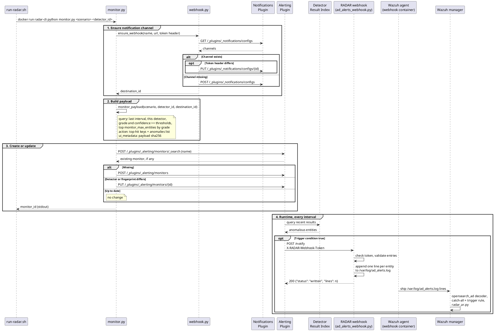

# RADAR monitor and webhook workflow

The diagram below depicts how `radar/anomaly_detector/monitor.py` and `radar/anomaly_detector/webhook.py` create the OpenSearch notification channel and alerting monitor for an anomaly detector, and how the monitor's notifications then reach Wazuh through the RADAR webhook service (`radar/webhook/ad_alerts_webhook.py`). `run-radar.sh` runs `monitor.py` after `detector.py` (LARC-022) for `log_volume` and `linux_resource_utilization`; the `suspicious_login` off-hours monitors are created by `off_hours.py` through the same channel and webhook.

## Workflow stages

### 1. Notification channel (idempotent)
`ensure_webhook()` in `webhook.py`:

- `GET /_plugins/_notifications/configs` and look for a `webhook` channel with the configured name (`webhook.name` in `config.yaml`, else `WEBHOOK_NAME`, default "RADAR Webhook") and URL (`webhook.url`, else `WEBHOOK_URL`).
- If found, update it when its shared-secret header differs; otherwise `POST /_plugins/_notifications/configs` to create it.
- The channel sends the header `X-RADAR-Webhook-Token` with `WEBHOOK_SHARED_SECRET`.

### 2. Monitor specification
`monitor_payload()` builds a query-level monitor named `monitor_name`:

- **Schedule**: every `monitor_interval`, else `detector_interval`, minutes.
- **Input**: search of the detector's `result_index` for results of this detector in the last interval with anomaly grade and confidence at or above `anomaly_grade_threshold` and `confidence_threshold`, highest grade first, at most `monitor_max_entities` (default 5) hits.
- **Trigger** `trigger_name`: a Painless condition on the maximum grade and the top hit's confidence.
- **Action**: POST to the channel with the message template of SWD-029: the top hit's keys plus an `anomalies` list with one entry per hit, each with entity, grade, confidence and the anomaly's own data window.
- A SHA-256 fingerprint of the payload is stored in the monitor's `ui_metadata`.

### 3. Monitor creation or update
- `POST /_plugins/_alerting/monitors/_search` by monitor name.
- If it exists and its detector ID or payload fingerprint differs, `PUT` the new payload; if it matches, leave it. Otherwise `POST /_plugins/_alerting/monitors`.
- Print the monitor ID.

### 4. Runtime delivery
- Each run with a hit posts to the webhook (`POST /notify`, port `WEBHOOK_INTERNAL_PORT`, default 8080).
- The webhook checks the token, validates each entry, and writes one line per entity to `/var/log/ad_alerts.log` (format in SWD-035).
- The Wazuh agent in the webhook container ships the file to the manager, where the `opensearch_ad` decoder, an AD catch-all rule (`radar_ad_received` group) and the scenario's trigger rule invoke `radar_ar.py`.

## Monitor and webhook sequence

## Implementation reference

- [radar/anomaly_detector/monitor.py](../../../radar/anomaly_detector/monitor.py) - monitor creation and update
- [radar/anomaly_detector/webhook.py](../../../radar/anomaly_detector/webhook.py) - notification channel management
- [radar/webhook/ad_alerts_webhook.py](../../../radar/webhook/ad_alerts_webhook.py) - webhook service

Related: HARC-004, HARC-012, LARC-022.