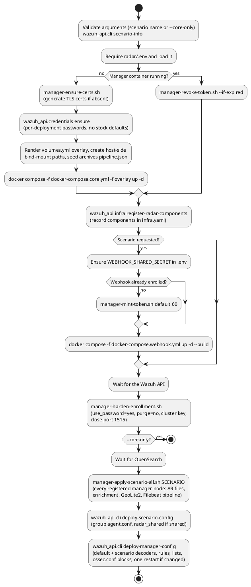

# RADAR deployment pipeline flow

This item describes the flow `radar/build-radar.sh` runs to deploy a scenario, or with `--core-only` to bring up a plain Wazuh stack. The GUI's Deploy action (`radar/gui/orchestrator/deploy.py`, `stream_build`) runs the same stages with the same scripts and `wazuh_api` calls, streaming their output to the browser. Two differences: it does not revoke an expired enrollment token when the manager is already running, and on success it records the scenario as deployed (`active: true`) in `ar.yaml`, which the GUI uses to show deployment status. It replaced the Ansible deployment pipeline, which was removed in v2.0.0. The component design is in SWD-042.

## Pipeline stages

1. **Validation.** The scenario must be listed in `radar/config.yaml`, and `radar/.env` must exist. `WAZUH_API_URL`, `WAZUH_AUTH_USER` and `WAZUH_AUTH_PASS` must be set before any API stage runs.
2. **Core stack.** Skipped when the registered manager container is already running; an expired enrollment token is then revoked. Otherwise certificates and per-deployment credentials are created if missing, every host-side path of the `volumes.yml` overlay is created, the Filebeat archives `pipeline.json` is seeded (the build aborts if `volumes.yml` does not map it), and the core compose project is started.
3. **Component registration.** The running components are recorded in `radar/infra.yaml`, which later stages use to resolve addresses.
4. **Webhook** (scenario builds only). A shared secret is ensured. If the webhook has no agent key yet, a 60-minute token for group `default` is minted so the container can enroll on first start.
5. **Enrollment hardening.** After the Wazuh API is reachable, `authd` requires a password, auto-purge is disabled, the cluster key is set, and port 1515 is closed (the firewall step needs root).
6. **Manager-side files.** Applied to the primary manager node first, then to each additional registered node. A failure on an additional node is reported as a warning and does not stop the build.
7. **API-side configuration.** The scenario's agent-group configuration, then its ruleset (always together with the `default` ruleset) and its marker-delimited `ossec.conf` blocks. The manager is restarted at most once, and only if something changed.

The anomaly detector and monitor are created afterwards, separately, by `run-radar.sh` (LARC-015, LARC-017).

## Idempotency

- Files and `ossec.conf` blocks are compared with what is deployed and written only when they differ. `ossec.conf` changes stay inside `<!-- RADAR: <name> BEGIN/END -->` markers.
- Certificates, credentials, the webhook enrollment and the GeoLite2 databases are created only when absent.
- Re-running the pipeline for a deployed scenario converges to the same state.

See: `docs/manual/radar_docs/radar-operations.md#deploy-a-scenario`.

Related: HARC-007, HARC-013.