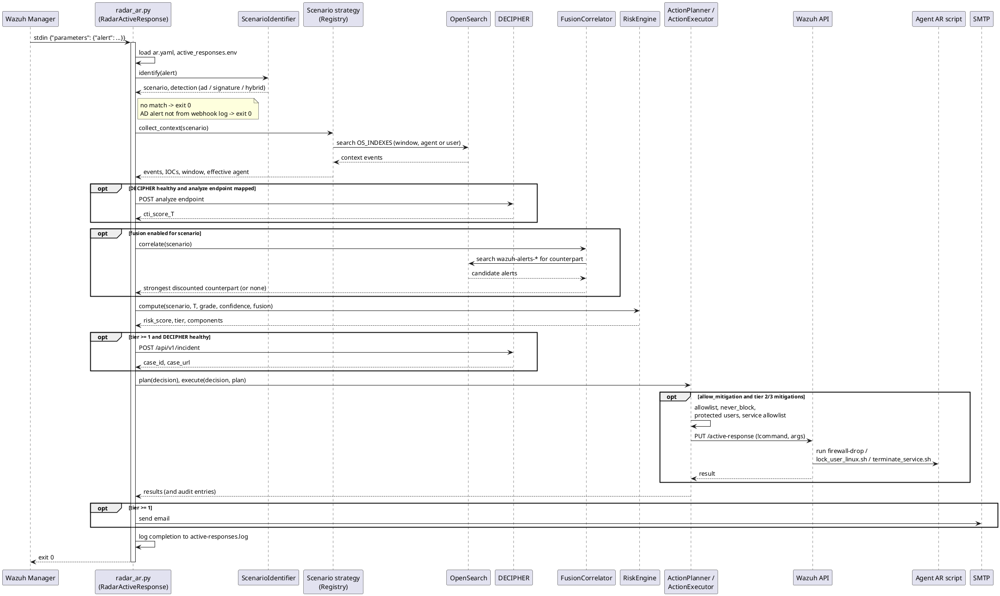

# RADAR active response decision pipeline

The diagram below depicts the decision pipeline implemented in `radar/scenarios/active_responses/radar_ar.py`, the Wazuh active response that every RADAR scenario invokes on the manager. It expands on LARC-016 (RADAR active response flow); SWD-027 is the normative design.

## Pipeline stages

### 1. Alert intake
- Wazuh runs the script once per matching alert (`<active-response>` with `location` `server`) and writes `{"parameters": {"alert": {...}}}` on stdin.
- Settings come from `active_responses.env` next to the script; the scenario configuration from `ar.yaml` (`AR_RISK_CONFIG`).
- An empty or unparseable input ends the run (exit 1).

### 2. Scenario identification
`ScenarioIdentifier` (SRS-061 requirement 3):

- An exact `rule.id` match in a scenario's `ad.rule_ids` or `signature.rule_ids` wins; otherwise `rule.groups` are matched against the scenario's `rule_groups`. In both cases the first scenario listed in `ar.yaml` wins.
- Detection type: `ad`, `signature`, or `hybrid` (rule ID in both lists).
- No match: logged, exit 0.

### 3. Anomaly alert origin
An `ad` or `hybrid` alert is processed only if the webhook agent (`WEBHOOK_AGENT_NAME`, default `ad-webhook`) read it from `/var/log/ad_alerts.log`; any other is logged and dropped (exit 0).

### 4. Context collection
The scenario's strategy class (`Registry`: `BaseScenario`, `GeoipDetection`, `SuspiciousLogin`, `LogVolume`, `LinuxResourceUtilization`, `ScanningDetection`):

- **Time window**: `delta_signature_minutes` (default 1) before the alert for signature alerts, `delta_ad_minutes` (default 10) for anomaly alerts; `LogVolume` and `LinuxResourceUtilization` use the alert's monitor period, capped at `delta_ad_minutes`.
- **Effective agent**: the alert's agent for signature alerts; the anomalous agent (`entity_keyword`) for `LogVolume`/`LinuxResourceUtilization`; for `suspicious_login` anomaly alerts, the named user's events on any agent, and the agent that appears most in them.
- **Query**: the indices in `OS_INDEXES` (default `wazuh-alerts-*,wazuh-archives-*`), up to 1000 events, retried while empty (`AR_CONTEXT_QUERY_ATTEMPTS`).
- **IOCs** from the alert and the context: IPs, users, services, domains, hashes, `radar_country`, `radar_asn`, agent.

The context feeds the email, DECIPHER and the case, never the risk score.

### 5. CTI enrichment (DECIPHER)
- Health check once per run; a failure is a WARNING and DECIPHER is skipped.
- If healthy and the scenario has an analyze endpoint (`suspicious_login`, `scanning_detection`), post the scenario's payload; the returned `severity` is $T$. Otherwise $T = 0$.

### 6. Scoring
- Anomaly grade and confidence from the alert (`ad`, `hybrid`).
- Fusion lookup (`FusionCorrelator`) for scenarios that enable it; a failure is logged and the alert is scored alone.
- Risk score and tier (LARC-021, SWD-026).

### 7. Decision
- Decision ID: SHA-256 of the alert ID, timestamp, rule, agent, scenario, detection, window and effective agent (SRS-061 requirement 6). It correlates log lines and the case; there is no deduplication cache.
- Target IP: the alert's own source IP (`ScanningDetection`: `src_ip`, or the `X-Forwarded-For` client when the peer is a trusted proxy).
- Tier ≥ 1 and DECIPHER healthy: create the Flowintel case through the DECIPHER incident endpoint (priority by tier).

### 8. Action planning
`ActionPlanner`: email from Tier 1; `mitigations_tier2` at Tier 2 and `mitigations_tier3` at Tier 3 only if `allow_mitigation` is true. Otherwise the would-be mitigations are logged with a `withheld_reason` (`mitigation_disabled`, `tier_out_of_mitigation_range`).

### 9. Action execution
`ActionExecutor`, for each planned mitigation:

- **Gates**: scenario allowlist (`allowlist_file`, checked once per decision, fail-closed when unreadable); `global.never_block` plus loopback, link-local and the manager's own addresses; supported identifiers only.
- **Agent**: Wazuh agent ID of the effective agent (`GET /agents?search=`), else the alert's own agent ID.
- **Arguments**: `firewall-drop` the target IP; `lock_user_linux.sh` the Linux users named in the alert, never `root` or `protected_users`; `terminate_service.sh` a context service listed in `terminable_services`, else the alert's remote IPv4.
- **Dispatch**: `PUT /active-response?agents_list=<id>` with command `!<name>`; the agent-side script runs on the endpoint.

Then the email is sent (if SMTP is configured).

### 10. Logging
Every stage writes a line `<time> [LEVEL] <message> {json}` to `/var/ossec/logs/active-responses.log` (`AR_LOG_FILE`): scenario, context, CTI, risk components, planned and withheld actions, case, dispatch results. Scenarios with an `allowlist_file` also get one JSON audit entry per action outcome, in the native active-response format that Wazuh decodes with rule 650.

### 11. Exit
- `0`: processed, including no scenario match and an untrusted anomaly alert
- `1`: no alert could be read
- `2`: unhandled exception (logged as CRITICAL with traceback)

## Error handling

- OpenSearch, DECIPHER, fusion, Wazuh API and SMTP failures are logged and the remaining stages continue.
- An empty context query is retried a fixed number of times with a fixed delay; there is no other retry.
- An anomaly alert without a numeric grade and confidence raises an error (exit 2).

## Configuration schema (ar.yaml)

Abbreviated from `radar/scenarios/active_responses/ar.yaml`:

```yaml
scenarios:
  geoip_detection:
    signature:
      rule_ids: ["100900", "100901", "100902", "100903"]
    w_ad: 0.0
    w_sig: 1.0
    w_cti: 0.0
    signature_impact: 0.6
    signature_likelihood:
      - rule_id: [100900, 100901, 100903]
        weight: 0.9
    tiers: {tier1_min: 0.0, tier1_max: 0.33, tier2_max: 0.66}
    mitigations_tier2: [firewall-drop]
    mitigations_tier3: [firewall-drop]
    allow_mitigation: true
```

## Active response sequence



## Implementation reference

See [radar/scenarios/active_responses/radar_ar.py](../../../radar/scenarios/active_responses/radar_ar.py) and [radar/scenarios/active_responses/ar.yaml](../../../radar/scenarios/active_responses/ar.yaml).

## See also
- SWD-027 for the normative software design specification of this pipeline
- LARC-016 for simplified flow diagram
- docs/manual/radar_docs/radar-tuning.md for weights, tiers and mitigations

Related: HARC-004, HARC-012, HARC-013, LARC-021.