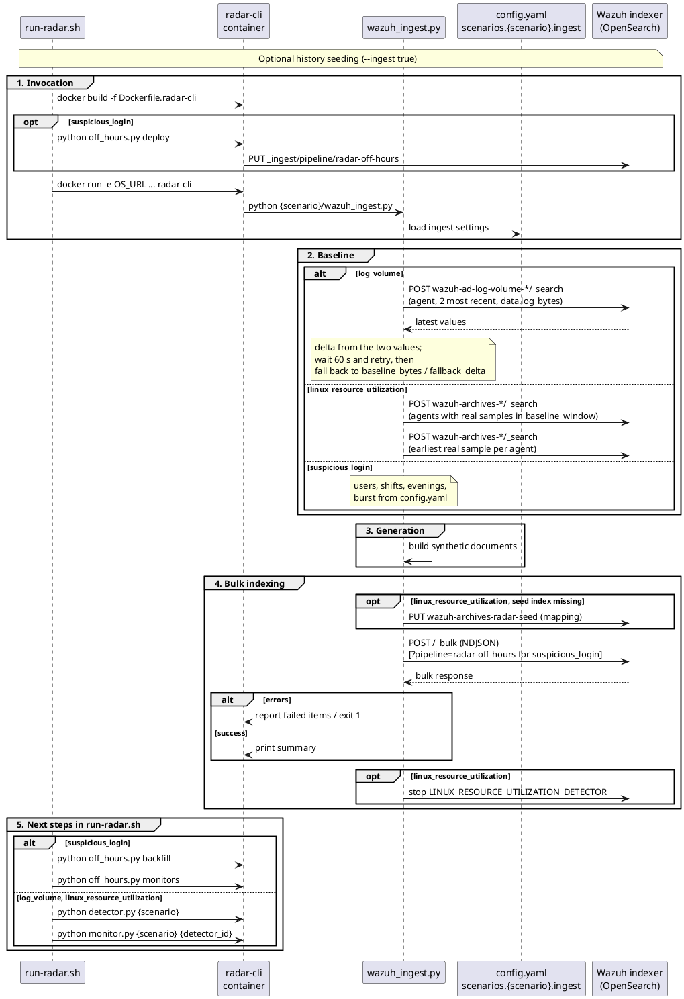

# RADAR data ingestion pipeline

This item describes how `run-radar.sh` seeds the indexer with history for the anomaly-based scenarios, through the scenario-specific `wazuh_ingest.py` scripts (SWD-033).

## Pipeline purpose

An OpenSearch RCF detector needs enough past intervals per entity before it reports anomalies, and the `suspicious_login` off-hours model mode needs weeks of per-user activity. Ingestion writes that history so a scenario can be demonstrated and tested right after deployment, without waiting for real data to accumulate. It is optional (`run-radar.sh <scenario> --ingest true`) and exists for three scenarios:

| Scenario | Target index | What is written | Shaped from |
|---|---|---|---|
| `log_volume` | `wazuh-ad-log-volume-<date>` (today) | Synthetic `log_volume_metric` samples (`data.log_bytes`) for one agent, growing linearly up to the latest real value | The agent's two most recent real samples |
| `linux_resource_utilization` | `wazuh-archives-radar-seed` | Synthetic `resource_usage_metric` samples (`data.cpu_usage_pct`, `data.mem_usage_pct`) per agent, marked `radar_seed: true`, ending where the agent's real samples begin | Agents with real samples in the configured recent window |
| `suspicious_login` | `wazuh-archives-4.x-<date>` (one index per day) | Synthetic archived activity events (`data.user`, `data.action`) per configured user, inside each user's shift, with optional evening work and one burst | The `ingest.users` list in `config.yaml` |

All parameters come from `scenarios.<scenario>.ingest` in `radar/config.yaml`; the indexer connection from `OS_URL`, `OS_USER`, `OS_PASS` and `OS_VERIFY_SSL`.

## Workflow stages

### 1. Invocation

`run-radar.sh` builds the `radar-cli` image, which contains the three ingest scripts, and runs `python <scenario>/wazuh_ingest.py` in it, passing the indexer settings as environment variables and mounting the indexer CA certificate. Ingestion runs before the detector is created; `detector.py` additionally waits briefly (about ten seconds at most) for the index pattern to have documents, because the AD plugin cannot start a detector on an empty index.

For `suspicious_login`, `off_hours.py deploy` first creates the `radar-off-hours` ingest pipeline, the synthetic events are indexed through it so they carry the off-hours flags, and `off_hours.py backfill` then flags real archived events indexed earlier.

### 2. Baseline

- **`log_volume`**: the two most recent `data.log_bytes` values of the configured agent give the latest value and the growth per step. With no real sample the script waits 60 seconds and asks again, then falls back to `baseline_bytes` and `fallback_delta` and warns that the scenario is probably not wired up. With one sample, it uses `fallback_delta`; a non-positive delta is replaced by `fallback_delta`.
- **`linux_resource_utilization`**: targets are the configured `agent_names`, or every agent with real (non-seed) samples in `baseline_window`. Each target's earliest real sample marks where the seed must end; an agent that already has `history_minutes` of history is skipped. With no target at all, the script exits with an error.
- **`suspicious_login`**: no query; the history comes entirely from configuration.

### 3. Generation

- **`log_volume`**: `history_minutes × 60 / step_seconds` points, one every `step_seconds`, rising linearly by the delta per step and ending at the latest real value, plus one point one step after now.
- **`linux_resource_utilization`**: one point every `step_seconds` from `now − history_minutes` to the agent's first real sample, CPU and memory drawn around `baseline_cpu_pct` and `baseline_mem_pct` with the configured jitter (reproducible per agent).
- **`suspicious_login`**: for each workday from `history_days` back to `future_days` ahead, between `events_per_login_min` and `events_per_login_max` events at random times within the user's shift (± `drift_minutes`), in the user's time zone; optionally evening events and a burst `days_ago` days back.

### 4. Bulk indexing

Documents are sent to the OpenSearch Bulk API (`POST /_bulk`, NDJSON): in one request for `log_volume`, in chunks for the other two (`suspicious_login` names the `radar-off-hours` pipeline when off-hours detection is enabled). `linux_resource_utilization` first creates its seed index with an explicit mapping if it does not exist.

### 5. Result

An HTTP error or a failed bulk item makes `log_volume` and `linux_resource_utilization` exit with an error; `suspicious_login` raises on HTTP errors and prints failed items. Each script prints what it indexed. `linux_resource_utilization` then stops its detector, if one exists, so that the detector re-initialises on the seeded history at its next start. There is no separate verification query and no retry.

## Data ingestion sequence

## Implementation reference

- `radar/scenarios/ingest_scripts/log_volume/wazuh_ingest.py`
- `radar/scenarios/ingest_scripts/linux_resource_utilization/wazuh_ingest.py`
- `radar/scenarios/ingest_scripts/suspicious_login/wazuh_ingest.py`
- `radar/run-radar.sh`, `radar/Dockerfile.radar-cli`

## See also

- `docs/manual/radar_docs/radar-run-ad.md` (sections "About data ingestion" and "Stage 1: Data ingestion")

Related: HARC-004, HARC-014, LARC-015.