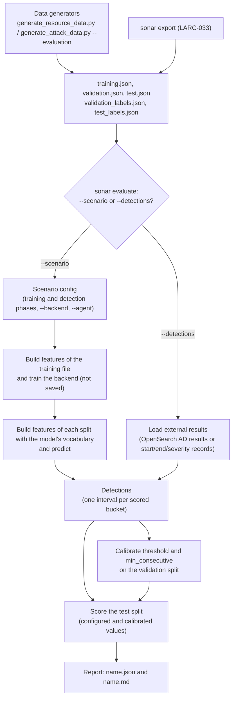

# SONAR evaluation and calibration workflow

`sonar evaluate` measures a scenario's detection quality against labelled data and calibrates its decision rule ([SRS-080](../srs/SRS-080.md)). It works offline, on alert files, and scores SONAR's own backends and the exported results of another detector with one implementation, so that the comparison is fair. This item describes the components and the order in which they run; the metric definitions and file formats are in [SWD-045](../swd/SWD-045.md).

## Workflow

## Components

| Component | Implementation | Role |
|---|---|---|
| Data generators | `sonar/test_data/generate_resource_data.py`, `sonar/test_data/generate_attack_data.py`, `sonar/test_data/labelled_splits.py` | With `--evaluation`, write a training file of normal data and a validation and a test split, each normal context followed by events injected at random, non-overlapping times, plus a label file per split; the seed (`--seed`, default 42) makes them reproducible |
| Format converter | `sonar/test_data/radar_format.py` | Rewrites the resource splits as RADAR collector events, keeping timestamps and hosts so the label files stay valid |
| Command | `sonar/cli.py` (`cmd_evaluate`, `_sonar_detections`) | Validates the inputs, runs SONAR's backend or loads external results, calibrates, scores and writes the report |
| Scenario configuration | `sonar/cli.py` (`load_scenario_for_phase`, `apply_agent`) | The same configuration path as `sonar train` and `sonar detect`: features, backend, window, `threshold`, `min_consecutive` |
| Model engine | `sonar/engine.py`, `sonar/backends/` | Trains the scenario's backend in memory, with the same pre-flight check as `sonar train`, and predicts each split |
| Evaluation | `sonar/evaluation.py` | Labels, detections, alarm grouping, metrics, calibration and the Markdown summary |
| Decision rule | `sonar/pipeline.py` (`select_anomalies`) | The rule detection applies; evaluation reuses it so an evaluated setting behaves the same in production |

## Behaviour

1. **Inputs.** Exactly one of `--scenario` (with `--train-file` and `--test-file`) and `--detections` is given; `--test-labels` is always required. Calibration needs both validation data (`--validation-file` or `--validation-detections`) and `--validation-labels`. Any other combination fails before work starts.
2. **SONAR's detections.** The backend (the scenario's, or `--backend`) is trained on the last `training.lookback_hours` of the training file; the model is not saved. Each split is scored as a whole, as in debug mode, so its first `context_buckets` buckets serve as context only; a split shorter than the backend's minimum is an error. Like debug mode, the files are not filtered by `alert_filter`; with `--agent`, only that agent's alerts are kept, and the model and report are named after it.
3. **External detections.** Results of the OpenSearch anomaly detection plugin (an anomaly when `anomaly_grade` is above 0, the grade as severity) or generic interval records are loaded; their own configured decision rule is not known, so the configured run uses no threshold and runs of one.
4. **Calibration** searches a fixed grid of thresholds and run lengths on the validation split only, choosing the best F1 within the false-alarm budget (`--max-false-alarms-per-day`, default 5). The test split is then scored with the configured and with the calibrated values; the test precision of the calibrated values is the scenario's `anomaly_confidence`.
5. **Output.** `<name>.json` (the full record) and `<name>.md` (a summary, also printed) are written to `--output-dir`; `<name>` defaults to `<scenario_id>-<backend>`. Exit status 0 on success, 1 on any error, including too little training data.

Recorded reports of the shipped scenarios are kept as test evidence in `docs/specs/trp/assets/sonar-evaluation/`.

## Design constraints

- **One scoring path.** SONAR's verdicts and external results become the same interval type and go through the same scoring function; there is no SONAR-only path.
- **No calibration on the test split.** Values are chosen on the validation split and reported on the test split, so the reported precision is not fitted to the data it is measured on.
- **No network.** Evaluation reads local files only; live data reaches it through `sonar export` ([LARC-033](LARC-033.md)).

See: docs/manual/sonar_docs/evaluation-guide.md