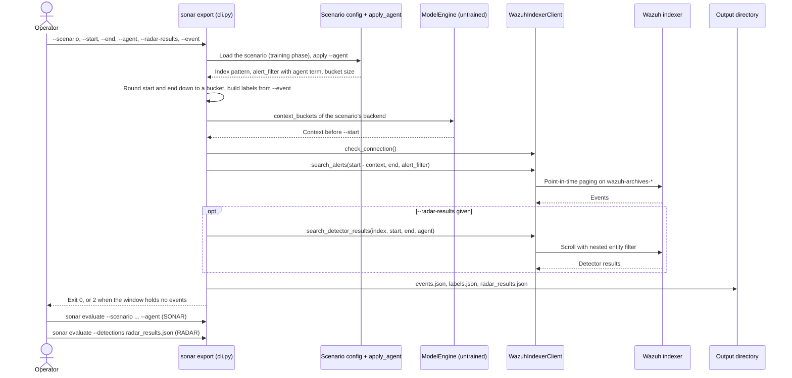

# SONAR export and RADAR comparison workflow

SONAR and RADAR's `linux_resource_utilization` detector are compared on the same events, features and labelled anomalies ([SRS-081](../srs/SRS-081.md)). The packaged scenario `sonar/scenarios/radar_linux_resource_utilization.yaml` reads RADAR's collector events; `--agent` gives one model per host, as RADAR's detector has; `sonar export` takes a labelled window and RADAR's results out of a live indexer; `sonar evaluate` ([LARC-032](LARC-032.md)) scores both detectors.

## Workflow

## Components

| Component | Implementation | Role |
|---|---|---|
| Comparison scenario | `sonar/scenarios/radar_linux_resource_utilization.yaml` | RADAR's index (`wazuh-archives-*`), filter (events with `data.mem_usage_pct`, without `radar_seed: true` documents), one-minute interval, zero fill and the mean and maximum of `data.cpu_usage_pct` and `data.mem_usage_pct`, as in `radar/config.yaml` |
| String metrics | `sonar/features.py` | RADAR's decoder stores the metrics as strings; the feature builder parses them as numbers |
| Per-host restriction | `sonar/cli.py` (`apply_agent`) | Adds an `agent.name` term to `alert_filter` and suffixes the model name and an explicit scenario ID with the agent; applied the same way by `train`, `detect`, `scenario`, `evaluate` and `export`, after the scenario and any `--model-name` |
| Export | `sonar/cli.py` (`cmd_export`, `_export_labels`) | Writes the window's events with their context, the label file and RADAR's results |
| Indexer reads | `sonar/wazuh_client.py` (`search_alerts`, `search_detector_results`) | Events through a point-in-time ([SRS-086](../srs/SRS-086.md)); RADAR's results through a scroll |
| Evaluation | `sonar/evaluation.py` (`load_external_detections`, `score`) | Reads RADAR's results as detections and scores both detectors with the same function |
| Debug data | `sonar/test_data/radar_format.py`, `sonar/test_data/radar_resource_utilization/` | The synthetic resource data rewritten as RADAR events, for debug runs and calibration |

## Behaviour

1. **Window.** `--start` and `--end` (ISO 8601, UTC without an offset) are rounded down to a bucket; the window must span at least one bucket. Each `--event TYPE,START,END` must overlap the window; a malformed or outside event fails before the indexer is contacted.
2. **Context.** Events are exported from the context before `--start`, so that SONAR gives a verdict for every bucket of the window. The context is the number of buckets the scenario's backend needs before its first verdict, taken from an untrained engine with the scenario's settings (119 one-minute buckets for MVAD with `sliding_window: 120`), or `--context-minutes`.
3. **Events.** Whole documents are exported, not only the fields the features read, through the scenario's index, `alert_filter` and agent term.
4. **RADAR's results.** With `--radar-results <index pattern>`, the plugin's results whose interval starts in the window are read through a scroll: results of several hosts share a start time and the result index has no keyword tiebreaker for point-in-time paging. With `--agent`, a nested query on the plugin's `entity` list (`name` `agent.name`, `value` the agent) keeps that host's results. At most `wazuh.max_alerts` results are kept.
5. **Files.** `events.json` (a JSON array), `labels.json` (`sonar-labels/1`, span = the window) and, with `--radar-results`, `radar_results.json`. Exit status 0 on success, 2 when the window holds no events (wrong index, filter or agent), 1 on error.
6. **Scoring.** `sonar evaluate --scenario radar_linux_resource_utilization --agent <host>` trains on an exported training window and scores the test window; `sonar evaluate --detections radar_results.json` scores RADAR's results on the same labels. RADAR's result counts as an anomaly when its `anomaly_grade` is above 0.

## Design constraints

- **Same inputs, different detectors.** The scenario's features, interval and empty-bucket handling copy RADAR's; changing one side without the other makes the comparison measure the inputs rather than the detectors.
- **No seeded history.** RADAR seeds a flat synthetic history into `wazuh-archives-radar-seed`, which matches the scenario's index pattern; SONAR excludes it so it never learns a host that did not exist.
- **One model per host.** A host's model stores its agent filter, so detection with that model reads only that host; each host has its own scenario ID, and therefore its own watermarks, data stream and anomaly identifiers.

See: docs/manual/sonar_docs/radar-comparison-guide.md