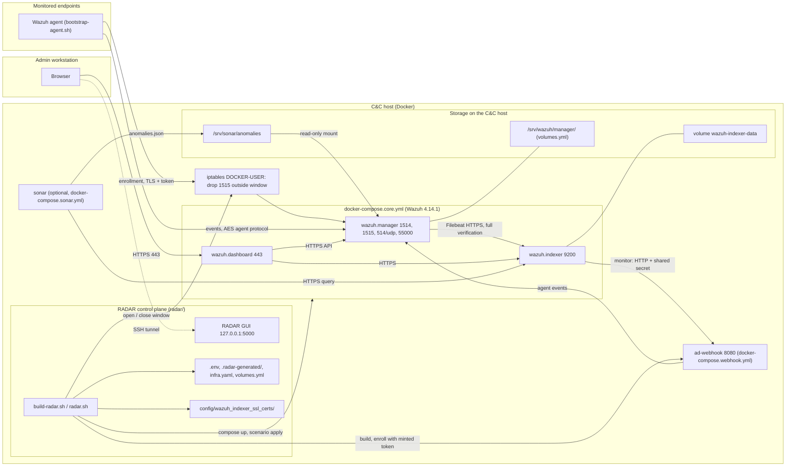

# C&C server deployment architecture

This item describes how the command-and-control (C&C) server of IDPS-ESCAPE is deployed on one Docker host by RADAR: the containers, their ports and storage, the credentials and certificates they share, and the order in which `radar/build-radar.sh` brings them up. It implements SRS-001 (centralized C&C deployment), SRS-004 (agent management), SRS-011 and SRS-012 (event visualization in the dashboard), SRS-013 (agent status panel), SRS-016 (indexer credentials), SRS-024 (event querying through the indexer and Wazuh API), SRS-044 (platform-independent, containerised deployment), SRS-083 (component channels), SRS-084 (storage on the C&C host) and SRS-085 (fleet monitoring).

## Deployment view

## Containers

| Container | Defined in | Image | Published ports | Role |
|---|---|---|---|---|
| `wazuh.manager` | `radar/docker-compose.core.yml` | `wazuh/wazuh-manager:4.14.1` | 1514/tcp, 1515/tcp, 514/udp, 55000/tcp | Agent events and enrollment, syslog, Wazuh API; Filebeat ships alerts and archives to the indexer |
| `wazuh.indexer` | `radar/docker-compose.core.yml` | `wazuh/wazuh-indexer:4.14.1` | 9200/tcp | OpenSearch storage, anomaly detectors and alerting monitors |
| `wazuh.dashboard` | `radar/docker-compose.core.yml` | `wazuh/wazuh-dashboard:4.14.1` | 443/tcp (container 5601) | Web interface for analysts |
| `ad-webhook` | `radar/docker-compose.webhook.yml` | built from `radar/webhook/` | 8080/tcp (`WEBHOOK_INTERNAL_PORT`) | Receives indexer monitor notifications and forwards them to the manager through its own Wazuh agent |
| `sonar` (optional) | `sonar/wazuh/docker-compose.sonar.yml` | `sonar:v0.8` | none | SONAR real-time scenario; reads alerts from the indexer and writes anomalies to a directory the manager reads |

The indexer and Wazuh API ports are published on `RADAR_MGMT_BIND_ADDRESS` and the webhook on `WEBHOOK_BIND_ADDRESS` (both `0.0.0.0` by default, see `radar/env.example`). The RADAR GUI (`radar/gui/`) is not a container of the stack; it listens on `127.0.0.1:5000` and is reached through an SSH tunnel. The recommended host firewall rules for each port are listed in `radar/README.md` ("Security assumptions and recommendations").

The webhook is built only when a scenario is deployed; `build-radar.sh --core-only` brings up the three core containers alone. SONAR is not started by `build-radar.sh`; it is added as a compose overlay or started with `sonar/sonar.sh`.

## Configuration, credentials and certificates

All files are relative to `radar/`.

| Item | Content | Produced by |
|---|---|---|
| `.env` | Addresses, users and passwords of the indexer, dashboard and Wazuh API, webhook secret, cluster key, SMTP, DECIPHER and MaxMind settings (template: `env.example`) | Operator; passwords, `WEBHOOK_SHARED_SECRET` and `WAZUH_CLUSTER_KEY` are generated when empty |
| `.radar-generated/internal_users.yml` | Password hashes of the indexer users `admin` and `kibanaserver`, mounted into the indexer | `wazuh_api/credentials.py` |
| `.radar-generated/wazuh.yml` | Wazuh API host and credentials, mounted into the dashboard | `wazuh_api/credentials.py` |
| `config/wazuh_indexer_ssl_certs/` | Root CA and certificates of the indexer, manager (Filebeat), dashboard and indexer admin | `radar_deploy/manager-ensure-certs.sh` (`wazuh/wazuh-certs-generator:0.0.2`, from `config/certs.yml`) |
| `volumes.yml` | Host bind mounts of each manager container (by default under `/srv/wazuh/manager/`) | Shipped; edited for an existing installation |
| `infra.yaml` | Registered manager and indexer nodes (primary first) and the dashboard, with container names, hosts, ports and schemes | `wazuh_api/infra.py`, RADAR GUI Infrastructure page |
| `.radar-state/` | Enrollment token expiry, backup of `.env` before a credential rotation | `radar_deploy/manager-mint-token.sh`, `wazuh_api/credentials.py` |
| `fleet.yaml` | Agents assigned to scenario groups, with IDs, groups and last action | `wazuh_api/fleet.py` |

The core compose file refuses to start when `OS_PASS`, `WAZUH_AUTH_PASS` or `INDEXER_DASHBOARD_PASSWORD` is unset, so the stack never runs with an empty password. `credentials.py` generates the passwords only for a fresh deployment, detected by the absence of the `wazuh-indexer-data` volume; on an existing deployment it leaves them unchanged and warns if stock Wazuh passwords are still in use. `radar.sh rotate-credentials` (`radar_deploy/manager-rotate-credentials.sh`) replaces them later.

## Build sequence

`build-radar.sh <scenario>` or `build-radar.sh --core-only`:

1. Loads `.env`, and stops if it is missing.
2. If the manager container is not running:
   1. creates the certificates if none exist (`manager-ensure-certs.sh`);
   2. generates missing credentials and writes `.radar-generated/` (`python3 -m wazuh_api.credentials ensure`);
   3. derives a compose overlay from `volumes.yml` for the services of the core compose file (`python3 -m wazuh_api.cli core-volumes-overlay`), creates the missing host directories with mode `0750`, and seeds the archives ingest pipeline file;
   4. runs `docker compose -f docker-compose.core.yml -f - up -d` with that overlay.

   If the manager is already running, it only revokes an expired enrollment token.
3. Registers the RADAR-built components in `infra.yaml`.
4. For a scenario: generates `WEBHOOK_SHARED_SECRET` if empty, resolves the manager address the webhook enrolls against, mints a 60-minute enrollment token unless the webhook is already enrolled, and builds and starts the webhook.
5. Waits for the Wazuh API, then hardens enrollment (`radar_deploy/manager-harden-enrollment.sh`): password-only enrollment, no purge of agent keys, the cluster key set from `.env` or generated, and the `DOCKER-USER` rule that drops traffic to port 1515 put back in place (`radar_deploy/manager-enrollment-window.sh close`, when run as root).
6. With `--core-only`, stops here. Otherwise it applies the scenario to every registered manager node (`radar_deploy/manager-apply-scenario-all.sh`) and deploys the scenario's agent-group configuration, decoders, rules and lists through the Wazuh API.

## Agent management

Endpoints are onboarded with `radar/radar-agent/bootstrap-agent.sh` and a token minted on the C&C host (`radar.sh mint-token`, i.e. `radar_deploy/manager-mint-token.sh`), which also opens the enrollment window for the token's lifetime. Scenario groups are assigned with `radar_deploy/manager-assign-agent-group.sh` or `python3 -m wazuh_api.cli assign-hosts-to-groups`, which records the result in `fleet.yaml`; groups are removed with `manager-unassign-agent-group.sh` and agents deleted from the manager with `manager-deregister-agent.sh`. The same operations are available in the RADAR GUI.

## Existing Wazuh installation

When RADAR is attached to an existing Wazuh installation, no core containers are created and no passwords are generated: the operator registers the existing manager nodes, indexer and dashboard in `infra.yaml`, enters their credentials in `.env`, and maps each manager's bind mounts in `volumes.yml`. Manager-side files are then written through those host paths and `docker exec`, so RADAR runs on the host of the manager containers. See: `docs/manual/radar_docs/radar-getting-started.md#working-with-an-existing-wazuh-installation`.

## See also

- `docs/manual/radar_docs/radar-getting-started.md`
- `docs/manual/radar_docs/radar-operations.md`
- `radar/README.md` ("Security assumptions and recommendations")