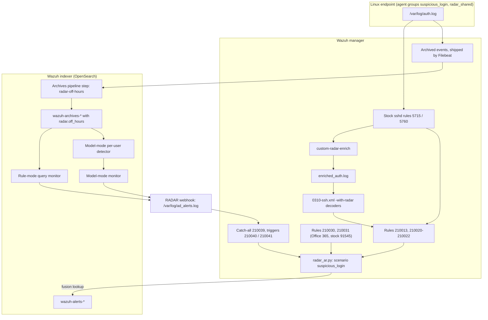

# RADAR suspicious login flow: signature, off-hours and fusion

This item describes how the `suspicious_login` scenario turns authentication events into RADAR decisions along two independent paths, signature rules on enriched authentication lines (SRS-051) and off-hours activity against declared working hours (SRS-062), and how the active response fuses the two for the same user (SRS-061 requirement 7).

## Flow diagram

## Signature path

1. **Collection.** The `radar_shared` agent group, assigned with `suspicious_login` (and `geoip_detection`), reads `/var/log/auth.log` as syslog (`radar/scenarios/agent_configs/_shared/radar-shared-auth-log-agent-snippet.xml`). The `suspicious_login` group itself adds nothing.
2. **First pass.** The stock rules 5715 (success) and 5760 (failure) classify the line into `authentication_success` / `authentication_failed`. These groups trigger the `custom-radar-enrich` integration, and the manager reads its output file back as a `localfile` (`radar/scenarios/ossec/radar-shared-auth-log-ossec-snippet.xml`).
3. **Enrichment** (LARC-025, SRS-068). The integration appends GeoIP, ASN, geo-velocity, country-change and ASN-novelty fields, computed against the user's history kept on the manager, and writes the line to `/var/ossec/logs/radar/enriched_auth.log`.
4. **Second pass.** The `-with-radar` decoders of `radar/scenarios/decoders/suspicious_login/0310-ssh.xml`, which replace the stock `0310-ssh_decoders.xml` (`decoder_exclude`), extract the `radar_*` fields.
5. **Rules** (`radar/scenarios/rules/suspicious_login/a3-suspicious-login.xml`): failed-login burst 210013 (repeated 5760, same user), impossible travel 210020 / 210021 (`radar_geo_velocity_kmh` above 900), credential compromise 210022 (210021 after repeated failures of the same user). Office 365 failures (stock 91545) give 210030 and the burst 210031; RADAR does not configure the Office 365 module.

## Off-hours path

All of it is managed by `radar/anomaly_detector/off_hours.py` from the block `scenarios.suspicious_login.off_hours` of `radar/config.yaml`; `radar/run-radar.sh suspicious_login` runs its `deploy`, `backfill` and `monitors` commands.

1. **Marking.** `off_hours.py deploy` creates the ingest pipeline `radar-off-hours` (a Painless script rendered from the declared schedule groups) and the legacy index template `radar-off-hours` (mappings only). At scenario deployment `radar/radar_deploy/manager-apply-scenario.sh` adds a step that calls the pipeline to the Filebeat archives pipeline (`radar/scenarios/pipelines/suspicious_login/radar-off-hours-step.json`, with `ignore_failure`), so that no archived event is lost if the pipeline is missing. Each archived event of an evaluated user gets `radar.user`, `radar.schedule_group` and `radar.off_hours` (0 or 1), or `radar.off_hours_error` when its time cannot be read.
2. **History.** `off_hours.py backfill` marks archived events of the last `backfill_days` (45) that carry no flag yet. The optional synthetic history (`run-radar.sh suspicious_login --ingest true`, LARC-027) is indexed through the same pipeline.
3. **Rule mode** (groups with `mode: rule`). The query monitor `SuspiciousLogin-OffHours-RuleMode-Monitor` runs every `rule_mode.interval_minutes`. Its query keeps the users with at least `min_events` off-hours events in the interval and none in the preceding quiet period, so a burst is reported once. The trigger `SuspiciousLogin-OffHours-Rule-Detected` posts one entry per user with the configured fixed grade and confidence, the event count and the schedule group.
4. **Model mode** (groups with `mode: model`). The detector `SUSPICIOUS_LOGIN_OFF_HOURS_DETECTOR` learns, per `radar.user`, the sum of `radar.off_hours` per interval, without imputation of empty intervals. Its monitor `SuspiciousLogin-OffHours-ModelMode-Monitor` reports up to `max_entities` users whose grade and confidence reach the thresholds and whose interval count is at least `min_events`, with trigger `SuspiciousLogin-OffHour-Detected`.
5. **Replacement of the previous design.** `off_hours.py monitors` stops the former time-of-day detectors and disables their monitors without deleting them, and updates or removes the off-hours monitors and detector in place when the configuration changes.
6. **Relay.** Both monitors post to the RADAR webhook (SRS-089). The catch-all 210039 (or another AD scenario's catch-all) tags the line `radar_ad_received`, and the trigger names select 210041 (rule mode) or 210040 (model mode), with the user as `entity_keyword`.

## Active response and fusion

The manager runs `radar_ar.py` for rules 210013, 210020, 210021, 210022, 210030, 210031, 210040 and 210041 (`radar/scenarios/ossec/radar-suspicious-login-ossec-snippet.xml`). `ar.yaml` maps the signature rules to `signature.rule_ids` and 210040 / 210041 to `ad.rule_ids`.

- **Origin check**: an anomaly alert not read by the webhook agent from its own log is dropped (SRS-089).
- **Context**: a signature alert's context is the alert agent's events in the last `delta_signature_minutes`; an anomaly alert's context is the named user's events on any agent in the last `delta_ad_minutes` (`SuspiciousLogin` in `radar/scenarios/active_responses/radar_ar.py`).
- **CTI**: the DECIPHER `suspicious_login` analysis endpoint receives the alert's user (else the anomalous user, else the first user in the context), host and source IPs.
- **Fusion** (`FusionCorrelator`): on every alert, one backward search of `wazuh-alerts-*` for alerts of the other detection type on the same user (`data.entity_keyword` on the anomaly side; `data.dstuser`, `data.srcuser`, `data.user`, `data.username` on the signature side) within `window_minutes` (30), widened by `ad_lead_minutes` (10) before the anomaly's data window. The strongest counterpart, discounted linearly by its time gap, supplies the missing $A$ or $S$ term; only trusted anomaly alerts count. Nothing waits for a counterpart, and without one the score is that of the alert alone.
- **Risk and tiers**: $R = 0.3 A + 0.4 S + 0.3 T$, tiers 0.15 / 0.33 / 0.55. A signature alert alone stays below Tier 3.
- **Mitigation** (with `allow_mitigation`): Tier 2 `firewall-drop` of the triggering alert's source IP; Tier 3 adds `lock_user_linux.sh` for the triggering alert's own users, never `root` or a protected user. Fused counterparts never supply targets, so an anomaly alert blocks or locks nothing.

## Implementation reference

- `radar/scenarios/rules/suspicious_login/a3-suspicious-login.xml`, `radar/scenarios/decoders/suspicious_login/`
- `radar/manager-enrichment/` (enrichment, LARC-025)
- `radar/anomaly_detector/off_hours.py`, `radar/scenarios/pipelines/suspicious_login/radar-off-hours-step.json`
- `radar/scenarios/active_responses/radar_ar.py`, `radar/scenarios/active_responses/ar.yaml`

## See also

- docs/manual/radar_docs/radar-scenarios/suspicious_login_explained.md
- docs/manual/radar_docs/radar-scenarios/off-hours-activity.md