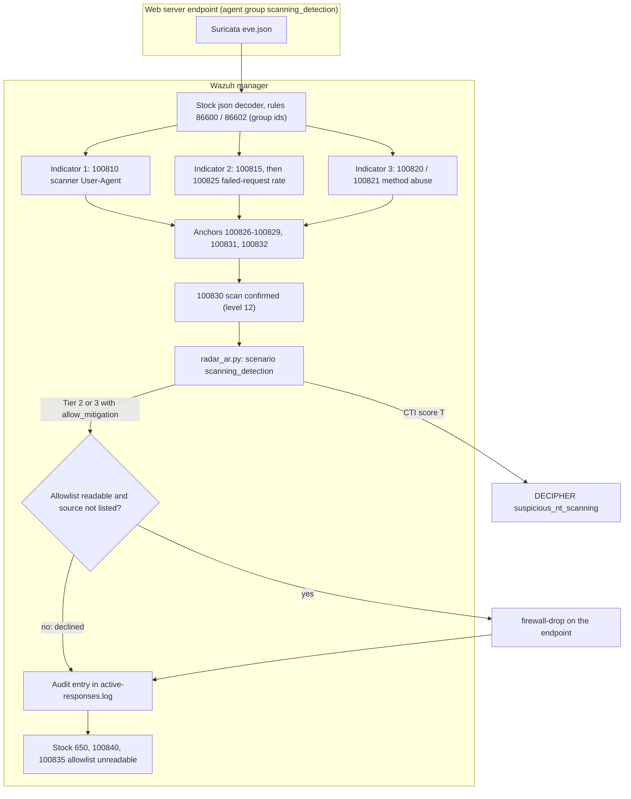

# RADAR scanning detection flow

This item describes the end-to-end flow of the `scanning_detection` scenario (SRS-066): Suricata HTTP events from a monitored web server are evaluated by three independent indicator rules, two agreeing indicators on the same source confirm a scan, and only the confirmation reaches the RADAR active response, which applies its allowlist before any mitigation. The scenario is signature-only: it has no anomaly detector and uses no enrichment integration.

## Flow diagram

## Flow stages

### 1. Collection on the endpoint

The `scanning_detection` agent group reads Suricata's `/var/log/suricata/eve.json` as JSON (`radar/scenarios/agent_configs/scanning_detection/radar-scanning-detection-agent-snippet.xml`). Suricata must already run on the monitored host and log HTTP events; RADAR does not install it. The same snippet also collects the Apache and Nginx access logs, but no rule of this scenario reads them.

### 2. Base classification

The stock JSON decoder and Suricata rules (86600, 86602 for `event_type` `http`) place each event in the group `ids`, with the HTTP fields (`http.http_user_agent`, `http.status`, `http.http_method`, `http.hostname`, `http.url`) and the source address `src_ip`. The scenario ships no decoder.

### 3. Indicators

In `radar/scenarios/rules/scanning_detection/a4-scanning-detection.xml`, every indicator attaches to `ids`:

- **Indicator 1**: 100810 (level 3), User-Agent of a known scanning tool.
- **Indicator 2**: 100815 (level 3) records each 401/403/404 response; 100825 (level 10) fires on 20 of them from the same `src_ip` within 70 seconds.
- **Indicator 3**: 100820 (level 6) for TRACE, TRACK and CONNECT; 100821 (level 6) for WebDAV methods on a virtual host not listed in the CDB list `radar_webdav_apps`.

Indicators set the groups `radar_ind_ua`, `radar_ind_rate` and `radar_ind_method`.

### 4. Confirmation

Six level-3 anchor rules (100826–100829, 100831, 100832) each fire on one indicator when a different indicator matched the same `src_ip` in the previous 300 seconds. **100830** (level 12) is the child of all six. Repetition of a single indicator never satisfies an anchor.

### 5. Response binding

Only 100830 is bound to the active response: the command `radar_ar_scanning` (`radar_ar.py`) runs on the manager (`radar/scenarios/ossec/radar-scanning-detection-ossec-snippet.xml`), and `ar.yaml` lists 100830 as the only `signature.rule_ids` of `scanning_detection`. The indicator and anchor rules only alert.

### 6. Decision in `radar_ar.py` (LARC-026)

- **Context**: the alert agent's events in the last `delta_signature_minutes` (5).
- **Source address** (`ScanningDetection`): `src_ip`; the `X-Forwarded-For` value is used instead only when `src_ip` is a configured `trusted_proxies` address, taking the last hop that is not itself a trusted proxy.
- **CTI**: the DECIPHER `suspicious_nt_scanning` analysis endpoint receives the source IPs, URIs, methods, User-Agents, target host and the chain of rules that fired in the context.
- **Risk**: $R = 0.7 \cdot (0.9 \times 0.6) + 0.3 \cdot T = 0.378 + 0.3\,T$; Tier 2 without CTI, Tier 3 only with $T \ge 0.94$ (tiers 0.0 / 0.33 / 0.66).
- **Notification**: Tier 1 and above send the email and, when DECIPHER is reachable, create a Flowintel case.

### 7. Allowlist and mitigation

- `firewall-drop` of the source address is planned for Tiers 2 and 3 and runs only with `allow_mitigation: true` (false as shipped), never against a `never_block`, loopback, link-local or manager address.
- Before dispatching, `AllowlistGuard` reads `etc/lists/radar_scanning_allowlist` (`allowlist_file`). A listed source is declined (`reason: allowlist`); an unreadable list declines too (`reason: allowlist_unreadable`), failing closed. Detection rules do not consult the allowlist, so an allowlisted source still alerts.
- Because the scenario sets `allowlist_file`, `AuditLog` writes one JSON entry per action outcome (executed, declined with reason, or nothing planned) to `/var/ossec/logs/active-responses.log`, in the format of native active responses. The stock rule 650 decodes it, 100840 selects RADAR entries, and 100835 (level 12) raises an operational alert for `allowlist_unreadable`.

## Configuration

- `ar.yaml`, `scanning_detection`: `w_sig` 0.7, `w_cti` 0.3, `signature_impact` 0.6, `signature_likelihood` 0.9 for 100830, `mitigations_tier2` / `mitigations_tier3` `[firewall-drop]`, `allowlist_file`, `trusted_proxies: []`, `allow_mitigation: false`.
- CDB lists in `radar/scenarios/lists/scanning_detection/`: `radar_webdav_apps` (rules) and `radar_scanning_allowlist` (active response only), deployed to `etc/lists/` and declared in `ossec.conf`.

## Implementation reference

- `radar/scenarios/rules/scanning_detection/a4-scanning-detection.xml`
- `radar/scenarios/active_responses/radar_ar.py` (`ScanningDetection`, `AllowlistGuard`, `AuditLog`), `radar/scenarios/active_responses/ar.yaml`
- `radar/radar-test-framework/simulate/scenarios/scanning_detection.py` (simulation)

## See also

- docs/manual/radar_docs/radar-scenarios/scanning_detection_explained.md