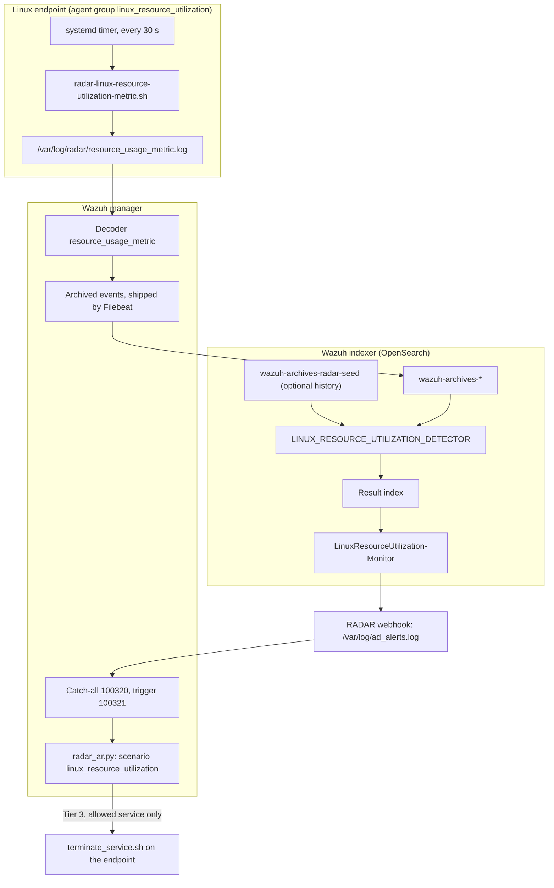

# RADAR Linux resource utilization flow

This item describes the end-to-end flow of the `linux_resource_utilization` scenario (SRS-071): CPU and memory utilization measured on each Linux endpoint, scored by an OpenSearch RCF detector against that endpoint's own history, relayed as an anomaly alert to Wazuh, and decided by the RADAR active response. It shares the anomaly path (LARC-022, LARC-023) and the context handling of `log_volume` (LARC-029).

## Flow diagram



## Flow stages

### 1. Collection on the endpoint

`bootstrap-agent.sh`, run with the group `linux_resource_utilization`, installs the collector of `radar/radar-agent/collectors/linux_resource_utilization/`: a systemd service and timer that run the metric script every 30 seconds, and a logrotate rule (daily, 7 compressed files). Each run computes CPU utilization from two `/proc/stat` samples one second apart and memory utilization from `/proc/meminfo`, and appends one line:

```
Nov 23 10:15:02 web01 resource_usage_metric: cpu=12.40 mem=71.85
```

The agent group's configuration reads `/var/log/radar/resource_usage_metric.log` as syslog (`radar/scenarios/agent_configs/linux_resource_utilization/`).

### 2. Decoding and indexing

The decoders of `radar/scenarios/decoders/linux_resource_utilization/0001-linux-resource-utilization.xml` extract `data.cpu_usage_pct` and `data.mem_usage_pct` as strings. No rule fires on these events: they reach the indexer as archived events (`logall_json`, enabled by every scenario deployment) through the stock Filebeat archives pipeline, in the daily `wazuh-archives-4.x-*` indices. The scenario has no ingest pipeline or index template of its own.

### 3. Optional history seeding (LARC-027)

`run-radar.sh linux_resource_utilization --ingest true` runs `radar/scenarios/ingest_scripts/linux_resource_utilization/wazuh_ingest.py`. It writes synthetic samples marked `radar_seed: true` to `wazuh-archives-radar-seed`, ending where each agent's real samples begin, then stops the detector so that it re-initialises on the seeded history at its next start.

### 4. Detector (LARC-022)

`radar/anomaly_detector/detector.py` creates and starts `LINUX_RESOURCE_UTILIZATION_DETECTOR` from `scenarios.linux_resource_utilization` in `radar/config.yaml`: index pattern `wazuh-archives-*`, filter on events that have `data.mem_usage_pct`, category field `agent.name`, four features (average and maximum of CPU and of memory, Painless scripts that parse the string values), zero imputation, shingle size 8, interval 1 minute, window delay 1 minute. Results go to `opensearch-ad-plugin-result-linux-resource-utilization`.

### 5. Monitor and webhook (LARC-023, SRS-089)

`radar/anomaly_detector/monitor.py` creates `LinuxResourceUtilization-Monitor`, run every detector interval. It reports up to `monitor_max_entities` (default 5) agents whose grade and confidence reach 0.01 / 0.01, with the trigger `LinuxResourceUtilization-Anomaly-Detected`. The webhook writes one line per agent to `/var/log/ad_alerts.log`, and the webhook container's agent forwards it.

### 6. Wazuh rules

In `radar/scenarios/rules/linux_resource_utilization/a5-linux-resource-utilization.xml`, the catch-all **100320** (level 5) matches any line decoded by `opensearch_ad` and sets the group `radar_ad_received`. **100321** (level 12) matches the trigger name with `if_group radar_ad_received`, so it fires even when another AD scenario's catch-all (100300 or 210039) matched first. Only 100321 is bound to the active response (`radar/scenarios/ossec/radar-linux-resource-utilization-ossec-snippet.xml`, command `radar_ar_linux_resource_utilization` on the manager).

### 7. Active response (LARC-026)

- **Origin check**: an alert of 100321 not read by the webhook agent from its own log is dropped.
- **Context** (`LinuxResourceUtilization`, which inherits `LogVolume` in `radar/scenarios/active_responses/radar_ar.py`): the anomalous agent (`entity_keyword`) is the effective agent; the window is the monitor period, ending no later than the alert and at most `delta_ad_minutes` (10) long.
- **Risk**: $A$ = grade × confidence, $R = 0.9\,A + 0.1\,T$; there is no DECIPHER analysis endpoint for this scenario, so $T = 0$ and $R \le 0.9$. Tiers 0.0 / 0.33 / 0.66.
- **Actions**: Tier 1 and above send the email and, when DECIPHER is reachable, create a Flowintel case. Tier 3 plans `terminate_service.sh`, which runs only with `allow_mitigation: true` (shipped) and only for a service found in the context that is listed both in the scenario's `terminable_services` (none configured as shipped) and in the agent's own allowlist. An anomaly alert carries no source IP, so without such a service nothing is terminated.
- **Audit**: the decision is recorded in `/var/ossec/logs/active-responses.log` (SRS-061).

## Implementation reference

- `radar/radar-agent/collectors/linux_resource_utilization/`, `radar/radar-agent/bootstrap-agent.sh`
- `radar/scenarios/decoders/linux_resource_utilization/`, `radar/scenarios/rules/linux_resource_utilization/`
- `radar/anomaly_detector/detector.py`, `radar/anomaly_detector/monitor.py`, `radar/webhook/ad_alerts_webhook.py`
- `radar/scenarios/active_responses/radar_ar.py`, `radar/scenarios/active_responses/ar.yaml`
- `radar/radar-test-framework/simulate/scenarios/linux_resource_utilization.sh` (load simulation)

## See also

- docs/manual/radar_docs/radar-scenarios/linux_resource_utilization_explained.md