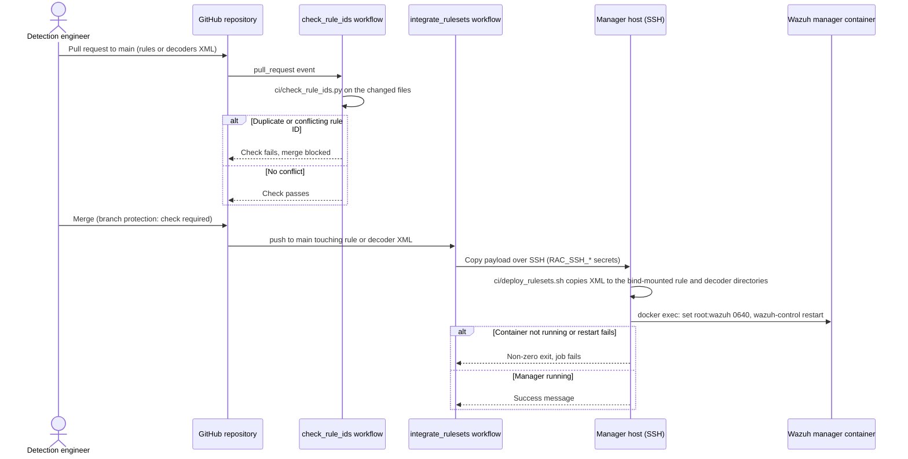

# RADAR ruleset-as-code pipeline

> **Status: planned.** Not implemented as of v2.2.0. This item specifies intended behaviour; no code implements it yet.

This item describes the intended pipeline of SRS-065: changes to RADAR's Wazuh rule and decoder files are proposed by pull request, checked automatically for rule ID conflicts, and, once merged, applied to the Wazuh manager by a CI job without an interactive session on the RADAR host. None of the workflows, scripts or secrets named below exists in the repository: there is no `ci/` directory, and the only GitHub Actions workflow (`.github/workflows/tests.yml`) runs the repository-level test suite.

## Intended pipeline

## Stages

1. **Scope.** The pipeline covers the XML rule files under `radar/scenarios/rules/<scenario>/` and the XML decoder files under `radar/scenarios/decoders/<scenario>/`. It is a second path for day-to-day rule and decoder changes; full scenario rollouts, CDB lists, `ossec.conf` blocks, agent groups and the rest of a deployment stay with the existing scenario deployment.
2. **Validation on pull request.** A workflow triggered by pull requests to `main` runs `ci/check_rule_ids.py` as its only validation step. It fails when a changed file defines the same rule ID twice, when a new file reuses a rule ID that exists anywhere on `main`, or when a modified file introduces a rule ID that exists in another file on `main`. It passes when no rule file changed.
3. **Merge gate.** Branch protection on `main` forbids direct pushes and requires the `check_rule_ids` status.
4. **Deployment on merge.** A workflow (`integrate_rulesets`) runs only when a merge changes a rule or decoder XML. It copies the changed files to the manager host over SSH, using the repository secrets `RAC_SSH_HOST`, `RAC_SSH_USER`, `RAC_SSH_PORT`, `RAC_SSH_KEY`, `RAC_MGR_CONTAINER`, `RAC_HOST_RULES_DIR` and `RAC_HOST_DECODERS_DIR`.
5. **Apply on the host.** `ci/deploy_rulesets.sh` aborts if the manager container is not running; otherwise it copies rules and decoders to the host directories bind-mounted at `/var/ossec/etc/rules` and `/var/ossec/etc/decoders`, sets `root:wazuh` and `0640` inside the container, restarts the manager with `wazuh-control restart` through `docker exec`, and reports success or fails the job with a non-zero exit.

## Relation to the current implementation

The existing scenario deployment, which the pipeline is to complement, already provides the building blocks for applying rule files to a running manager, through the Wazuh server API rather than through the host's Docker daemon:

- `radar/wazuh_api/ruleset.py` uploads a rule, decoder or CDB list file (`PUT /rules/files/{name}`, `/decoders/files/{name}`, `/lists/files/{name}` with `overwrite=true`) only when its content differs from the manager's copy, and deletes such files.
- `deploy_ruleset_files` in `radar/wazuh_api/scenario_ops.py` uploads a scenario's decoders, rules and lists, together with the `default` rules, after refusing a scenario whose rules reference a CDB list that has no source file.
- `restart_manager_or_cluster` in `radar/wazuh_api/manager_config.py` restarts the manager, or every cluster node, through the API. The same module can query the manager's configuration validation endpoint, which the deployment does not call today.
- The rule ID ranges each scenario uses are documented in SWD-034; no tool checks them for conflicts.

## Implementation reference

None yet. Foundations: `radar/wazuh_api/ruleset.py`, `radar/wazuh_api/scenario_ops.py`, `radar/wazuh_api/manager_config.py` (deployment control plane, SWD-042).