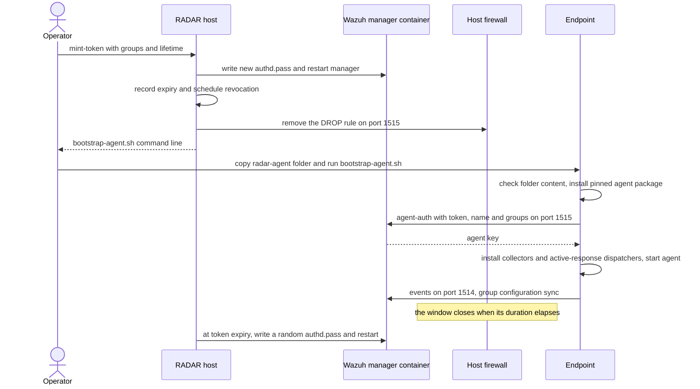

# RADAR endpoint onboarding and agent lifecycle flow

This item describes how a Linux endpoint joins a RADAR deployment, changes scenario groups, and leaves it again. Manager-side steps run on the RADAR host, from the command line (`radar/radar.sh`, `radar/radar_deploy/`) or from the GUI's Deployment page, which runs the same scripts (LARC-040). Endpoint-side steps run on the endpoint itself, from a copy of the `radar/radar-agent/` folder. The RADAR host never connects to an endpoint: enrollment is initiated by the endpoint, and every later configuration change reaches it through its Wazuh agent groups (SRS-069).

The enrollment controls and the token lifecycle are designed in SWD-049, the endpoint package in SWD-048, and the API calls for groups and agents in SWD-047.

## Lifecycle stages

| Stage | Runs on | Command line | GUI (Deployment page) | Effect |
|---|---|---|---|---|
| Harden enrollment | RADAR host | `radar_deploy/manager-harden-enrollment.sh`, run by every `build-radar.sh` | every Build | Manager requires an enrollment password (`use_password=yes`), refuses duplicate names (`purge=no`), cluster key set, port 1515 closed |
| Mint token | RADAR host | `sudo ./radar.sh mint-token <group>[,<group>...] [minutes]` | Agent Management, Onboard agent | New random enrollment password on the manager, revocation scheduled, enrollment window opened for the token's lifetime, bootstrap command printed |
| Enrollment window | RADAR host | `sudo ./radar.sh enrollment open [--minutes N] \| close \| status` | Agent Management, Enrollment Window | Opens, closes or reports the firewall window on port 1515, independently of a token |
| Bootstrap | Endpoint | `sudo ./bootstrap-agent.sh --manager <addr> --token <t> --group <g> ...` | Command shown for copying | Pinned Wazuh agent installed and enrolled into its groups, active responses and collectors installed, agent started |
| Revoke token | RADAR host | `radar_deploy/manager-revoke-token.sh [--if-expired]`, run by the revocation timer, by `build-radar.sh` when the manager is already running, and by every health check | Status (health check) | Enrollment password replaced with an undisclosed random value |
| Assign or unassign groups | RADAR host | `radar_deploy/manager-assign-agent-group.sh`, `manager-unassign-agent-group.sh` | Group Management | Agent added to, or removed from, a scenario's groups through the Wazuh API |
| Deregister | RADAR host | `radar_deploy/manager-deregister-agent.sh --agent-name <n> [--no-purge]` | Agent Management, Deregister agent | Agent deleted from the manager; its key is no longer accepted |
| Uninstall | Endpoint | `sudo ./uninstall-agent.sh [--purge-data]` | — | RADAR files and the agent package removed; the agent key kept unless `--purge-data` |

## Onboarding sequence

1. **Mint.** `manager-mint-token.sh` writes a new random password into the manager's `authd.pass`, restarts the manager so that `authd` reads it, records the expiry on the host and schedules the revocation, then opens the enrollment window for the same number of minutes (1 to 1440). Opening the window needs root; without it the script prints how to open it by hand. The script ends with the command to run on the endpoint, which the GUI extracts and shows separately.
2. **Bootstrap.** On the endpoint, `bootstrap-agent.sh` checks the folder's catalog, scripts, collectors and helpers before it changes anything, installs and holds the pinned agent package, writes the manager address into `ossec.conf`, and enrolls with `agent-auth`, passing the token, the agent name and every requested group. It then installs the collectors of the groups that have one, starts the agent, and installs the whole active-response catalog. The agent receives each group's `agent.conf` through Wazuh's own group synchronisation.
3. **Revoke.** When the token's lifetime ends, the revocation timer replaces the password with an undisclosed value and restarts the manager. If the timer did not run (for example after a host reboot), the next health check, or the next `build-radar.sh` against a running manager, does it. Minting a new token replaces the password immediately, so only the newest token is ever valid.

## Groups

The groups an agent joins at enrollment are the ones the endpoint passes to `agent-auth`. The token is a shared enrollment password: it does not restrict which groups the endpoint may request, and the `<group>` argument of `mint-token` only shapes the printed command. The GUI mints for `default`, the selected scenario's group and, for scenarios listed under `shared_scenarios` in `radar/config.yaml`, `radar_shared`.

After enrollment, group membership is changed from the manager only:

- **Assign** resolves the agent through the Wazuh API, by IP address first and then by name, and adds it to `default`, the scenario's group and, for shared scenarios, `radar_shared`. The result is also recorded in `radar/fleet.yaml`.
- **Unassign** removes the agent from the scenario's own group only. Its `default` and `radar_shared` memberships stay.
- **Undoing a scenario** (`radar_deploy/manager-undo-scenario.sh`, GUI Undo) removes every agent from the scenario's group, and from `radar_shared` once no other deployed shared scenario needs it (LARC-024, SWD-047).

## Re-enrollment and removal

- **Re-running the bootstrap** on an enrolled endpoint keeps the existing registration: "Duplicate agent name" from `agent-auth` is accepted when the endpoint has a key, and the scripts, catalog and collectors are refreshed.
- **Duplicate name without a key** fails, with the hint to deregister the old agent first. The manager never overwrites an existing registration (`purge=no`).
- **Uninstall** stops the agent, removes the collectors, the active-response dispatchers and `/var/ossec/radar-agent`, uninstalls the package and keeps a root-only copy of the agent key together with the manager address. A later bootstrap for the same agent name and manager restores that key, so the agent keeps its ID and groups. `--purge-data` removes all local state, the kept key included.
- **Deregistration** deletes the agent through the Wazuh API (`DELETE /agents`), by default with purge, so that its name can be reused. `--no-purge` is available on the command line only; the GUI always purges. An endpoint whose agent is still running tries to enroll again, which only succeeds with a valid token while the window is open.

## Webhook agent

The `ad-webhook` container is an agent too. When `build-radar.sh` (or the GUI Build) finds it without a key, it mints a 60-minute token for group `default` and passes it to the container's first start; later starts reuse the stored key.

## Constraints

- Minting and revoking each restart the manager, which briefly disconnects all agents: Wazuh's `authd` reads its password file only at start.
- Opening, closing and querying the enrollment window need root on the RADAR host, because they manage an `iptables` rule. Without root, `manager-harden-enrollment.sh` skips the firewall step.
- Only Linux endpoints with `apt-get`, `yum` or `dnf` are supported by the bootstrap and uninstall scripts; the manager-side controls apply to any agent.

See: `docs/manual/radar_docs/radar-operations.md#agent-enrollment` and `docs/manual/radar_docs/radar-getting-started.md#3-onboard-an-endpoint`.