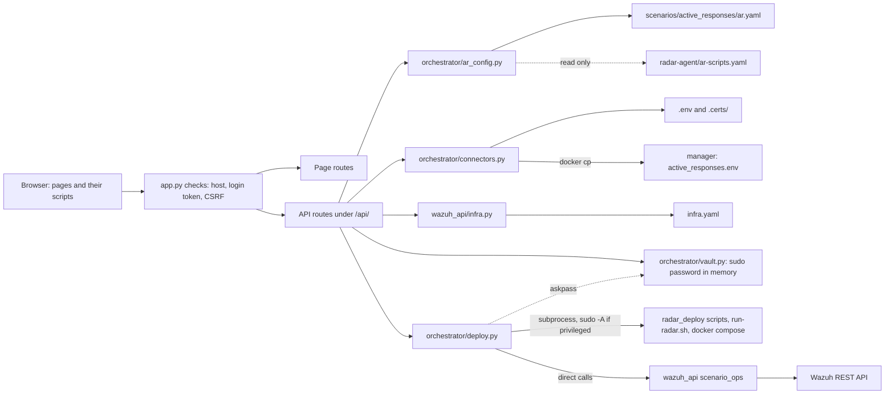

# RADAR GUI request and action flow

This item describes how a request from the RADAR web interface travels through the GUI process (`radar/gui/app.py`) to the files, scripts and APIs that carry it out. The GUI adds no deployment logic of its own: configuration requests read and write the same files as the command line, and deployment actions run the same scripts and `wazuh_api` calls. The module design (access control details, credential store, file locking) is in SWD-041.

## Request flow

1. **Access checks.** Every request, page or API, passes three checks in order: the `Host` header must name an allowed host, the request must carry the login token (query parameter once, then the HttpOnly cookie) unless authentication is switched off, and a state-changing request must be JSON and not cross-site. A refused API request gets a JSON error; a refused page request plain text.
2. **Pages.** The page routes (`/`, `/active-responses`, `/connectors`, `/infrastructure`, `/deploy`) render server-side templates with the data for the first render. Everything after that is a call to an API route from the page's script (`radar/gui/static/`).
3. **API.** Each API group is served by one backend module, listed below. Configuration and credential routes answer in JSON; deployment actions answer with a `text/plain` stream.

## Route groups and their targets

| Route group | Backend | Reads or writes | Answer |
|---|---|---|---|
| `/api/scenarios`, `/api/scenarios/<id>`, `.../ar-config`, `.../bind`, `.../unbind`, `/api/scenarios/deploy-status` | `orchestrator/ar_config.py`, `wazuh_api/config.py` | `ar.yaml` (read and write), `config.yaml` and the scenario rule files (read), the catalog `radar-agent/ar-scripts.yaml` (read only, for mitigation validation) | JSON |
| `/api/connectors`, `/api/connectors/<name>`, `.../test`, `/api/connectors/reveal` | `orchestrator/connectors.py` | `.env` and `.certs/`; after a save, a filtered copy of `.env` is copied into the manager as `active_responses.env`; tests open a connection to the service, some from inside a container | JSON |
| `/api/infra/...` | `wazuh_api/infra.py` | `infra.yaml`; the link test runs `curl` inside the source component's container | JSON |
| `/api/sudo/status`, `unlock`, `lock` | `orchestrator/vault.py` | Process memory only; unlock first checks the password with `sudo` | JSON |
| `/api/logout` | `app.py`, `deploy.py`, `vault.py` | Stops every running job, clears every stored password and the cookies, then stops the server | JSON |
| `/api/deploy/<action>` | `orchestrator/deploy.py` | Scripts, `docker compose` and `wazuh_api` calls, see below | `text/plain` stream |
| `/api/deploy/preview` | `orchestrator/deploy.py` | Nothing; returns the commands an action would run | JSON |

## Deployment actions

| Action | Runs | Host privilege | Specified in |
|---|---|---|---|
| `build` | The stages of `build-radar.sh` (certificates, credentials, core stack, webhook, enrollment hardening, `manager-apply-scenario-all.sh`), then `deploy_scenario_config` and `deploy_manager_config` in-process; on success the scenario is marked deployed (`active: true`) in `ar.yaml` | Yes | LARC-024 |
| `undo-scenario` | `undo_scenario_config` and `undo_manager_config` in-process; the scenario is marked not deployed | No | LARC-024, SWD-047 |
| `run` | `run-radar.sh <scenario> --ingest true\|false` | No | LARC-015 |
| `health` | The three health-check stages (not `health-radar.sh` itself) | No | LARC-041 |
| `mint-token`, `enrollment-window` | `radar_deploy/manager-mint-token.sh`, `manager-enrollment-window.sh` | Yes | LARC-039 |
| `assign-agent-group`, `unassign-agent-group`, `deregister-agent` | `radar_deploy/manager-assign-agent-group.sh`, `manager-unassign-agent-group.sh`, `manager-deregister-agent.sh` | No | LARC-039 |
| `teardown` | Only with explicit confirmation: `docker compose down` for the core and webhook projects; with data removal, also the named volumes and the manager's host-side bind-mount directories from `volumes.yml`, and every scenario is marked not deployed | Yes | SRS-070 |

- **Validation before spawning.** Scenario names are checked against `radar/config.yaml` and other inputs against their allowed values before any process starts. Because the stream is already open, an invalid input is reported as a line starting with `[ERROR]`.
- **Privileged actions.** An action that needs host privileges and has no unlocked sudo password for the session is refused before the stream starts, with HTTP 403 and `need_sudo: true`; the page then asks for the password, unlocks it, and retries the action once. While the action runs, `sudo -A` reads the password through an owner-only askpass helper that is deleted when the action ends.
- **Unprivileged actions** authenticate to the Wazuh API and OpenSearch with the credentials in `.env`. They need access to the Docker daemon where a script uses `docker exec` (health check, token revocation).
- **Streaming and stopping.** Each child process runs in its own session. When the browser stops reading (the page's Stop control aborts the request), the child's process group receives `SIGTERM`, then `SIGKILL` after 5 seconds.

## Consistency with the command line

The GUI calls the scripts and `wazuh_api` functions that `radar.sh` and the entry-point scripts call, with the same arguments, so a deployment made from either interface can be inspected and reversed from the other. The differences are deliberate and small: the GUI's Build records the deployment state in `ar.yaml` and does not revoke an expired token itself, the GUI always purges on deregistration, and the GUI mints tokens for the selected scenario's full group set.

See: `docs/manual/radar_docs/radar-gui-user-manual.md`.