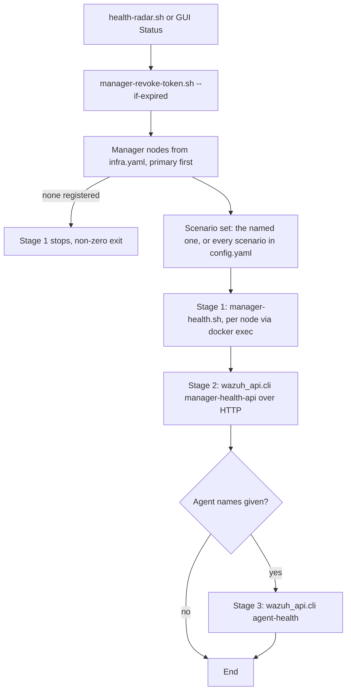

# RADAR deployment health check flow

This item describes how a health check of a RADAR deployment runs: which components it reaches, in which order, and how the scenario selection and the registered manager nodes scope it. The check list of each stage and the output format are specified in SWD-040.

## Entry points

| Entry point | Runs |
|---|---|
| `radar/health-radar.sh [--scenario <name\|all>] [--agent-name n1,n2]` | The three stages below, in order, after loading `radar/.env` |
| `radar/radar.sh health ...` | `health-radar.sh` with the same arguments |
| GUI, Deployment page, Status tab (`/api/deploy/health`) | The same three stages directly, from `radar/gui/orchestrator/deploy.py`, streamed to the browser (LARC-040) |

None of them needs root. They need access to the Docker daemon (stage 1 uses `docker exec`) and the Wazuh API and OpenSearch credentials from `.env`.

## Flow

1. **Token revocation.** Before checking anything, `radar_deploy/manager-revoke-token.sh --if-expired` revokes an enrollment token whose recorded expiry has passed (SWD-049). This is the only change a health check can make; it restarts the manager.
2. **Stage 1, manager containers** (`radar/radar_deploy/manager-health.sh`). The manager nodes come from `radar/infra.yaml` through `wazuh_api.cli manager-containers`, primary node first; with no registered node the stage stops with a non-zero exit status. The webhook container is checked once. Then, for each node, the container state, the active-response and core configuration files, the scenario-specific runtime and enrichment files, and the reachability of OpenSearch and, when configured, DECIPHER from inside that container. Addresses are resolved at run time with `wazuh_api.infra` (SWD-050). Finally, for the anomaly scenarios that send to the webhook (`log_volume`, `linux_resource_utilization`), the webhook URL is probed from inside the indexer container.
3. **Stage 2, Wazuh API, OpenSearch and webhook** (`wazuh_api.cli manager-health-api`, `radar/wazuh_api/health.py`). If the manager runs as a cluster, the daemon status and the scenario `ossec.conf` markers are checked per cluster node, as reported by the API; otherwise on the single manager. Then, for the selected scenarios: group configuration, decoder, rule and list files, and the agents that are members of all of the scenario's groups. Last, the OpenSearch cluster health (with the `log_volume` index template) and the webhook URL, both from the RADAR host.
4. **Stage 3, named agents** (`wazuh_api.cli agent-health`), only when agent names are given: each agent's registration and connection status, and its membership of `default` and, unless all scenarios were selected, of the named scenario's group. No connection is made to the endpoint.

## Scenario scoping

The scenario selection decides which scenario-dependent checks run. Checks without a scenario dependency always run.

| Check | Stage | Runs when the selection includes |
|---|---|---|
| Manager framework Python and `maxminddb` | 1 | `suspicious_login` or `geoip_detection` |
| Enrichment integration files, GeoLite2 databases, user state store, enrichment error log | 1 | `suspicious_login` |
| Filebeat archives pipeline patch | 1 | `log_volume` |
| Webhook reachable from the indexer container | 1 | `log_volume` or `linux_resource_utilization` (and `WEBHOOK_URL` set) |
| Scenario `ossec.conf` block present | 2 | each selected scenario with an entry in the health module's ruleset table |
| Scenario group configuration non-empty (or `radar_shared` for shared scenarios) | 2 | each selected scenario |
| Decoder and rule files | 2 | each selected scenario, from the health module's ruleset table |
| `whitelist_countries` list | 2 | `geoip_detection` |
| Agents in all of the scenario's groups | 2 | each selected scenario |
| `radar-log-volume` index template | 2 | `log_volume` (and `OS_URL` set) |
| Agent in the named scenario's group | 3 | a single named scenario |

With `--scenario all`, the selection is every scenario listed in `radar/config.yaml` (`wazuh_api.cli list-scenarios`), whether or not it is deployed. Scenarios that are not deployed therefore report `FAIL` lines; to check a partial deployment, run one check per deployed scenario.

## Results and exit status

Each stage prints its lines as it produces them, prefixed `OK`, `WARN`, `FAIL` or `SKIP`. A `FAIL` line does not change a stage's exit status: a stage exits non-zero only when it could not run (no registered manager node, or a Wazuh API error such as failed authentication). `health-radar.sh` stops at the first stage that exits non-zero, so the later stages are not run; the GUI's Status tab runs all three stages regardless.

## Known gaps

- The enrichment checks of stage 1 are gated on `suspicious_login` only, although `geoip_detection` uses the same GeoLite2 databases and its own web enrichment integration (SWD-040).
- The decoder and rule files checked in stage 2 come from a table in `radar/wazuh_api/health.py`, not from `radar/scenarios/`; a file added to a scenario must be added there too to be checked.

See: `docs/manual/radar_docs/radar-operations.md#health-check`.