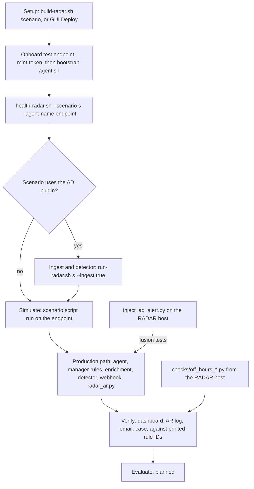

# RADAR test workflow

This item describes how a RADAR scenario is tested: the live workflow that exercises a real deployment end to end (setup, ingest, simulate, check, evaluate), and the automated suites that test the RADAR code without a deployment. The live workflow reuses the deployment tooling for setup and ingest; only the simulation and the live checks are test-specific code, in the RADAR Automated Test Framework (`radar/radar-test-framework/`, HARC-005).

## Live workflow

| Phase | Implemented by | Runs on | Design |
|---|---|---|---|
| Setup | `radar/build-radar.sh <scenario>` or the GUI's Scenario Management (LARC-024, LARC-040) | RADAR host | SWD-019 |
| Onboarding | `radar.sh mint-token`, then `radar-agent/bootstrap-agent.sh` (LARC-039) | RADAR host, then endpoint | SWD-019, SWD-048 |
| Readiness | `radar/health-radar.sh --scenario <s> --agent-name <endpoint>` (LARC-041) | RADAR host | SWD-040 |
| Ingest and detector | `radar/run-radar.sh <scenario> --ingest true` or the GUI's Anomaly Detector tab, for scenarios with `radar/scenarios/ingest_scripts/<scenario>/wazuh_ingest.py` | RADAR host (`radar-cli` container) | SWD-018 |
| Simulate | One standalone script per scenario in `radar/radar-test-framework/simulate/scenarios/`, copied to the endpoint and run there | Endpoint | SWD-020, SWD-039 |
| Anomaly injection | `simulate/scenarios/inject_ad_alert.py`, which posts one off-hours anomaly to the webhook for fusion tests | RADAR host | SWD-039 |
| Live checks | `radar/radar-test-framework/checks/off_hours_phase0.py`, `off_hours_simulate.py`, `off_hours_rule_e2e.py`, `off_hours_model_history.py`, against the indexer | RADAR host | SWD-039 |
| Verify | The operator, against the rule IDs each simulation case prints | — | SWD-020 |
| Evaluate | Not implemented | — | SWD-021 (planned) |

1. **Setup** deploys the scenario on the manager, exactly as in production.
2. **Onboarding** enrolls a test endpoint into the scenario's groups and installs its active responses and collector.
3. **Readiness** confirms the deployment and the endpoint's groups before anything is simulated.
4. **Ingest** applies only to the scenarios that use the OpenSearch anomaly-detection plugin and ship an ingest script (`log_volume`, `linux_resource_utilization`, `suspicious_login`): it seeds the detector's indices with synthetic history, then creates and starts the detector and monitor, so the detector has a baseline before the simulation.
5. **Simulate** writes the scenario's real artefact on the endpoint (log lines, Suricata records, filesystem growth, CPU or memory load). The events travel the production path; the simulator writes nothing to the indexer. Case-based scripts pause after each case for the operator to check the dashboard, unless run with `-b`.
6. **Live checks** cover what the endpoint cannot observe: the off-hours marking pipeline and the rule and model modes of `suspicious_login`. Each prints pass or fail per case and exits non-zero on failure.
7. **Verify** is manual today: the operator compares the alerts, active-response log entries, notification email and, if DECIPHER is configured, the incident case with the rule IDs the script printed as expected present and absent.

## Automated suites

The RADAR code is also tested without a deployment, by `radar/tests/run-tests.sh`. These tests are separate from the repository-level `tests/` tree, which covers SONAR and ADBox.

| Suite | Location | What it isolates |
|---|---|---|
| Shell lint | `shellcheck` over the entry-point, agent, helper, active-response and collector scripts | Skipped when `shellcheck` is not installed |
| Python compile | `py_compile` of the anomaly-detector modules | — |
| pytest | `radar/tests/py/` | Wazuh and OpenSearch HTTP calls mocked with `responses`; scripts run in sandboxes with stubbed `docker`; simulation scripts run against temporary files |
| bats | `radar/tests/bash/{build-radar,run-radar,bootstrap-agent,uninstall-agent,ar-mapping,ar-dispatch,collectors}.bats` | System commands (`docker`, `systemctl`, package managers, `agent-auth`) replaced by stubs, from `radar/tests/bash/stubs/` or written by each test into a fake root |

`radar/test.sh` builds `radar/Dockerfile.test` (Python, `bats`, `jq`, `shellcheck`) and runs `run-tests.sh` inside it, so the suites run the same way on any host with Docker. `radar/tests/bash/simulate-radar.bats`, which tests `linux_resource_utilization.sh`, is not in the `run-tests.sh` list and is run on its own.

The automated suites verify the logic of each component; only the live workflow verifies that a deployed scenario detects and responds.

## Planned extensions

> **Status: planned.** Not implemented as of v2.2.0. The extensions below specify intended behaviour; no code implements them yet.

- **Evaluation**: retrieve the detection results of a simulation run from the indexer, compare them with each case's expected outcome and compute detection metrics into a machine-readable report (SWD-021).
- **Single orchestrated run**: one entry point that sequences setup, ingest, simulation and evaluation without manual steps.

See: `radar/radar-test-framework/README.md` and `docs/manual/radar_docs/radar-operations.md#testing-detections`.