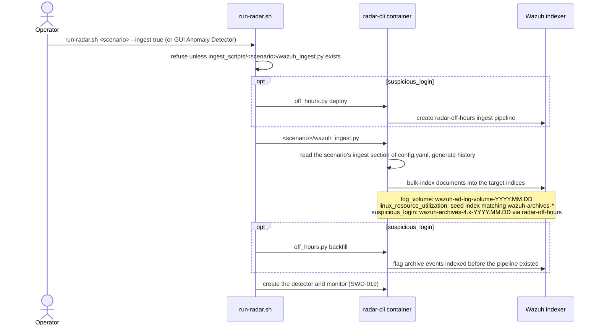

# RADAR baseline history ingestion

## Sequence of the ingest phase

The ingest phase seeds the indices an anomaly detector reads with synthetic history, so that the detector has a baseline as soon as it starts. It is outside the RADAR Automated Test Framework: `run-radar.sh <scenario> --ingest true` (or the GUI's Anomaly Detector tab with the ingest option) runs it, in the throwaway `radar-cli` container, before the detector and monitor are created.

Only scenarios that ship `radar/scenarios/ingest_scripts/<scenario>/wazuh_ingest.py` can be ingested; `run-radar.sh` refuses `--ingest true` for the others. Each script takes its parameters from the scenario's `ingest` section in `radar/config.yaml` and bulk-indexes documents into the OpenSearch indices the scenario's detector reads:

| Scenario | Generated history | Target indices |
|---|---|---|
| `log_volume` | Periodic directory-size samples growing from a baseline, for `history_minutes` | `wazuh-ad-log-volume-YYYY.MM.DD` |
| `linux_resource_utilization` | CPU and memory samples around the configured baseline with jitter, for each target agent | a seed index matching the detector's `wazuh-archives-*` pattern |
| `suspicious_login` | Archived authentication events for the configured users over `history_days` (and `future_days` ahead), including one off-hours burst | `wazuh-archives-4.x-YYYY.MM.DD`, through the `radar-off-hours` ingest pipeline |

For `suspicious_login`, `run-radar.sh` first deploys the off-hours ingest pipeline (`off_hours.py deploy`) so that the ingested events are flagged, and afterwards backfills archive events indexed before the pipeline existed (`off_hours.py backfill`).

No users are created anywhere: the earlier design created single-sign-on (Keycloak) users for `suspicious_login`, and that step no longer exists.

{width="80%"}

See: `docs/manual/radar_docs/radar-run-ad.md`.