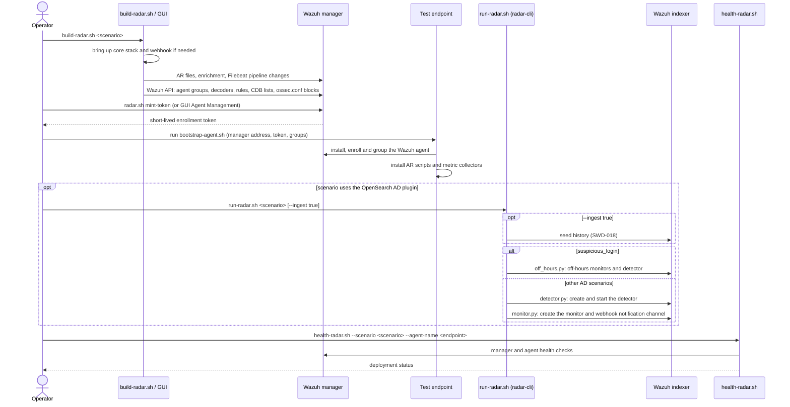

# RADAR test environment setup

## Sequence of the setup phase

The setup phase brings a RADAR deployment to the state a simulation needs. It is outside the RADAR Automated Test Framework and uses the deployment control plane (SWD-042):

1. `build-radar.sh <scenario>` (or the GUI's Scenario Management) brings up the Wazuh core stack and the webhook if needed and applies the scenario's manager-side configuration: active-response files, enrichment, Filebeat pipeline changes, agent-group configuration, decoders, rules, CDB lists and `ossec.conf` blocks (LARC-024).
2. A short-lived token is minted (`radar.sh mint-token` or the GUI's Agent Management), and `radar-agent/bootstrap-agent.sh` is run on the test endpoint to install, enroll and group the Wazuh agent and install the active-response scripts and metric collectors.
3. For scenarios that use the OpenSearch AD plugin, `run-radar.sh <scenario>` creates and starts the detector (`detector.py`) and creates the monitor and its webhook notification channel (`monitor.py`); for `suspicious_login`, `off_hours.py` creates the off-hours monitors and detector instead. Ingest (SWD-018) runs first when requested.
4. `health-radar.sh --scenario <scenario> --agent-name <endpoint>` confirms the deployment before simulating (SWD-040).

No Ansible playbook is involved; the earlier design delegated manager and agent setup to Ansible.

{width="80%"}