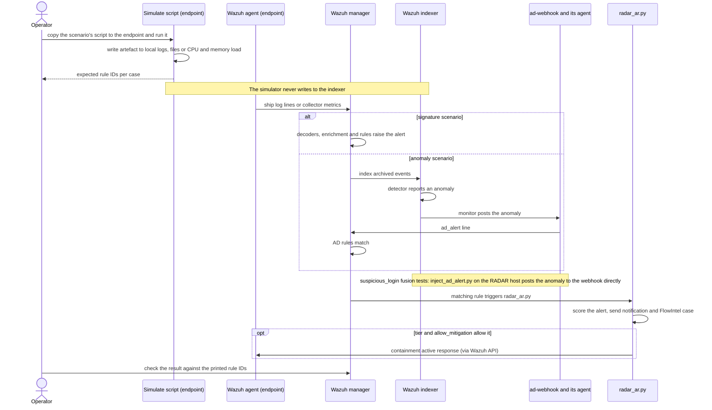

# RATF: simulation phase

## Sequence diagram of threat simulation in RATF

The simulation phase is the part of the RADAR Automated Test Framework that is implemented (`radar/radar-test-framework/simulate/scenarios/`, designed in SWD-039). The operator copies a scenario's script to an enrolled endpoint and runs it there:

1. The script writes the scenario's artefact on the endpoint: authentication log lines, web access-log lines, Suricata `eve.json` records, filesystem growth, or real CPU and memory load.
2. The endpoint's Wazuh agent ships the resulting log lines or collector metrics to the manager, like any other event. The simulator never writes to the indexer.
3. Signature scenarios: the manager's decoders, enrichment and rules raise the alert. Anomaly scenarios: the events are indexed, the detector reports an anomaly, the monitor posts it to the webhook, and the webhook's agent sends the `ad_alert` line that the manager's AD rules match.
4. The matching rule triggers `radar_ar.py`, which scores the alert, sends the notification and FlowIntel case, and, when the tier and `allow_mitigation` allow it, triggers containment active responses on the endpoint.
5. The operator checks the result against the rule IDs the script printed for each case.

For fusion tests of `suspicious_login`, `inject_ad_alert.py` runs on the RADAR host instead and posts an anomaly alert directly to the webhook, replacing steps 1 to 3 for the anomaly side.

{width="80%"}