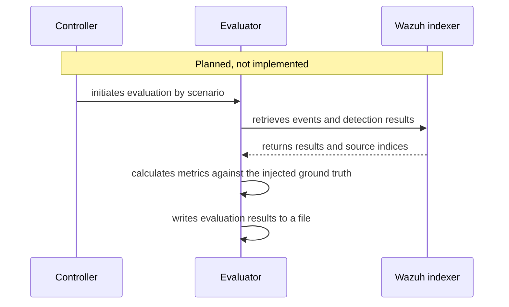

# RATF: evaluation phase

> **Status: planned.** Not implemented as of v2.2.0. This item specifies intended behaviour; no code implements it yet.

## Sequence diagram of metrics evaluation in RATF

The diagram below depicts the intended sequence of the RADAR Automated Test Framework's evaluation phase, which
- retrieves the events and detection results of a simulation run from the indices of the scenario,
- calculates evaluation metrics by comparing them with the injected ground truth of the dataset and the simulation,
- writes the evaluation results to a file.

Until it exists, results are checked by hand against the rule IDs each simulation script prints (SWD-020), and, for off-hours detection, by the live checks in `radar/radar-test-framework/checks/`.

{width="80%"}