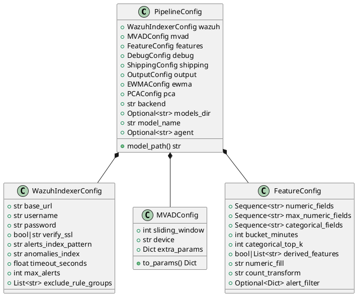
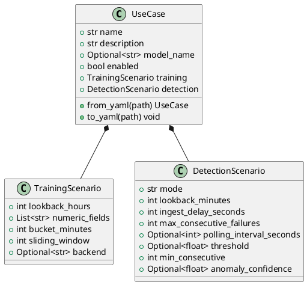
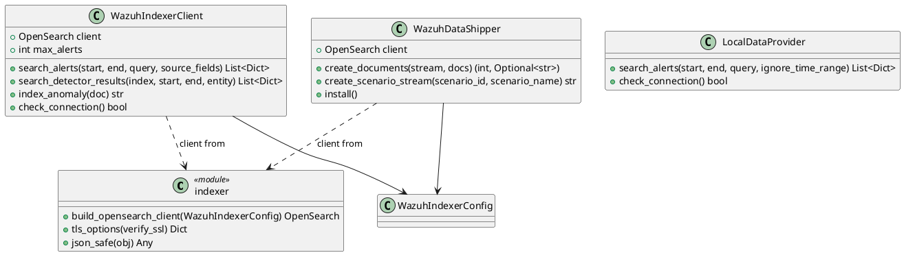
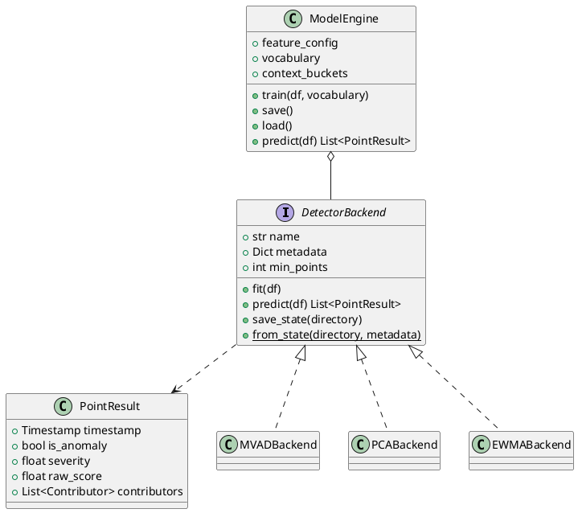

# SONAR class structure and relationships

## Class diagram overview

The SONAR subsystem employs a modular class structure organized around configuration management, data access, and processing pipelines.

### Core configuration classes

### Scenario management classes

### Indexer access classes

All indexer traffic goes through one OpenSearch client per component, built by a single factory, so TLS, credentials and timeouts are configured once and behave the same for reading alerts and writing anomalies.

- **TLS.** `verify_ssl` is `false` (no certificate check), `true` (system trust store) or a CA bundle path; the factory turns it into the client's TLS arguments, so a CA bundle reaches both alert search and shipping.
- **Complete alert reads.** `search_alerts` reads every alert of the requested range: it opens a point-in-time on the alert indices and pages through it with `search_after`, sorted on `timestamp` with the alert's `id` as tiebreaker, and closes the point-in-time afterwards, also on error. It requests only the alert fields the feature builder declares (`WazuhFeatureBuilder.required_source_fields`). A single unsorted page, as before, returned an arbitrary subset of at most 10,000 alerts.
- **Bounded memory.** `max_alerts` caps one search. Paging runs newest first, so a capped result keeps the most recent alerts, which hold the detection window; the cap is logged with the total.
- **Interchangeable sources.** `LocalDataProvider` offers the same `search_alerts` for debug mode, over a local file, and writes nothing.

### Detector backends and the model engine

The detector is behind one interface, so that SONAR does not depend on a single library and can compare detectors on the same features.

- **`PointResult`** is the only input of post-processing: one verdict per time bucket, with `severity` normalised to 0–1 (0 when the bucket is not anomalous) so thresholds, severity bands and consumers work the same for every backend, and `raw_score` on the backend's own scale. A backend gives verdicts from bucket `min_points − 1` on; the buckets before are context, which detection fetches before the scored window.
- **`mvad`** wraps Microsoft's multivariate detector (`time-series-anomaly-detector` 0.4.0): training pre-flight check, private checkpoint directory, and conversion of its per-bucket output.
- **`pca`** is a linear multivariate model without deep learning. Each bucket is scored on the window of its last few buckets, every feature standardised with its training median and scaled median absolute deviation. Training fits a probabilistic PCA to these window vectors (the principal components that keep a set share of the variance, isotropic noise for the rest); a window's score is its Mahalanobis distance under that model, which grows both for a window far out along a direction normal data varies in (a spike, a level never seen) and for one that breaks the correlations between features (a feature moving alone, a category that never moved). A bucket is anomalous when the robust z-score of its score against the training scores reaches a threshold; severity follows `ewma`'s convention. Each feature contributes its share of the squared distance. The window is short by default (3 buckets): an anomaly confined to a few features and buckets is diluted in a long window.
- **`ewma`** is a baseline without deep learning: each feature is smoothed with an exponentially weighted moving average and compared with its training median through a robust z-score (scaled median absolute deviation); a bucket is anomalous when its largest z-score reaches a threshold, and its severity is that z-score over twice the threshold, capped at 1. It ignores correlations between features, which is what a multivariate model has to improve on.
- **`ModelEngine`** owns what is backend-independent: the feature contract (feature configuration, categorical vocabulary, column order), the column check before prediction, and the model directory.

### Model directory

A model is the directory `<models_dir>/<model_name>/`: `metadata.json` (format version, SONAR version, backend name and training record, feature schema version and feature contract) and the backend's state, `mvad_config.json` and `mvad_weights.pt` (a tensor dictionary) for MVAD, `pca_state.json` or `ewma_state.json`. Loading reads JSON and loads the weights as tensors only (`weights_only`), so no code in a model file runs; the former pickled model files are refused. A model is written to a staging directory and swapped in when complete.

### Evaluation

`sonar/evaluation.py` measures detection quality against label files (event type and interval). It works on scored intervals (`Detection`), built either from a backend's `PointResult`s or from another detector's exported results, so SONAR's backends and external detectors are scored by one implementation. Reported intervals are chosen with `select_anomalies`, the decision rule post-processing applies (`threshold` on severity, `min_consecutive`), so an evaluated setting behaves the same in detection. Touching reported intervals form an alarm; precision is counted over alarms and recall over events, because an analyst handles alarms and the goal is to catch events. Calibration searches threshold and run length on a validation split within a false-alarm budget and measures precision on a separate test split, which becomes the scenario's `anomaly_confidence`.

### Paths

All locations are resolved by `sonar/paths.py`, never against the working directory: a relative path in a configuration or scenario file is relative to that file, and unset paths default to the SONAR home (`$SONAR_HOME`, else the package directory of a source checkout, else `~/.sonar`). Example scenarios and their debug datasets are package data. Without a `model_name`, a scenario's model is named after the scenario, so training and detection find the same model; the default scenario ID (data stream, watermark and anomaly identities) is the model name.

## Configuration dataclasses summary

**Implementation**: [sonar/config.py](sonar/config.py)

| Dataclass | Key Fields | Purpose |
|-----------|------------|---------|
| `PipelineConfig` | wazuh, mvad, pca, ewma, features, debug, shipping, output, backend, models_dir, model_name, agent | Top-level pipeline configuration |
| `WazuhIndexerConfig` | base_url, username, password, verify_ssl, alerts_index_pattern, anomalies_index, timeout_seconds, max_alerts, exclude_rule_groups | Wazuh Indexer connection |
| `MVADConfig` | sliding_window, device, extra_params, min_gradient_steps | MVAD backend parameters |
| `PCAConfig` | window, variance, z_threshold | PCA backend parameters |
| `EWMAConfig` | alpha, z_threshold | Baseline backend parameters |
| `FeatureConfig` | numeric_fields, max_numeric_fields, categorical_fields, categorical_top_k, bucket_minutes, derived_features, numeric_fill, count_transform, alert_filter | Feature extraction configuration |
| `DebugConfig` | enabled, data_dir, training_data_file, detection_data_file | Debug mode data sources |
| `ShippingConfig` | enabled, install_templates, scenario_id, rollover_days, retention_days | Data stream configuration |
| `OutputConfig` | sinks, fallback, debug_sinks, jsonl_path, wazuh, state_dir | Anomaly sinks and delivery state (watermarks) |
| `WazuhSinkConfig` | transport, file_path, api_url, api_username, severity_medium, severity_high | The `wazuh` sink ([SWD-037](SWD-037.md)) |
| `UseCase` | name, description, model_name, enabled, training, detection | Scenario definition (`sonar/scenario.py`) |
| `TrainingScenario` | lookback_hours, feature settings, sliding_window, extra_params, backend, pca, ewma | Training parameters |
| `DetectionScenario` | mode, lookback_minutes, polling_interval_seconds, ingest_delay_seconds, max_consecutive_failures, threshold, min_consecutive, anomaly_confidence | Detection parameters |

## Design patterns

| Pattern | Application | Benefit |
|---------|-------------|---------|
| **Dataclasses** | Configuration objects | Typed fields with defaults in one place |
| **Factory Method** | `UseCase.from_yaml()` | Encapsulates YAML parsing logic |
| **Strategy** | Data providers (Wazuh/Local) | Interchangeable data sources |
| **Factory** | `build_opensearch_client()` | One place for connection, TLS and timeout settings |
| **Strategy** | Detector backends (`mvad`, `pca`, `ewma`) | Interchangeable detectors behind `DetectorBackend` |

## Related documentation

- Complete class diagram: [docs/manual/sonar_docs/uml-diagrams.md](docs/manual/sonar_docs/uml-diagrams.md#class-diagram)
- Architecture guide: [docs/manual/sonar_docs/architecture.md](docs/manual/sonar_docs/architecture.md#module-structure)