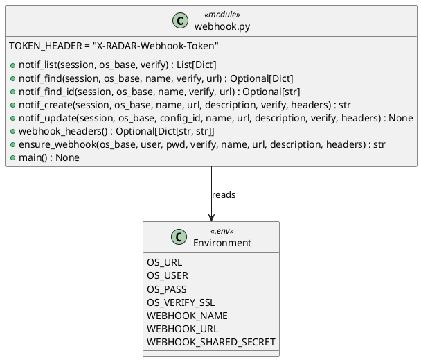
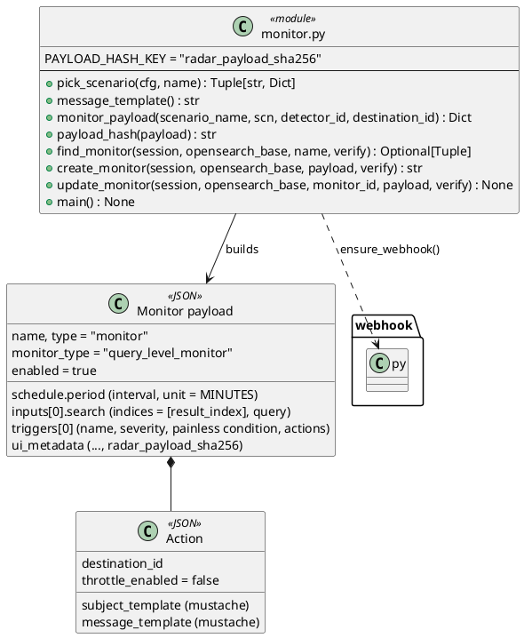
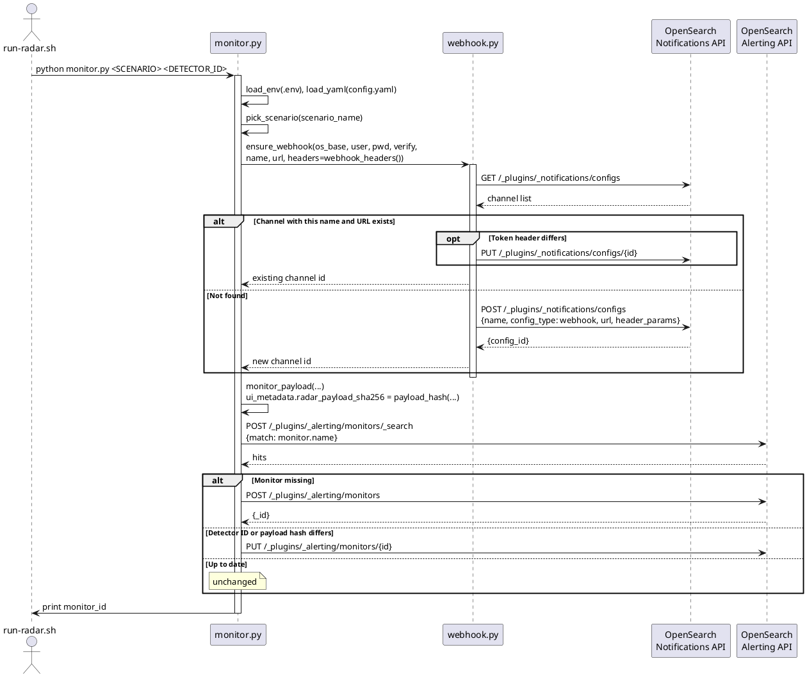

# RADAR monitor and webhook module design

This document specifies the detailed design of the monitor and webhook Python modules used in RADAR's anomaly detection workflow. They create and maintain the OpenSearch alerting monitor of a detector and the notification channel it posts to. The receiving webhook service is specified in SWD-035.

## Module overview

Both modules are scripts of plain functions (no classes):

- **`radar/anomaly_detector/webhook.py`**: manages the OpenSearch Notifications channel (`config_type: webhook`) that points at the RADAR webhook service, including its shared-secret header.
- **`radar/anomaly_detector/monitor.py`**: builds, creates and updates the query-level alerting monitor that reads a detector's result index and notifies the channel.

`radar/anomaly_detector/off_hours.py` reuses both for the `suspicious_login` off-hours monitors.

## webhook.py structure



| Function | Purpose | Returns |
|----------|---------|---------|
| `notif_list()` | `GET /_plugins/_notifications/configs` | List of channel configs |
| `notif_find()` / `notif_find_id()` | Find a `webhook` channel by exact name (and URL, if given) | Channel config / ID, or None |
| `notif_create()` | `POST /_plugins/_notifications/configs` with URL and optional header parameters | Channel ID |
| `notif_update()` | `PUT /_plugins/_notifications/configs/{id}` | — |
| `webhook_headers()` | `{X-RADAR-Webhook-Token: WEBHOOK_SHARED_SECRET}`, or None when unset | Header dict |
| `ensure_webhook()` | Find by name and URL; update the header when it differs; else create | Channel ID |

## monitor.py structure



## Monitor creation sequence



## Monitor payload structure

**Schedule**: every `monitor_interval`, else `detector_interval` (default 5), minutes.

**Search input** on `result_index`:

- results of this `detector_id` whose `execution_end_time` lies in the last interval before the run's `period_end`,
- `anomaly_grade` ≥ `anomaly_grade_threshold` and `confidence` ≥ `confidence_threshold`,
- sorted by grade then confidence, descending, at most `monitor_max_entities` hits (default 5, clamped to 1–50),
- aggregation `max(anomaly_grade)`.

**Trigger condition** (Painless): there is at least one hit, the maximum grade is at or above `anomaly_grade_threshold`, and the top hit's confidence is at or above `confidence_threshold`.

**Action message** (`message_template()`): the top hit's keys at top level, for webhooks that read only those, plus one `anomalies` entry per hit. `periodStart`/`periodEnd` are the monitor's run window; `dataStart`/`dataEnd` the anomaly's own data window (epoch milliseconds). Rendered shape:

```json
{
  "monitor": {"name": "LogVolume-Monitor"},
  "trigger": {"name": "LogVolume-Growth-Detected"},
  "entity": "edge.vm",
  "periodStart": "…", "periodEnd": "…",
  "anomaly_grade": "0.85", "anomaly_confidence": "0.92",
  "dataStart": "1771236000000", "dataEnd": "1771236060000",
  "anomalies": [
    {"entity": "edge.vm", "anomaly_grade": "0.85", "anomaly_confidence": "0.92",
     "dataStart": "1771236000000", "dataEnd": "1771236060000"},
    null
  ]
}
```

The trailing `null` keeps the array valid JSON after the mustache loop's last comma.

## Configuration parameters

From the `config.yaml` scenario section:

| Parameter | Default | Description |
|-----------|---------|-------------|
| `monitor_interval` | `detector_interval` | Monitor evaluation frequency (minutes) |
| `detector_interval` | 5 | Detector run interval (minutes) |
| `anomaly_grade_threshold` | 0.2 | Minimum anomaly grade to report (0-1) |
| `confidence_threshold` | 0.2 | Minimum confidence to report (0-1) |
| `monitor_max_entities` | 5 | Entities reported per run (1-50) |
| `result_index` | — (required) | Detector result index |
| `monitor_name` | `{scenario}-monitor` | Monitor name |
| `trigger_name` | `{scenario}-trigger` | Trigger name; Wazuh rules match it (SWD-034) |

From `config.yaml` (`webhook.name`, `webhook.url`) or the environment:

| Variable | Required | Description |
|----------|----------|-------------|
| `OS_URL` | Yes | OpenSearch endpoint URL |
| `OS_USER`, `OS_PASS` | No | OpenSearch credentials |
| `OS_VERIFY_SSL` | No | TLS verification (default true; `monitor.py` falls back to `DASHBOARD_VERIFY_SSL`) |
| `WEBHOOK_NAME` | No | Channel name (default "RADAR Webhook") |
| `WEBHOOK_URL` | Yes | Webhook endpoint URL (e.g. `http://<webhook-host>:8080/notify`) |
| `WEBHOOK_SHARED_SECRET` | No | Sent as `X-RADAR-Webhook-Token`; the webhook service rejects requests without it (SWD-035) |

## Error handling

- Any unexpected HTTP status, or a missing `OS_URL`/`WEBHOOK_URL`, prints the status and response on stderr and exits 1. There is no retry.
- Idempotency: `ensure_webhook()` and `find_monitor()` reuse existing resources; a stale monitor (other detector, or payload fingerprint differs after a configuration or code change) is updated in place.

## Integration with RADAR workflow

1. `run-radar.sh` executes `detector.py` (SWD-028) and passes the detector ID to `monitor.py`.
2. `monitor.py` ensures the channel and creates or updates the monitor.
3. The monitor runs every interval and posts to the RADAR webhook service when the trigger condition holds (SWD-035).