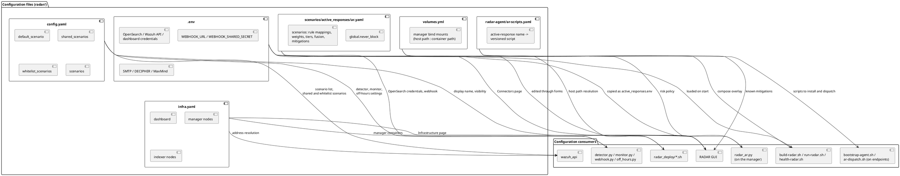

# RADAR configuration management design

This document specifies the design and structure of RADAR's configuration, which coordinates anomaly detection scenarios, active response policies, credentials, infrastructure addresses and deployment paths across several files in `radar/`. RADAR keeps no host inventory: the earlier Ansible inventory and vault files no longer exist.

## Configuration architecture



## config.yaml structure

Primary configuration file for scenarios. Top-level keys:

| Key | Description |
|---|---|
| `default_scenario` | Scenario used by `detector.py`/`monitor.py` when none is given |
| `shared_scenarios` | Scenarios whose agents also join the `radar_shared` group (currently `suspicious_login`, `geoip_detection`) |
| `whitelist_scenarios` | Scenarios that need the `whitelist_countries` CDB list deployed |
| `scenarios` | One block per scenario; the set of keys defines which scenarios exist |
| `webhook` (optional) | `name` and `url` of the monitor's notification channel; `WEBHOOK_NAME`/`WEBHOOK_URL` in `.env` are used when absent |

### Scenario schema

```yaml
scenarios:
  <scenario_name>:
    # Presentation (GUI)
    display_name: <text>
    description: <text>
    gui_visible: <boolean>

    # Anomaly detection scenarios only
    index_prefix: <index_prefix>          # or log_index_pattern: <pattern>
    result_index: <result_index_name>
    time_field: <timestamp_field>
    categorical_field: <field_name>       # per-entity detector
    detector_interval: <minutes>
    delay_minutes: <minutes>
    shingle_size: <integer>
    filter_query: <OpenSearch query>      # optional
    imputation_option: <object>           # optional
    rules: [<AD suppression rules>]       # optional
    features:
      - feature_name: <name>
        feature_enabled: <boolean>
        aggregation_query: {<name>: {<aggregation>: {field: <field>}}}
    monitor_name: <name>
    trigger_name: <name>
    anomaly_grade_threshold: <float 0-1>
    confidence_threshold: <float 0-1>
    monitor_interval: <minutes>           # optional, defaults to detector_interval
    monitor_max_entities: <integer>       # optional, default 5

    # Optional
    ingest: <parameters of scenarios/ingest_scripts/<scenario>/wazuh_ingest.py>
```

Signature-only scenarios (`geoip_detection`, `scanning_detection`) carry only the presentation keys. `suspicious_login` carries an `off_hours` block (schedule groups, modes, users) read by `off_hours.py` instead of the detector keys. See: `radar/config.yaml`.

### Feature definition

Each feature defines an OpenSearch aggregation for the RCF detector. Aggregation types are those of OpenSearch (for example `avg`, `max`, `sum`, `value_count`, `cardinality`), on a field or on a Painless script.

## ar.yaml structure

Active response configuration, read by `radar_ar.py` on the manager and edited by the GUI.

### Schema

```yaml
global:
  never_block: [<IP or CIDR>]            # never a mitigation target

scenarios:
  <scenario_name>:                        # "default" holds the baseline rule set
    active: <boolean>                     # written by the GUI: deployment state
    ad:        {rule_ids: [<id>], rule_groups: [<group>]}
    signature: {rule_ids: [<id>], rule_groups: [<group>]}
    w_ad: <float>
    w_sig: <float>
    w_cti: <float>
    delta_ad_minutes: <int>
    delta_signature_minutes: <int>
    signature_impact: <float 0-1>
    signature_likelihood: <float 0-1> | [{rule_id|rule_group: ..., weight: <float>}]
    fusion: {enabled: <bool>, window_minutes: <int>, ad_lead_minutes: <int>, key: {...}}  # optional
    tiers: {tier1_min: <float>, tier1_max: <float>, tier2_max: <float>}
    mitigations_tier2: [<action>]
    mitigations_tier3: [<action>]
    allow_mitigation: <boolean>
```

The risk formula, tier determination, scenario resolution order and fusion semantics are specified in SWD-026 and SWD-027. Mitigation action names are `firewall-drop` and the names listed in `radar/radar-agent/ar-scripts.yaml`; the GUI rejects any other name. See: `radar/scenarios/active_responses/ar.yaml`.

## .env file structure

Environment variables for credentials and endpoints, created from `radar/env.example` and never committed. The GUI's Connectors page edits it. `build-radar.sh` generates per-deployment passwords for a stack it deploys itself (`wazuh_api.credentials`), and generates `WEBHOOK_SHARED_SECRET` and `WAZUH_CLUSTER_KEY` when absent.

| Group | Variables |
|---|---|
| Indexer and dashboard | `OS_URL`, `OS_USER`, `OS_PASS`, `OS_VERIFY_SSL`, `DASHBOARD_URL`, `DASHBOARD_USER`, `DASHBOARD_PASS`, `DASHBOARD_VERIFY_SSL` |
| Wazuh | `WAZUH_API_URL`, `WAZUH_AUTH_USER`, `WAZUH_AUTH_PASS`, `WAZUH_MANAGER_ADDRESS`, `WAZUH_AGENT_VERSION`, `WAZUH_CLUSTER_KEY` |
| Webhook | `WEBHOOK_NAME`, `WEBHOOK_URL`, `WEBHOOK_SHARED_SECRET`, `WEBHOOK_INTERNAL_PORT`, `WEBHOOK_CONTAINER_NAME`, `WEBHOOK_AGENT_NAME`, `WEBHOOK_BIND_ADDRESS` |
| Active response | `AR_LOG_FILE`, `AR_RISK_CONFIG`, `SMTP_HOST`, `SMTP_PORT`, `SMTP_USER`, `SMTP_PASS`, `EMAIL_TO`, `SMTP_STARTTLS`, `DECIPHER_BASE_URL`, `DECIPHER_VERIFY_SSL`, `DECIPHER_TIMEOUT_SEC` |
| Enrichment | `MAXMIND_LICENSE_KEY` |

`manager-apply-scenario.sh` copies a filtered `.env` into the manager as `active-response/bin/active_responses.env`, which is how `radar_ar.py` gets its SMTP, DECIPHER and OpenSearch settings. See: `radar/env.example`.

## Deployment target resolution

RADAR does not maintain a host inventory. The manager containers run on the same host as the entry-point scripts, and every manager-side operation is addressed either through the Wazuh REST API or through the containers' bind mounts. Endpoints are not deployment targets: they self-enroll by running `radar-agent/bootstrap-agent.sh`, and are thereafter addressed by agent ID through the API.

- **`infra.yaml`** registers the dashboard and the manager and indexer nodes (container name, host, port, scheme; the first node of a role is the primary). `wazuh_api/infra.py` resolves a component by trying its declared host first and falling back to its container name, as seen from a given container or from the host. The file is `components: {}` in the repository and filled in at run time by `build-radar.sh` and the GUI's Infrastructure page.
- **`volumes.yml`** lists, per manager service, the bind mounts `host path:container path`. `build-radar.sh` passes it to Docker Compose as an overlay, and `radar_deploy/_lib.sh` resolves host-side paths from it, so that manager files are written on the host without `docker exec`.

## radar-agent/ar-scripts.yaml

Catalog of the active-response scripts installed on every endpoint, mapping each name the manager triggers to a versioned script under `radar-agent/active_responses/`. `bootstrap-agent.sh` installs the catalog and every listed script; the dispatcher installed under each name resolves the script through the endpoint's copy of the catalog at run time. The catalog does not decide which scenario uses which action; `ar.yaml` does.

## Configuration validation

- **`build-radar.sh`**: the scenario exists in `config.yaml`; `.env` exists; `WAZUH_API_URL`, `WAZUH_AUTH_USER` and `WAZUH_AUTH_PASS` are set; `volumes.yml` maps the Filebeat archives pipeline when the stack is brought up.
- **`detector.py`, `monitor.py`**: the scenario exists; `features` are present; `OS_URL` is set; a webhook URL is configured.
- **GUI**: risk weights sum to 1.0, tier boundaries are non-decreasing within [0, 1], and mitigation names are in the catalog, before `ar.yaml` is written.
- **`bootstrap-agent.sh`**: the catalog parses and every listed script exists before anything is installed.

## Configuration precedence

1. Command-line arguments (for example the scenario name).
2. Environment variables, loaded from `.env` by the entry-point scripts.
3. `config.yaml` and `ar.yaml`.
4. Defaults in the Python modules.

The exception is the monitor's webhook: `webhook.url` in `config.yaml`, when present, wins over `WEBHOOK_URL`.

## Best practices

1. **Version control**: keep `config.yaml`, `ar.yaml`, `volumes.yml` and `ar-scripts.yaml` in Git; `infra.yaml` stays `components: {}` in Git.
2. **Secrets management**: never commit `.env`; use `env.example` as the template.
3. **Validation**: test configuration changes in a lab environment before production.
4. **Consistency**: keep scenario names identical across `config.yaml`, `ar.yaml` and the `scenarios/` folders.