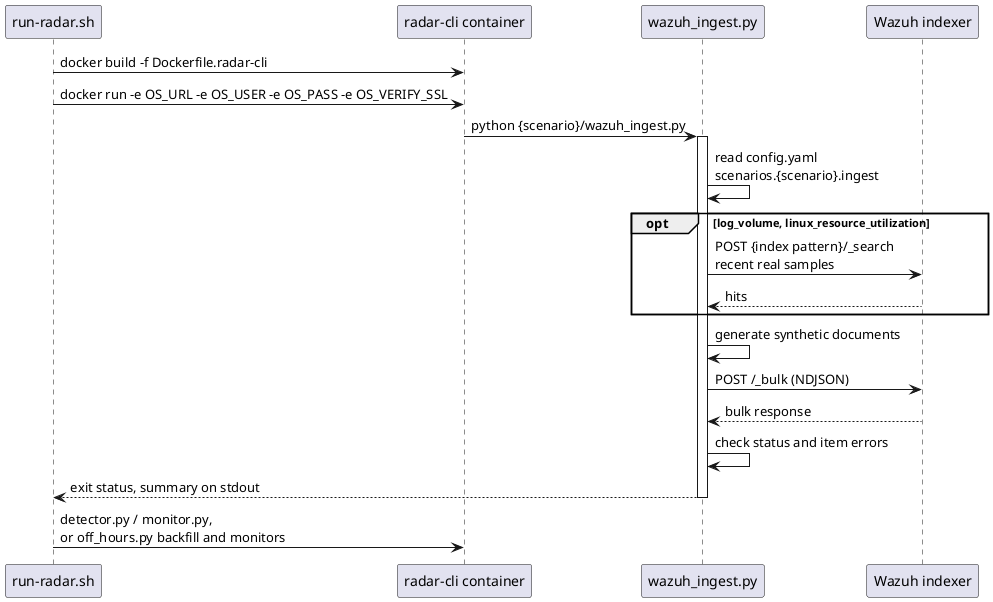

# RADAR data ingestion module design

This document specifies the design of RADAR's data ingestion modules, the scenario-specific `wazuh_ingest.py` scripts that seed the Wazuh indexer with synthetic history for the anomaly-based scenarios (LARC-027).

## Purpose

An anomaly detector only reports once it has enough history per entity. The ingestion modules write that history so that a scenario can be exercised right after deployment. Each module:

1. Writes documents with exactly the fields, types and index names the scenario's detector or off-hours pipeline reads.
2. Shapes the history from configuration and, where available, from the entity's real recent data, so that the first real samples continue the seeded pattern rather than look anomalous.
3. Reads every parameter from `scenarios.<scenario>.ingest` in `radar/config.yaml`; nothing scenario-specific is hard-coded beyond field and index names.

Ingestion is a demonstration and test aid, run only with `run-radar.sh <scenario> --ingest true`. A production deployment can skip it and let the detector learn from real data.

## Architecture



## Common contract

| Aspect | Design |
|---|---|
| Entry point | `python <scenario>/wazuh_ingest.py`, no arguments |
| Configuration | `scenarios.<scenario>.ingest` in the `config.yaml` one directory above the script (`/app/config.yaml` in the image) |
| Connection | `OS_URL`, `OS_USER`, `OS_PASS`, `OS_VERIFY_SSL` from the environment; `log_volume` and `suspicious_login` also read a `.env` file in the working directory without overriding set variables. `suspicious_login` falls back to built-in development defaults when they are unset |
| Write path | OpenSearch Bulk API, `application/x-ndjson`, one `index` action per document |
| Exit status | 0 on success; 2 when `log_volume` or `linux_resource_utilization` lack connection settings; 1 on a bulk failure or, for `linux_resource_utilization`, on no target agent |

## Scenario-specific implementations

### Log volume

**Index**: `<index_prefix>-<YYYY.MM.DD>` (today), default prefix `wazuh-ad-log-volume`; the detector reads `wazuh-ad-log-volume-*`.

**Document**:
```json
{"@timestamp": "<ISO 8601 UTC>",
 "agent": {"name": "<agent_name>", "id": "<agent_id>"},
 "data": {"log_path": "<log_path>", "log_bytes": <int>},
 "predecoder": {"program_name": "log_volume_metric"}}
```

**Baseline**: the two most recent documents of `agent_name` (by `@timestamp`) give the latest value and the growth per step. Fallbacks, in order: wait 60 seconds and query again; one document gives the value and `fallback_delta`; none gives `baseline_bytes` and `fallback_delta`, with a warning that the scenario is probably not wired; a non-positive delta becomes `fallback_delta`.

**Series**: $N = \lfloor 60 \cdot history\_minutes / step\_seconds \rfloor$ points at `step_seconds` intervals ending now, with value $v_i = v_{latest} - \delta (N - 1 - i)$ (floored at 0), plus one point one step after now. One bulk request.

| Parameter | Default in `config.yaml` |
|---|---|
| `agent_id`, `agent_name` | `"001"`, `"edge.vm"` |
| `program`, `log_path`, `index_prefix` | `log_volume_metric`, `/var/log`, `wazuh-ad-log-volume` |
| `history_minutes`, `step_seconds` | 240, 20 |
| `delta_min_docs`, `fallback_delta`, `baseline_bytes` | 2, 20000, 228654752 |

### Linux resource utilization

**Index**: `seed_index` (default `wazuh-archives-radar-seed`), matched by the detector's `wazuh-archives-*` pattern. The script creates it with an explicit mapping when missing: CPU and memory values are keywords, as in Wazuh's archives template, and the detector's features parse them.

**Document**:
```json
{"@timestamp": "<ISO 8601 UTC>", "timestamp": "<same>",
 "radar_seed": true, "location": "radar-ingest-seed",
 "agent": {"id": "<agent id>", "name": "<agent name>"},
 "predecoder": {"program_name": "resource_usage_metric"},
 "data": {"cpu_usage_pct": "<n.nn>", "mem_usage_pct": "<n.nn>"}}
```

**Targets**: `agent_names` if set, else every agent with real (`radar_seed` absent) samples within `baseline_window`. For each target, the seed runs from `now − history_minutes` to the agent's earliest real sample; an agent already covered is skipped.

**Series**: one point every `step_seconds`, CPU and memory drawn from a normal distribution around `baseline_cpu_pct` and `baseline_mem_pct` with `cpu_jitter` and `mem_jitter`, clamped to 0–100, with a random generator seeded by the agent name so reruns produce the same history. Bulk requests of up to 5000 documents.

**After indexing**: the script stops `LINUX_RESOURCE_UTILIZATION_DETECTOR` if it exists, so it re-initialises on the seed at its next start. The `radar_seed` flag lets other consumers, such as SONAR's `radar_linux_resource_utilization` scenario, leave the seed out.

### Suspicious login

**Index**: `<archives_index_prefix>-<YYYY.MM.DD>` per event day, default prefix `wazuh-archives-4.x`. The prefix must stay under Wazuh's archives template so that `agent.name` and `data.user` are mapped as keywords.

**Document**:
```json
{"@timestamp": "<ISO 8601 UTC>", "timestamp": "<same>",
 "agent": {"name": "<agent_name>"},
 "predecoder": {"program_name": "<activity>"},
 "decoder": {"name": "<sshd | auditd | nginx>"},
 "data": {"user": "<user>", "action": "<activity>"},
 "full_log": "synthetic off-hour training event: user=<user> activity=<activity>"}
```

**Series**: for each user in `ingest.users` and each workday from `history_days` back to `future_days` ahead, between `events_per_login_min` and `events_per_login_max` events at random times within the user's shift (`start_hour` to `end_hour`, crossing midnight when start > end, ± `drift_minutes`) in the user's `timezone` (default UTC). Optional per user: `evenings` (on average `per_week` workday evenings with a few events) and one `burst` of events within one 30-minute interval `days_ago` days back. Activities are drawn from `activity_types`.

**Pipeline**: when `off_hours.enabled` is true, every bulk request names the `radar-off-hours` ingest pipeline, which `off_hours.py deploy` creates beforehand, so the documents carry `radar.user`, `radar.schedule_group` and `radar.off_hours`. Bulk requests of 200 documents with `refresh=true`.

## Error handling requirements

- An HTTP status other than 200/201 on a bulk request ends the run with a non-zero status (`suspicious_login` raises).
- A bulk response with `errors: true` is reported with the first failed items; `log_volume` and `linux_resource_utilization` then exit with status 1, `suspicious_login` continues with the next chunk.
- `log_volume` and `linux_resource_utilization` report missing connection settings on stderr before any request.
- Ingestion never deletes or overwrites existing documents; documents are indexed with generated IDs, so a rerun adds a second copy, except for `linux_resource_utilization`, which seeds only the part of the window before an agent's first real sample.

## Integration with the detector workflow

Sequence in `run-radar.sh <scenario> --ingest true`:

1. For `suspicious_login`: `off_hours.py deploy` (pipeline and template).
2. `wazuh_ingest.py` in the `radar-cli` container.
3. For `suspicious_login`: `off_hours.py backfill` and `off_hours.py monitors`. For the other two: `detector.py`, which waits briefly for documents, creates or finds the detector and starts it, then `monitor.py`.

## Implementation references

- `radar/scenarios/ingest_scripts/log_volume/wazuh_ingest.py`
- `radar/scenarios/ingest_scripts/linux_resource_utilization/wazuh_ingest.py`
- `radar/scenarios/ingest_scripts/suspicious_login/wazuh_ingest.py`
- `radar/run-radar.sh`, `radar/Dockerfile.radar-cli`
- Tests: `radar/tests/py/test_suspicious_login_ingest.py`

See `docs/manual/radar_docs/radar-run-ad.md` for running the workflow.