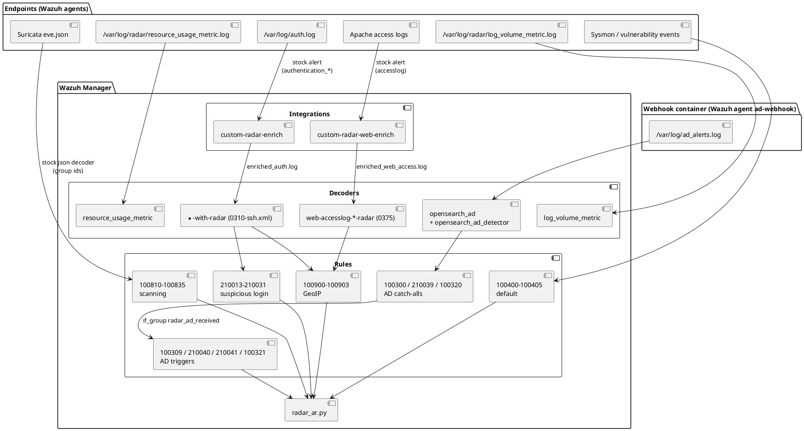

# RADAR custom rule and decoder patterns

This document specifies the design patterns of RADAR's custom Wazuh decoders and rules (`radar/scenarios/decoders/<scenario>/`, `radar/scenarios/rules/<scenario>/`, `radar/scenarios/lists/<scenario>/`) for the anomaly-alert path, the enriched authentication and web logs, the metric collectors, and the signature scenarios.

## Architecture overview



The metric decoders feed the indexer (anomaly detectors read the indexed events); they raise no RADAR rule themselves.

## Decoder patterns

### Program-name parent with a field-extracting child

Used for the metric collectors. File `radar/scenarios/decoders/linux_resource_utilization/0001-linux-resource-utilization.xml`:

```xml
<decoder name="resource_usage_metric">
  <program_name>resource_usage_metric</program_name>
</decoder>

<decoder name="resource_usage_metric_fields">
  <parent>resource_usage_metric</parent>
  <regex>cpu=(\S+) mem=(\S+)</regex>
  <order>cpu_usage_pct, mem_usage_pct</order>
</decoder>
```

`log_volume_metric` (`0001-log-volume.xml`) follows the same pattern and extracts `log_path`, `log_bytes`.

### AD alert decoder with same-name siblings for optional fields

`0001-ad-common.xml` is shipped identically under `decoders/log_volume`, `decoders/linux_resource_utilization` and `decoders/suspicious_login`. The parent `opensearch_ad` matches `program_name ^ad_alert$` and the prematch `OpenSearchAD`. Several children share the name `opensearch_ad_detector`:

- the first extracts `detector_name, entity_keyword, period_start, period_end, anomaly_grade, anomaly_confidence` from the line the webhook writes (SWD-035);
- one sibling extracts the optional `data_start, data_end`;
- one sibling extracts the optional `off_hours_count, schedule_group` (off-hours rule mode).

A line without the optional fields still decodes; those fields are then absent. Every value is matched with `\S+`, so an empty value or a value with a space makes the child fail: the webhook's validation guarantees neither occurs. Changing the webhook line format requires changing this decoder.

### Enrichment-tail decoders replacing stock files

The manager integrations append a `RADAR ...` tail to the original line (SRS-068). RADAR-aware copies of the stock files decode the tail:

- `0310-ssh.xml` (`suspicious_login`, `geoip_detection`): `sshd-success-with-radar`, `ssh-failed-with-radar`, `ssh-invfailed-with-radar` extract the user, source IP and `radar_outcome`, `radar_asn`, `radar_asn_placeholder_flag`, `radar_country`, `radar_region`, `radar_city`, `radar_geo_velocity_kmh`, `radar_country_change_i`, `radar_asn_novelty_i`.
- `0375-web-accesslog.xml` (`geoip_detection`): `web-accesslog-domainport-radar`, `web-accesslog-ip-ip-radar`, `web-accesslog-domain-radar`, `web-accesslog-ip-radar` extract `radar_country`, `radar_region`, `radar_city`, allowing empty region and city.

The stock `0310-ssh_decoders.xml` and `0375-web-accesslog_decoders.xml` are excluded in `ossec.conf` (`<decoder_exclude>`), because a custom file with the same decoder names would otherwise clash with them.

## Rule patterns

### AD catch-all and trigger rules attached by group

Each AD scenario ships a catch-all on the shared decoder, restricted to the webhook's log file, and trigger rules that attach to the group the catch-all sets. File `radar/scenarios/rules/log_volume/a1-log-volume.xml`:

```xml
<rule id="100300" level="5">
  <decoded_as>opensearch_ad</decoded_as>
  <location>/var/log/ad_alerts.log$</location>
  <description>OpenSearch AD alert received</description>
  <group>radar_ad_received,</group>
</rule>

<rule id="100309" level="12">
  <if_group>radar_ad_received</if_group>
  <match>LogVolume-Growth-Detected</match>
  <description>OpenSearch AD: Log Volume Growth Detected</description>
</rule>
```

Wazuh stops at the first top-level rule that matches, so with several AD scenarios deployed only the first-loaded catch-all (100300, 210039 or 100320) fires. Trigger rules therefore use `if_group radar_ad_received`, never `if_sid` of their own catch-all. `<match>` is a substring match on the trigger name: trigger names must not contain one another (`SuspiciousLogin-OffHour-Detected` for 210040, `SuspiciousLogin-OffHours-Rule-Detected` for 210041).

### Frequency and correlation rules

- Same-entity bursts: `frequency`/`timeframe` with `if_matched_sid` and `same_user` (210013) or `same_field` (210031 on `office365.UserId`, 100825 on `src_ip`).
- Sequence correlation: `if_sid` of the later event plus `if_matched_sid` of the earlier one (210022: impossible-travel success after failures).
- Multi-indicator confirmation (scanning): an anchor rule per ordered pair of indicator groups (`if_group` of the current indicator, `if_matched_group` or `if_matched_sid` of another, `same_field` `src_ip`, `timeframe` 300), and one confirmation rule (100830) that is the child of all anchors.

### List lookups

CDB lists hold values that change without a rule change. File `radar/scenarios/rules/geoip_detection/a2-geoip-detection.xml`:

```xml
<rule id="100900" level="10">
  <if_group>authentication_success</if_group>
  <field name="radar_country" type="pcre2">.+</field>
  <list field="radar_country" lookup="not_match_key">etc/lists/whitelist_countries</list>
  <description>Connection from non-whitelist country</description>
</rule>
```

The `.+` check keeps an unenriched event (empty field) from matching `not_match_key`. 100821 uses the same pattern with `radar_webdav_apps`.

### Rules on RADAR's own audit entries

`radar_ar.py` writes audit entries in the native active-response log format, decoded by Wazuh's rule 650; rule 100840 (level 0) selects those with a `decision_id`, and 100835 (level 12) raises an operational alert when the `reason` is `allowlist_unreadable`.

### Variables

Long alternations live in `<var>` definitions at the top of the rule file (`RADAR_SCANNER_UA`, `LEGIT_ACTIVITIES`) and are referenced as `$NAME`.

## Rule ID ranges

| Range | Scenario | File |
|---|---|---|
| 100300, 100309 | `log_volume` | `rules/log_volume/a1-log-volume.xml` |
| 100320, 100321 | `linux_resource_utilization` | `rules/linux_resource_utilization/a5-linux-resource-utilization.xml` |
| 100400–100405 | `default` | `rules/default/radar_rules.xml` |
| 100810–100840 | `scanning_detection` | `rules/scanning_detection/a4-scanning-detection.xml` |
| 100900–100903 | `geoip_detection` | `rules/geoip_detection/a2-geoip-detection.xml` |
| 210013–210041 | `suspicious_login` | `rules/suspicious_login/a3-suspicious-login.xml` |

## Rule hierarchy

```
opensearch_ad decoder (from /var/log/ad_alerts.log)
├── 100300 / 210039 / 100320  AD catch-all, level 5, group radar_ad_received (first loaded wins)
    ├── 100309  LogVolume-Growth-Detected, level 12
    ├── 210040  SuspiciousLogin-OffHour-Detected, level 10 (model mode)
    ├── 210041  SuspiciousLogin-OffHours-Rule-Detected, level 10 (rule mode)
    └── 100321  LinuxResourceUtilization-Anomaly-Detected, level 12

5760 (stock sshd failure)
├── 210013  ≥ frequency 5 in 60 s, same user, level 8
└── 210022  (with 210021) frequency 4 in 300 s, same user, level 12
authentication_success / authentication_failed
├── 210021 / 210020  geo-velocity > 900 km/h, level 10
└── 100900 / 100901  non-whitelisted country, level 10
91545 (stock Office 365)
└── 210030  UserLoginFailed, level 5
    └── 210031  3 in 300 s, same UserId, level 10
accesslog
└── 100902  non-whitelisted country, level 10
    └── 100903  300 in 300 s, level 12
ids (Suricata http)
├── 100810 / 100815→100825 / 100820, 100821  indicators
    └── 100826–100829, 100831, 100832  anchors → 100830 confirmed, level 12
```

## Deployment

Rules, decoders and lists are deployed per scenario through the Wazuh server API (`radar/wazuh_api/scenario_ops.py`, `radar/wazuh_api/ruleset.py`): each file is uploaded with `PUT /rules/files/{name}`, `/decoders/files/{name}` or `/lists/files/{name}` (`overwrite=true`) only when its content differs. The `default` rules are deployed with every scenario. The manager's `ossec.conf` receives the scenario's snippet (`radar/scenarios/ossec/`) between `<!-- RADAR: <scenario> BEGIN -->` / `END` markers, plus the shared `decoder_exclude` and list declarations. Undoing a scenario removes its files unless another deployed scenario still uses them.

## Best practices

1. **Unique rule IDs**: keep each scenario in its own range (table above).
2. **Trigger rules by group**: AD trigger rules attach with `if_group radar_ad_received` (checked by `test_ad_child_rules_reachable_from_every_ad_catch_all` in `radar/tests/py/test_radar_ar.py`).
3. **One contract, three places**: the webhook line, `0001-ad-common.xml` and the trigger names in `config.yaml` / `off_hours.py` change together; all copies of `0001-ad-common.xml` stay identical.
4. **Descriptive messages**: include extracted values in descriptions with `$(field)`.
5. **Response binding by rule ID**: only the rules listed in the scenario's `<active-response>` and in `ar.yaml` reach `radar_ar.py`; indicator and base rules stay unbound.
6. **Guard list lookups** with a non-empty field check before `not_match_key`.