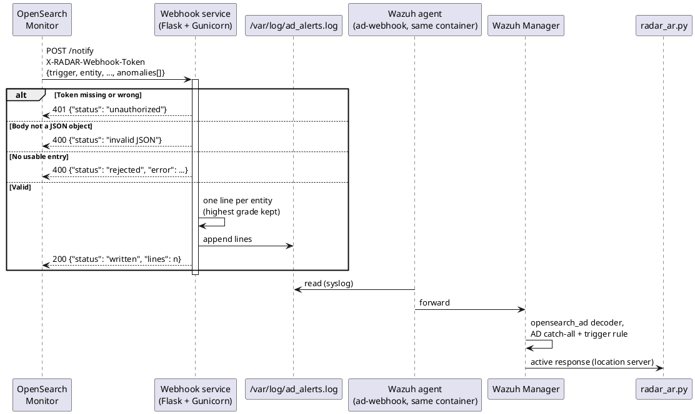

# RADAR webhook service design

This document specifies the design of RADAR's webhook service (`radar/webhook/ad_alerts_webhook.py`), which receives OpenSearch alerting monitor notifications and writes them as syslog-style lines to a log file that a Wazuh agent ships to the manager.

## Purpose

The webhook service bridges OpenSearch anomaly monitors (SWD-029, and the off-hours monitors of `off_hours.py`) and Wazuh's rule engine by:

1. receiving authenticated HTTP POST notifications from the monitors,
2. validating every field it will write,
3. writing one line per anomalous entity to `/var/log/ad_alerts.log`,
4. letting the Wazuh agent in the same container ship those lines, so that the RADAR decoders and rules (SWD-034) can invoke `radar_ar.py`.

## Architecture



## Route handler specification

**Endpoint**: `POST /notify` (port `WEBHOOK_INTERNAL_PORT`, default 8080)

**Authentication**: the header `X-RADAR-Webhook-Token` must equal `WEBHOOK_SHARED_SECRET` (constant-time comparison). Without a configured secret every request is refused.

**Behavior**:

1. Refuse bodies over 16 KiB (413).
2. Parse the body; anything but a JSON object is a 400.
3. Answer `{"ping": true}` with `{"status": "pong"}` (connectivity check).
4. Build the lines (below) and append them under a lock to the log file (`AD_ALERTS_LOG`, default `/var/log/ad_alerts.log`).
5. Return `{"status": "written", "lines": n}`.

**Validation** (an invalid field rejects the entry; values are only written after validation, which prevents log injection):

| Field | Rule |
|---|---|
| `trigger.name`, `entity` | `[A-Za-z0-9._:-]`, 1–128 characters |
| `periodStart`, `periodEnd` | ISO 8601 timestamp |
| `anomaly_grade`, `anomaly_confidence` | number in [0, 1] |
| `dataStart`, `dataEnd` (optional) | epoch milliseconds or ISO 8601; rewritten as ISO UTC; written only when both are usable and ordered |
| `off_hours_count`, `schedule_group` (optional, off-hours rule mode) | non-negative integer and a name as above; written only together |

**Multiple entities**: when the body has an `anomalies` list (SWD-029), each entry inherits `trigger`, `periodStart` and `periodEnd` from the top level; at most 50 entries are read, invalid entries are skipped, and only the first (highest-graded) entry per entity is written. The request is rejected only when no entry is usable. A body without `anomalies` (older monitors) gives one line from its top-level keys.

## Log output format

### Template

```
{Mon DD HH:MM:SS} {hostname} ad_alert: OpenSearchAD {trigger}: entity="{entity}", start="{periodStart}", end="{periodEnd}", anomaly_grade="{grade}", anomaly_confidence="{confidence}" [data_start="{iso}", data_end="{iso}" ][off_hours_count="{n}", schedule_group="{group}" ]
```

### Example output

```
Feb 16 10:30:15 3f2a9c1d ad_alert: OpenSearchAD LogVolume-Growth-Detected: entity="edge.vm", start="2026-02-16T10:25:00Z", end="2026-02-16T10:30:00Z", anomaly_grade="0.85", anomaly_confidence="0.92" data_start="2026-02-16T10:18:00.000Z", data_end="2026-02-16T10:19:00.000Z"
```

### Field mapping

| Payload field | Log field | Decoded as |
|---------------|-----------|--------|
| `trigger.name` | text after `OpenSearchAD` | `detector_name` |
| `entity` | `entity` | `entity_keyword` |
| `periodStart` / `periodEnd` | `start` / `end` | `period_start` / `period_end` |
| `anomaly_grade` / `anomaly_confidence` | same | same |
| `dataStart` / `dataEnd` | `data_start` / `data_end` | same |
| `off_hours_count` / `schedule_group` | same | same |

`monitor.name` is read but not written. The decoder (`0001-ad-common.xml`, SWD-034) must change with this format.

## Deployment

The service runs in its own container (`radar/webhook/Dockerfile`, `radar/docker-compose.webhook.yml`), built and started by `build-radar.sh`:

- Ubuntu 24.04 with Python 3, Flask, Gunicorn and a Wazuh agent.
- On first start the entrypoint enrolls the agent with a short-lived token as `WEBHOOK_AGENT_NAME` (default `ad-webhook`); `radar_ar.py` trusts anomaly alerts only from this agent and file. The image appends `radar/webhook/ad-ossec.conf` (a `syslog` `localfile` for `/var/log/ad_alerts.log`) to the agent configuration.
- Gunicorn (1 worker, 4 threads, 30-second timeout) runs the app as an unprivileged user on `0.0.0.0:WEBHOOK_INTERNAL_PORT`; the host port is bound to `WEBHOOK_BIND_ADDRESS`.
- `WEBHOOK_SHARED_SECRET` is mandatory in the compose file.

## Error handling

| Case | Response |
|---|---|
| Missing or wrong token | 401 `{"status": "unauthorized"}` |
| Body over 16 KiB | 413 `{"status": "payload too large"}` |
| Not a JSON object | 400 `{"status": "invalid JSON"}` |
| No valid entry | 400 `{"status": "rejected", "error": "<first error>"}` |
| File write failure | unhandled, 500 from the server |

## Testing

```bash
curl -X POST http://localhost:8080/notify \
  -H "Content-Type: application/json" \
  -H "X-RADAR-Webhook-Token: $WEBHOOK_SHARED_SECRET" \
  -d '{"trigger": {"name": "Test-Trigger"}, "entity": "test-entity",
       "periodStart": "2026-02-16T10:00:00Z", "periodEnd": "2026-02-16T10:05:00Z",
       "anomaly_grade": "0.95", "anomaly_confidence": "0.98"}'
```

Expected response: `{"lines": 1, "status": "written"}`, and one new line in `/var/log/ad_alerts.log`. Unit tests: `radar/tests/py/test_ad_alerts_webhook.py` (TST-074). `radar/radar-test-framework/simulate/scenarios/inject_ad_alert.py` posts a realistic body.

## Configuration summary

| Setting | Value | Description |
|---------|-------|-------------|
| **Port** | `WEBHOOK_INTERNAL_PORT` (8080) | HTTP port |
| **Endpoint** | `POST /notify` | Notification receiver |
| **Secret** | `WEBHOOK_SHARED_SECRET` | Required `X-RADAR-Webhook-Token` value |
| **Log file** | `AD_ALERTS_LOG` (`/var/log/ad_alerts.log`) | Output file shipped by the agent |
| **Agent name** | `WEBHOOK_AGENT_NAME` (`ad-webhook`) | Identity `radar_ar.py` trusts |

## Security considerations

1. **Authentication**: shared-secret header; requests without it are refused.
2. **Input validation**: strict per-field validation and a 16 KiB body limit prevent log injection and oversized payloads.
3. **Least privilege**: the app runs as an unprivileged user; only the agent runs as root.
4. **Network exposure**: bind the port to the network the indexer uses (`WEBHOOK_BIND_ADDRESS`). The service speaks plain HTTP; TLS needs a reverse proxy in front.
5. **Rate limiting**: not implemented.

## Implementation

See [radar/webhook/ad_alerts_webhook.py](../../../radar/webhook/ad_alerts_webhook.py).