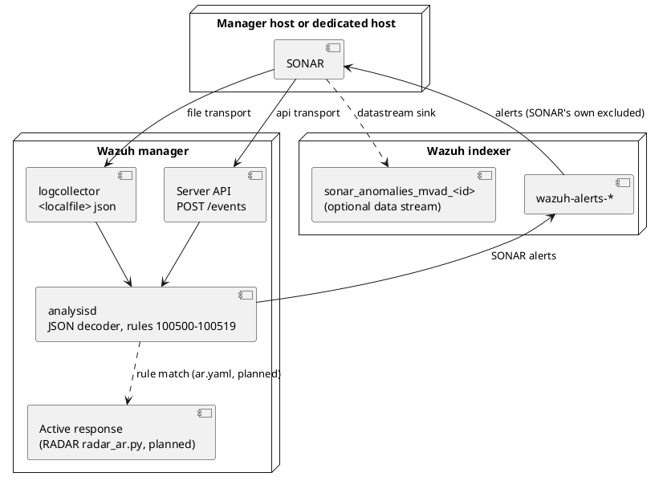

# RADAR-SONAR integration design

SONAR reports anomalies to the Wazuh manager as events. The manager decodes them, matches SONAR's rules and raises ordinary Wazuh alerts, which reach the indexer, dashboards, integrations and active responses. There is no direct link between SONAR and RADAR: RADAR is to act on SONAR alerts the way it acts on any other anomaly alert, which needs the RADAR changes listed under "Planned extensions".

Before this design, SONAR indexed anomaly documents straight into OpenSearch, bypassing the manager: no rule, active response or integration could fire on them, and RADAR could not see them.

## Deployment topologies

SONAR runs on the Wazuh manager host or on a dedicated machine, never on monitored endpoints, whose resources may be limited. No Wazuh agent is needed on the SONAR host. The topology selects the transport of the `wazuh` sink:

| Topology | Transport | Path to the manager's analysis engine |
|---|---|---|
| SONAR on the manager host, or in a container sharing a volume with the manager container | `file` | One JSON line per anomaly appended to a file, read by the manager's own `<localfile>` with `log_format json` |
| SONAR on a dedicated machine | `api` | Wazuh server API `POST /events` (Wazuh 4.6 and later; the project targets 4.14.1), JWT authentication, by a user whose role allows only `event:ingest` |



## Event format

One single-line JSON object per anomalous time bucket:

```json
{"integration": "sonar", "anomaly_grade": 0.82, "anomaly_confidence": 0.5,
 "sonar": {"anomaly_id": "…", "scenario": "brute_force", "model": "brute_force",
           "bucket_start": "2026-11-19T10:05:00Z", "bucket_minutes": 5,
           "severity": 0.82, "severity_band": "high", "score": 1.41,
           "top_contributors": [{"variable": "alert_count", "contribution": 0.61, "value": 212.0}]}}
```

- Wazuh's JSON decoder places the fields under `data.*` in the alert.
- `anomaly_grade` is MVAD's severity (0–1). `anomaly_confidence` (0–1) is a per-scenario setting, the scenario's measured precision; until it is measured, 0.5 is sent and SONAR warns at start-up. Together they are exactly the fields RADAR reads for anomaly-detection scenarios (`data.anomaly_grade`, `data.anomaly_confidence`).
- `severity_band` (`low`, `medium`, `high`, with configurable boundaries, by default 0.5 and 0.8) exists because Wazuh rules match strings and cannot compare numbers.
- `anomaly_id` identifies the scenario and bucket; it is the same in the optional data stream document.

## Rules

SONAR's rules ship as `sonar/wazuh/rules/sonar_rules.xml` and are installed through the server API (`sonar wazuh install-rules`) or copied by hand. SONAR owns the rule ID range **100500–100519**:

| ID | Level | Matches |
|---|---|---|
| 100500 | 3 | Any SONAR event: decoded as JSON, `integration` is `sonar` |
| 100501 | 3 | Band `low` |
| 100502 | 7 | Band `medium` |
| 100503 | 10 | Band `high` |
| 100510–100519 | | Free for per-scenario rules (child rules matching `sonar.scenario`) |

The range is free in the repository: RADAR's default rules use 100400–100405 and SRS-057 reserves 100600–100629. The rules carry the group `sonar`.

## Feedback-loop guard

SONAR alerts are written to `wazuh-alerts-*`, the indices SONAR reads. Every alert search therefore excludes the rule groups in `wazuh.exclude_rule_groups` (by default `sonar`), so SONAR never trains on, or detects from, its own alerts. The exclusion can be disabled explicitly.

## RADAR consumption

The SONAR event carries the two fields `radar_ar.py` reads for an anomaly-detection alert, `data.anomaly_grade` and `data.anomaly_confidence` (`resolve_ad_scores` in `radar/scenarios/active_responses/radar_ar.py`), so RADAR's risk engine can score a SONAR alert like an OpenSearch AD alert ($A = G \times C$).

**Constraint on mitigations.** A SONAR alert is raised by the manager itself, so its `agent` is the manager, whichever transport delivered the event. RADAR scenarios take the mitigation target from the alert's agent, so a mitigation would act on the manager. SONAR anomalies are aggregates over a scenario's alerts and carry no affected entity; a per-host model (`--agent`) names its host only in `sonar.scenario` and `sonar.model`. Until SONAR events name the entity in a field RADAR reads, RADAR scenarios for SONAR alerts must be limited to notifications and cases (`allow_mitigation: false`).

## Planned extensions

> **Status: planned.** Not implemented as of v2.2.0. This item specifies intended behaviour; no code implements it yet.

RADAR does not act on SONAR alerts yet. No shipped `ar.yaml` scenario maps a SONAR rule, and a mapping alone would not be enough: `radar_ar.py` accepts an anomaly alert only when it comes from the webhook agent's log (`AdAlertOrigin`: agent `WEBHOOK_AGENT_NAME`, default `ad-webhook`, location `/var/log/ad_alerts.log`), so a SONAR alert listed under `ad.rule_ids` is dropped as untrusted before scoring. The RADAR side of this design is to:

1. Accept SONAR alerts as a trusted anomaly origin, without weakening the check for OpenSearch AD alerts (for example by their manager agent and SONAR rule group).
2. Ship a scenario that maps SONAR's rules as anomaly-detection rules, with mitigations off:

```yaml
scenarios:
  sonar_anomaly:
    ad:
      rule_ids: ["100503"]
    w_ad: 1.0
    w_sig: 0.0
    w_cti: 0.0
    allow_mitigation: false
```

3. Keep the constraint on mitigations above until SONAR events name the affected entity.

## Delivery guarantees

Each anomaly is delivered at most once per sink, also across restarts: see [SWD-024](SWD-024.md) for the per-sink watermarks and document identities. The Wazuh manager cannot recognise a duplicate event, so the watermark is the only protection on this path; a batch that the server API rejects part-way may be delivered again from its first unconfirmed event.

## Verification

The lab verification of both topologies on Wazuh 4.14.1 is specified in TST-068: an anomaly reaches `wazuh-alerts-*` as rule 100503 with `data.anomaly_grade` and `data.sonar.scenario` populated, through each transport; a test `ar.yaml` entry triggers the active response; SONAR does not read its own alerts. How the manager decodes events received through the server API (their location and JSON decoding) is confirmed by that test.

## Related documentation

- Setup per topology: `docs/manual/sonar_docs/setup-guide.md`
- Sinks and event format: `docs/manual/sonar_docs/data-shipping-guide.md`
- Delivery design: [SWD-024](SWD-024.md)