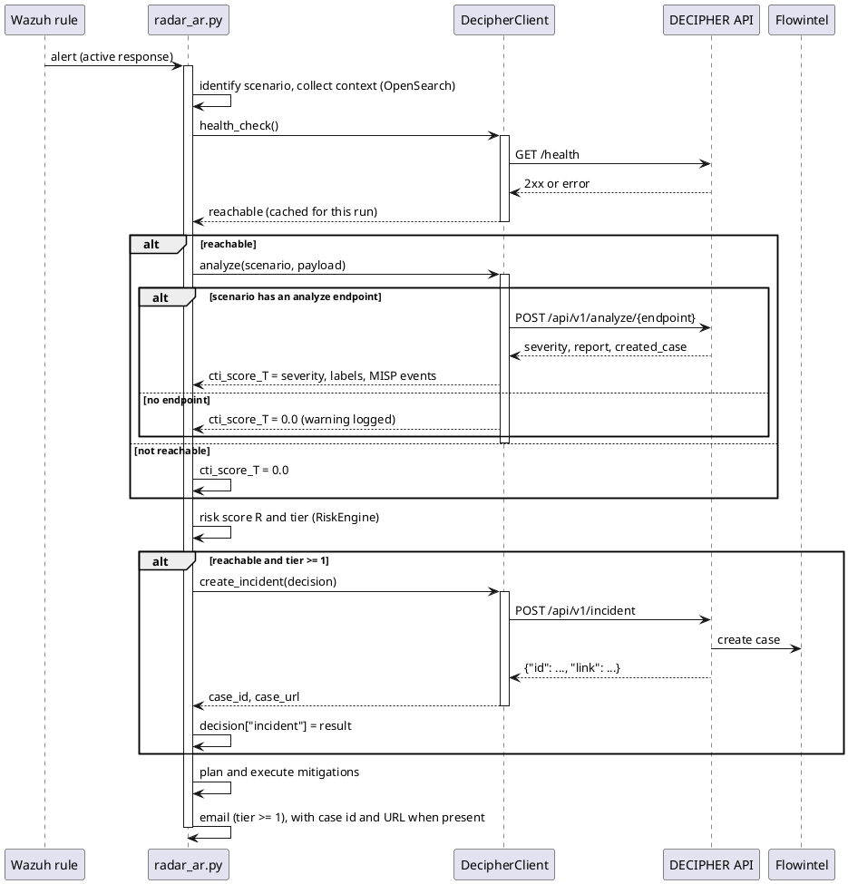

# RADAR-DECIPHER CTI and Flowintel integration design

This document specifies how RADAR's active response (`radar/scenarios/active_responses/radar_ar.py`) uses the SATRAP-DL DECIPHER subsystem: to obtain a CTI score for the risk engine, and to create Flowintel incident cases. RADAR talks only to DECIPHER's REST API; DECIPHER creates the Flowintel cases. The integration is optional: without DECIPHER, RADAR scores with $T = 0$ and creates no case.

## Integration architecture



## DecipherClient interface

`DecipherClient` in `radar_ar.py`:

```python
class DecipherClient:
    def __init__(self, logger: Logger): ...                  # reads DECIPHER_* from the environment
    def health_check(self) -> bool: ...                      # GET /health, result cached per instance
    def analyze(self, scenario_name: str, payload: dict) -> dict: ...
    def create_incident(self, decision: dict) -> dict: ...
```

`analyze` returns `{ok, cti_score_T, labels, misp_events, identified_scanners, case_id, case_url, raw}`; `create_incident` returns `{ok, case_id, case_url, raw}`. On any failure both return the same keys with `ok: false`, `cti_score_T: 0.0` and empty values; neither raises.

## CTI analysis

| Scenario | Endpoint | Payload built by the scenario strategy |
|---|---|---|
| `suspicious_login` | `POST /api/v1/analyze/suspicious_login` | `title`, `username` (the alert's user, else the anomaly's user, else the first user in the context), `target_host`, `src_ips`, `timestamp` |
| `scanning_detection` | `POST /api/v1/analyze/suspicious_nt_scanning` | `src_ip`, `uri`, `user_agents`, `http_method`, `target_host`, `timestamp`, `detection_chain` |
| any other scenario | none | analysis skipped, $T = 0$ |

Response fields used: `severity` becomes $T$ (clamped to [0, 1] by the risk engine); `report.log_summary` the CTI labels (listed in the email); `report.misp_events_found` is passed into the incident, and `report["identified-scanners"]` into the incident and the email; `created_case.id` and `created_case.link`, when DECIPHER creates a case during analysis, are logged.

The weight of $T$ is the scenario's `w_cti` in `ar.yaml`. `geoip_detection` has no analyze endpoint, so its shipped `w_cti` is 0.

## Incident creation

Incident creation runs in `RadarActiveResponse.run()` after risk scoring, gated on two conditions (the DECIPHER incident gate):

1. `DecipherClient.health_check()` returns `True`;
2. the computed tier is at least 1.

No scenario-level flag controls it: every alert that clears tier 0 gets a case when DECIPHER is reachable. The result is stored in the decision as `incident`, and the email lists the case ID and URL when both are present.

**Request** (`POST /api/v1/incident`, abbreviated):

```json
{"priority_level": "priority-level:low | medium | high",
 "title": "RADAR: suspicious login attempts",
 "description": {
   "source": "RADAR", "decision_id": "<sha256>", "timestamp": "<alert timestamp>",
   "scenario": {"name": "<scenario>", "detection_type": "signature | ad | hybrid"},
   "agent": {"id": "...", "name": "..."},
   "alert": {"id": "...", "rule_id": "...", "rule_level": 0, "rule_description": "...", "rule_groups": []},
   "risk": {"score": 0.0, "tier": 1, "components": {"anomaly_intensity_A": 0.0, "signature_risk_S": 0.0, "cti_score_T": 0.0, "...": 0.0}},
   "misp_events": [], "identified_scanners": null,
   "iocs": {"ip": [], "user": [], "domain": [], "hash": [], "service": [], "asn": [], "country": [], "agent": []},
   "extras": {}}}
```

The priority follows the tier (1 low, 2 medium, 3 high). The title is fixed per scenario (`_incident_title`), with `RADAR: <scenario>` for an unknown one.

**Response**: `{"id": <case id>, "link": "<case URL>"}`, returned as `case_id` and `case_url`.

## Configuration

Environment variables, set in RADAR's `.env` (or on the GUI's Connectors page) and copied into the manager's `active_responses.env` by `radar/wazuh_api/ar_env.py`:

| Variable | Default | Meaning |
|---|---|---|
| `DECIPHER_BASE_URL` | unset | DECIPHER API base URL; unset disables the integration; `http://` is assumed when no scheme is given |
| `DECIPHER_VERIFY_SSL` | `false` | Verify DECIPHER's TLS certificate |
| `DECIPHER_TIMEOUT_SEC` | `30` | Timeout per request |

`health-radar.sh` reports whether `DECIPHER_BASE_URL/health` is reachable from the manager container when the variable is set.

## Error handling

| Error | Handling |
|---|---|
| `DECIPHER_BASE_URL` unset | `health_check` returns `False` with a warning; no analysis, no case |
| DECIPHER unreachable or `/health` failing | `health_check` returns `False` with a warning; no analysis, no case |
| No analyze endpoint for the scenario | Warning; $T = 0$ |
| HTTP error, timeout or invalid JSON on analyze | Error logged; $T = 0$, no labels |
| HTTP error, timeout or invalid JSON on incident | Error logged; `incident.ok` is false; email and mitigations proceed |
| `requests` library missing | Error logged; every call fails as above |

**Design principle**: a DECIPHER failure never blocks scoring, email or mitigation.

## Verification

Unit tests in `radar/tests/py/test_radar_ar.py` cover the incident gate through `run()` (no case at tier 0 or when DECIPHER is down, one case at tiers 1 to 3), the analyze payload's user selection and the incident titles.