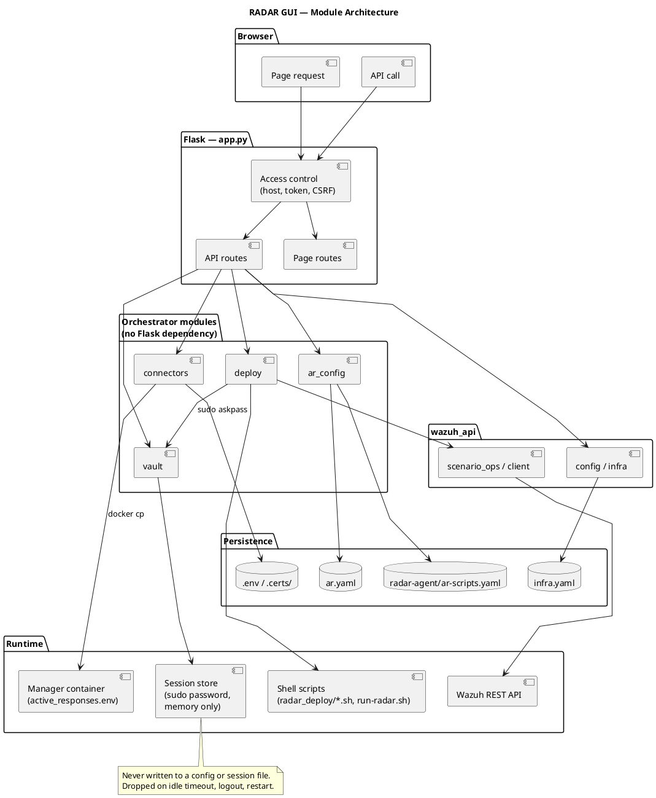

# RADAR GUI software design

This document specifies the software design of the RADAR GUI (`radar/gui/`), a Flask-based web application providing a browser interface for the RADAR operational lifecycle (SRS-063, SRS-064, SRS-070). It covers the backend-to-frontend architecture, key design decisions, and the access-control and credential model. Frontend component internals (HTML structure, JavaScript event wiring, CSS) are out of scope.

## Purpose and scope

The RADAR GUI replaces direct file editing and shell invocation for routine RADAR operations. It wraps `build-radar.sh`'s stages, `run-radar.sh`, the health-check stages and the `radar_deploy/` scripts with a browser interface, manages `ar.yaml` through structured forms, stores connector credentials in `.env`, registers infrastructure components in `infra.yaml`, and holds the host `sudo` password in a session-scoped, in-memory credential store.

The interface presents four pages — **RADAR Scenarios**, **Connectors**, **Infrastructure** and **Deployment** — and a **Log out** control. It does not manage an Ansible inventory: RADAR deploys against the local manager containers and their REST API, so there is no host inventory, no `host_vars/`, and no vault to unlock.

## Module structure

```
gui/
├── app.py                 Flask application: access control, all routes, startup and shutdown
├── requirements.txt       Runtime dependencies (installed into radar/.venv by radar.sh gui)
├── templates/, static/    Server-rendered pages and their scripts and styles
└── orchestrator/          Backend modules — no Flask dependency
    ├── ar_config.py       Read/write ar.yaml; read the active-response catalog
    ├── connectors.py      Read/write .env, live connector tests, manager env sync
    ├── deploy.py          Action specs, subprocess streaming, wazuh_api calls
    ├── health.py          Health output parsing (not used by any route)
    └── vault.py           Session-scoped sudo password store
```

The orchestrator modules are kept free of Flask imports, so the file-management and subprocess logic can be tested independently (`radar/tests/py/test_gui_ar_config.py`). `app.py` and the orchestrator also import `wazuh_api` (`config`, `infra`, and the scenario deploy and undo operations).



## Flask application: app.py

### Startup, login and shutdown

`./radar.sh gui` creates or updates `radar/.venv` from `requirements.txt` and starts `app.py`. The server binds to `RADAR_GUI_HOST` (default `127.0.0.1`) and `RADAR_GUI_PORT` (default 5000) with a threaded WSGI server, so long-running streaming responses do not block other requests. It warns when bound to a non-loopback address or when `RADAR_GUI_DEBUG=1` enables the Werkzeug debugger.

At start it generates a login token (or takes `RADAR_GUI_TOKEN`), prints the login URL `http://127.0.0.1:<port>/?token=<token>`, and writes the URL and its PID to an owner-only state file (`$XDG_STATE_HOME/radar-gui/gui-<port>.env`), from which `./radar.sh gui-url` prints it again. `RADAR_ROOT` (default: the parent of `gui/`) selects the RADAR installation the GUI manages.

**Log out** stops every running job, clears all stored sudo passwords, deletes the cookies and shuts the server down. Stopping the server any other way performs the same cleanup.

### Access control

Three `before_request` hooks run on every request:

1. **Host check**: the `Host` header must be one of the loopback names on the GUI port, the configured bind address, or a name listed in `RADAR_GUI_ALLOWED_HOSTS` (protects against DNS rebinding).
2. **Login token**: unless `RADAR_GUI_AUTH=off`, a request must carry the token, either once in the `token` query parameter of a `GET` (which sets an HttpOnly, SameSite=Strict cookie `radar_gui_auth` and redirects) or in that cookie. Comparisons are constant-time.
3. **CSRF**: `POST`, `PUT`, `PATCH` and `DELETE` must use `Content-Type: application/json`, must not be marked cross-site or same-site by `Sec-Fetch-Site`, and must carry no `Origin` other than an allowed host.

Refusals are JSON for `/api/` paths and plain text otherwise.

### Route organisation

**Page routes** (`/`, `/active-responses`, `/connectors`, `/infrastructure`, `/deploy`) render templates with the data needed for the initial render; all later interactions go through the API routes via JavaScript.

**API routes** (`/api/scenarios`, `/api/connectors`, `/api/infra`, `/api/sudo`, `/api/logout`, `/api/deploy`) are the contract between the frontend and the backend (SRS-063). Deployment actions return `text/plain` streams; the others return JSON.

## Orchestrator modules

### AR configuration management: ar_config.py

Reads and writes `scenarios/active_responses/ar.yaml`. `get_scenario()` starts from a deep copy of the `scenarios.default` block and deep-merges the scenario-specific block on top. `update_scenario()` deep-merges a partial patch into the scenario's stored block, so the GUI sends only the changed fields. `bind_scenario()`/`unbind_scenario()` add or remove a scenario block; `mark_deployed()` sets the block's `active` flag, which the GUI shows as deployment state.

Mitigation names are validated against `firewall-drop` plus the names in `radar/radar-agent/ar-scripts.yaml`; legacy names without the `.sh` suffix are mapped to the catalog names, and unknown names are rejected. A missing or invalid catalog is reported on the RADAR Scenarios page.

All writes happen under a module-level `threading.Lock` and use atomic temp-file replacement (`ar.yaml.tmp` -> `ar.yaml`).

### External service credentials: connectors.py

Manages credentials and URLs in `.env` at the RADAR root. `FIELD_MAP` maps GUI field IDs to environment variable names; `PASSWORD_KEYS` lists the five secret fields (`OS_PASS`, `WAZUH_AUTH_PASS`, `DASHBOARD_PASS`, `SMTP_PASS`, `MAXMIND_LICENSE_KEY`). The connector list returns only public keys plus which secrets are set. The reveal endpoint accepts only an environment variable name from `PASSWORD_KEYS` and needs an unlocked sudo password.

Changing an endpoint that receives a stored secret (`OS_URL`, `WAZUH_API_URL`, the SMTP host, port or STARTTLS setting, `WEBHOOK_URL`) without supplying the secret in the same save requires an unlocked sudo password, so that a browser session cannot redirect a stored secret to another server.

SSL verification fields are handled separately: `false` disables verification; a CA certificate supplied in the same request is written to `.certs/<name>-ca.pem` and its path stored as the variable's value; otherwise verification is enabled. `.env` is written through `wazuh_api.envfile`, which validates and quotes values, keeps comments and order, and replaces the file atomically with mode 0600. After a save, the filtered environment is copied into the manager as `active_responses.env`; a failure is returned as a warning.

### Subprocess streaming: deploy.py

Builds each action from its validated JSON specification and streams the output. Scenario names are validated against `config.yaml` before anything is spawned; an invalid input is yielded as an `[ERROR] ...` line because the `text/plain` stream is already open.

- **Build** runs the stages of `build-radar.sh` itself (LARC-024): certificate and credential generation, the core compose project and the webhook (each under `sudo -A`), enrollment hardening, `manager-apply-scenario-all.sh`, then `deploy_scenario_config` and `deploy_manager_config` through `wazuh_api`, and finally marks the scenario deployed in `ar.yaml`.
- **Undo scenario** calls `undo_scenario_config` and `undo_manager_config` through `wazuh_api` and marks the scenario not deployed.
- **Run** runs `run-radar.sh <scenario> --ingest true|false`; **Health** runs the three health-check stages (SWD-040); the group, deregistration, token and enrollment-window actions run the matching `radar_deploy/` scripts.
- **Teardown** requires explicit confirmation, runs `docker compose down` for the core and webhook projects, and with data removal also deletes the manager's host-side bind-mount directories listed in `volumes.yml`.
- **Preview** returns the commands an action would run without running them.

**Termination**: every child runs in its own session and is tracked. When the client stops reading (the frontend's Stop control aborts the fetch), the generator is closed and its `finally` block sends `SIGTERM` to the child's process group, then `SIGKILL` if it has not exited within 5 seconds. Log out stops every tracked child the same way.

**Sudo injection**: actions requiring host privilege run `sudo -A` with an askpass helper fed from the session store. Actions that do not — the anomaly detector, the health check, group assignment, deregistration and the Wazuh API operations — run without it and authenticate over HTTP with credentials from `.env`.

### Credential session store: vault.py

**In-memory session store**: the host `sudo` password is held in a module-level dictionary keyed by a session ID (`secrets.token_urlsafe(24)`), issued as an HttpOnly, SameSite=Strict cookie (`radar_vault_sid`). The unlock endpoint first verifies the password with `sudo -S -k true` and stores it only if `sudo` accepts it.

**Expiry**: an entry not used for `RADAR_SUDO_IDLE_MINUTES` (default 15) is dropped; each use refreshes it. Log out and server shutdown clear all entries.

**Hand-off to sudo**: for the duration of one privileged action, the password is written to an owner-only temporary file read by an owner-only askpass helper; both are deleted when the action ends. The password is never written to `.env`, `ar.yaml` or any session file.

**Naming**: the module and cookie keep the `vault` name from the previous Ansible-based design, where they also held an Ansible Vault password and an SSH passphrase. Neither exists any longer.

**Prompt-on-demand**: the GUI does not ask for the password at login. An API call that needs it and does not have it returns `403` with `need_sudo: true`; the frontend then prompts, submits to the unlock endpoint, and retries the original action once.

### health.py

Parses `OK`/`WARN`/`FAIL` lines into structured results. No route uses it: the Status tab streams the health-check stages through `deploy.py`.

## Session and security model

The sudo session does not survive a server restart. Keeping state only in process memory means no session database to maintain, no session files to protect, and a clean security boundary.

The sudo credential state is polled by the frontend via `/api/sudo/status`, intended to drive a badge showing whether the password is held for the session.

> **Known defect (open):** the frontend updates this badge by element id `sudo-badge`, which no template renders, so the badge never appears. The prompt-on-demand path is unaffected and remains the working route to setting the password.

## File I/O consistency

Mutations of `ar.yaml` acquire a module-level `threading.Lock`, read the file, apply the change in memory, write a `.tmp` sibling and atomically rename it over the target. `.env` is updated the same way by `wazuh_api.envfile` under the connectors module's lock. A concurrent request or an unexpected termination therefore never leaves a half-written configuration file.

Related: SRS-063, SRS-064.