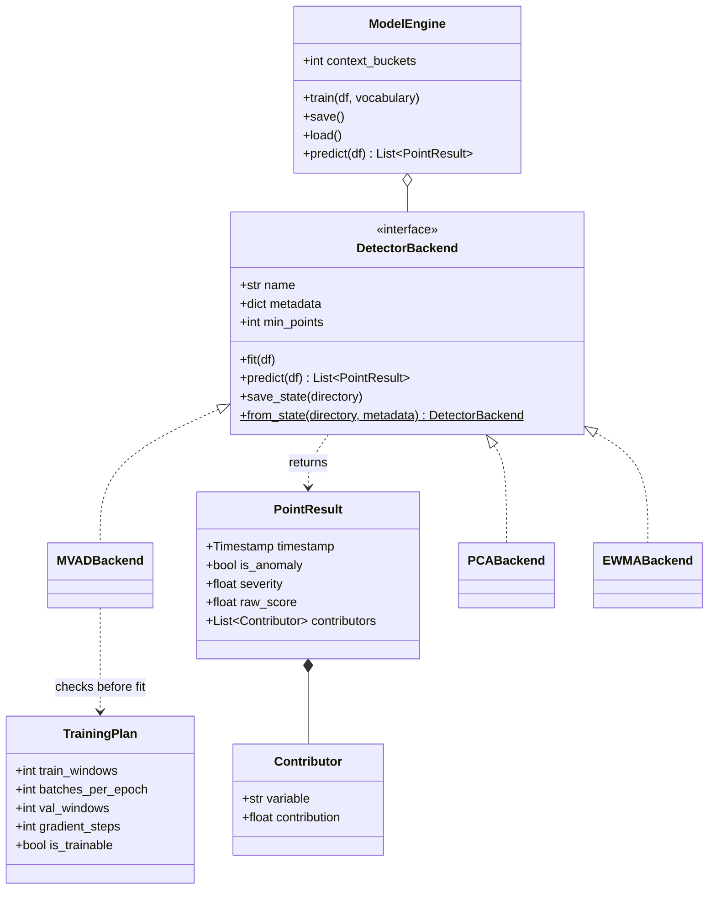

# SONAR detector backend contract

The anomaly detector behind SONAR's training and detection pipelines ([LARC-019](../larc/LARC-019.md), [LARC-020](../larc/LARC-020.md)) is a pluggable backend. Feature extraction, the scored window, post-processing, sinks and the model directory are backend-independent; a backend only learns from a feature matrix, gives verdicts and saves its own state. This item specifies that contract and the three backends that implement it.

**Implementation**: `sonar/backends/base.py` (contract), `sonar/backends/__init__.py` (registry), `sonar/backends/mvad.py`, `sonar/backends/pca.py`, `sonar/backends/ewma.py`, `sonar/training_plan.py` (MVAD training pre-flight), `sonar/engine.py` (the engine that drives a backend).

## Class structure

## Contract

| Member | Contract |
|---|---|
| `name` | Registry name (`mvad`, `pca`, `ewma`), stored as `backend` in the model's `metadata.json` and used to rebuild the backend on load |
| `metadata` | JSON-serialisable record of how the backend was trained (parameters, library versions, training statistics); merged into `metadata.json` |
| `min_points` | Fewest buckets `predict` accepts. Verdicts start at position `min_points − 1`; the engine exposes `context_buckets = min_points − 1`, which detection fetches before the scored window |
| `fit(df)` | Trains on a matrix with a time index and one numeric column per feature. Raises `InsufficientTrainingDataError` (from `sonar/training_plan.py`) when it cannot learn from that many buckets, before any state is kept |
| `predict(df)` | One `PointResult` per bucket from position `min_points − 1` on, in time order. Raises on fewer than `min_points` buckets or when not trained |
| `save_state(dir)` | Writes the trained state into an existing directory, as JSON or plain tensors; never pickle |
| `from_state(dir, metadata)` | Rebuilds a trained backend from `save_state`'s files and the stored metadata, without executing code from the files |

`PointResult` is the only input of post-processing (`sonar/pipeline.py`) and of evaluation (`sonar/evaluation.py`):

- `severity` is in [0, 1], comparable across backends and scenarios, and 0 when `is_anomaly` is false. The minimum severity (`threshold`), the severity bands of the Wazuh event and RADAR's anomaly grade all read it.
- `raw_score` is the backend's own score on its own scale, reported for diagnosis only.
- `contributors` lists features by decreasing share of the bucket's score; the shares of a bucket sum to about 1.

The registry (`backend_class`, `new_backend`) maps the configured `backend` (`backend:` in the configuration, `training.backend` in a scenario, `--backend` of `sonar evaluate`; default `mvad`) to a class, with its settings from the `mvad:`, `pca:` or `ewma:` section. An unknown name is an error. Each constructor validates its parameters and raises `ValueError` on an invalid one.

## Backends

| Backend | `min_points` | Training minimum | State files | Settings (default) |
|---|---|---|---|---|
| `mvad` | `input_size + threshold_window` | from the training plan (below) | `mvad_config.json`, `mvad_weights.pt` | `sliding_window` (200), `device` (`cpu`), `extra_params`, `min_gradient_steps` (500) |
| `pca` | `window` | `window − 1 + 20` buckets | `pca_state.json` | `window` (3), `variance` (0.95), `z_threshold` (4.0) |
| `ewma` | `⌈1/α⌉ + 1` (1 when α = 1) | `max(10, min_points + 1)` buckets | `ewma_state.json` | `alpha` (0.5), `z_threshold` (4.0) |

### `mvad`

Wraps the multivariate anomaly detector of `time-series-anomaly-detector` 0.4.0, a graph-attention network that forecasts and reconstructs every feature. With sliding window $W$, the library uses $\text{input\_size} = \lfloor W/2 \rfloor$ and $\text{threshold\_window} = \min(200, W - \text{input\_size})$. Verdict, severity and contributors are the library's: the anomaly score $s$ combines forecast and reconstruction errors, $\text{severity} = s/(e-1)$ for an anomaly and 0 otherwise, $\text{raw\_score} = s$, and the contributors are the library's interpretation. An output in any other format than one entry per bucket is an error. Training uses a private temporary checkpoint directory per run, so concurrent trainings never share one and nothing is written to the working directory.

### `ewma`

A per-feature baseline without deep learning. Each feature $j$ is smoothed, $\tilde{x}_{t,j} = \alpha x_{t,j} + (1-\alpha)\tilde{x}_{t-1,j}$; training stores, after the warm-up, the median $m_j$ and scale $s_j$ of the smoothed values ($1.4826 \cdot \text{MAD}$, else the standard deviation, else 1). For a bucket:

$$z_{t,j} = \frac{|\tilde{x}_{t,j} - m_j|}{s_j}, \qquad z_t = \max_j z_{t,j}, \qquad \text{anomaly} \iff z_t \ge \tau$$

$\text{severity} = \min(1, z_t / 2\tau)$ for an anomaly (0.5 at the threshold, 1 from twice the threshold), $\text{raw\_score} = z_t$, and feature $j$ contributes $z_{t,j} / \sum_k z_{t,k}$. It ignores correlations between features, which a multivariate model must improve on to justify its cost.

### `pca`

A linear multivariate model without deep learning. Every feature is standardised with its training median and scale (as in `ewma`), $u_{t,j} = (x_{t,j} - m_j)/s_j$, and bucket $t$ is represented by the window of its last $w$ buckets, $x_t = (u_{t-w+1}, \dots, u_t)$, of dimension $D = w \cdot p$ for $p$ features. Training fits a probabilistic PCA to the training windows: mean $\mu$, the $k$ leading components $v_i$ that explain at least the share `variance` of the training variance (at most $D-1$), their variances $\lambda_i$, and an isotropic noise variance $\sigma^2$ for the rest (the mean discarded variance, at least 0.01). With $y = x_t - \mu$:

$$d^2 = \sum_{i=1}^{k} \frac{(v_i^\top y)^2}{\lambda_i} + \frac{\lVert y - V V^\top y \rVert^2}{\sigma^2}, \qquad r_t = \sqrt{d^2 / D}$$

The first term grows for a window far out along a direction normal data varies in (a spike, a level never seen), the second for one that breaks the correlations between features or lags (a feature moving alone). The bucket's robust z-score $z_t = (r_t - \text{median}(r)) / \text{scale}(r)$ against the training windows' scores decides: anomaly when $z_t \ge \tau$, severity as in `ewma`, $\text{raw\_score} = z_t$. Each feature contributes its share of $d^2$, summed over the lags of the window. An anomalous bucket stays in the window for $w$ buckets, so an alarm can last up to $w - 1$ buckets after the anomaly; a long window dilutes an anomaly confined to few features and buckets, hence the short default.

## MVAD training pre-flight

The library builds training windows with a stride, drops incomplete batches and selects its checkpoint on a validation split. Below a data size that depends on these parameters, its `fit` performs no update and returns a randomly initialised network ([SRS-072](../srs/SRS-072.md)). `sonar/training_plan.py` reproduces that arithmetic without importing torch, and `MVADBackend.fit` checks it first. For $n$ buckets, with the library defaults `epochs` 100, `batch_size` $B$ = 128, `interval` $I$ = 10, `horizon` $h$ = 1, `train_ratio` 0.8 and `val_ratio` 0.1, any of which `extra_params` can override:

$$\text{train\_windows} = \left\lfloor \frac{\max(0,\ \lfloor 0.8n \rfloor - h + 1 - \text{input\_size})}{I} \right\rfloor, \quad \text{batches} = \left\lfloor \frac{\text{train\_windows}}{B} \right\rfloor, \quad \text{val\_windows} = \max(0,\ \lfloor 0.1n \rfloor - \text{input\_size})$$

Training is possible when $\text{batches} \ge 1$ and $\text{val\_windows} \ge 1$; the number of optimiser updates is $\text{batches} \times \text{epochs}$. Otherwise `fit` raises `InsufficientTrainingDataError` with the smallest trainable bucket count (a binary search over the same plan): 1,725 buckets for the default window, 610 for `sliding_window: 120` with `interval: 1`. Fewer updates than `min_gradient_steps` only warn. Before the plan, the parameters are validated: a key the library would ignore is rejected with the likely intended name (`learning_rate` → `lr`), and keys the library derives itself (`data_dim`, `input_size`, `threshold_window`, `normalize_base`) cannot be set.

The constants are copied from library 0.4.0; `tests/sonartests/test_engine_real_mvad.py` fails if the installed library differs, which means re-deriving the plan, not only updating numbers. The backend records in its metadata the library name and version, the effective parameters, the training plan, the number of updates (`gradient_steps`), the library's threshold and the training score range ([SWD-044](SWD-044.md)).

## Design rationale

- **One contract, one post-processing.** Thresholds, run lengths, severity bands, evaluation and RADAR's use of the anomaly grade work the same for every backend only because each backend normalises its severity to [0, 1] and returns verdicts from the same position.
- **Baselines.** `ewma` and `pca` need neither torch nor a GPU; they show whether MVAD is worth its cost on a given scenario, measured with `sonar evaluate` ([SWD-045](SWD-045.md)).
- **MVAD verdicts are pinned.** `tests/assets/sonar_mvad_regression.json` holds the verdicts the MVAD backend gave before the contract existed; `tests/sonartests/test_backends.py` compares them, so a change of behaviour is visible.