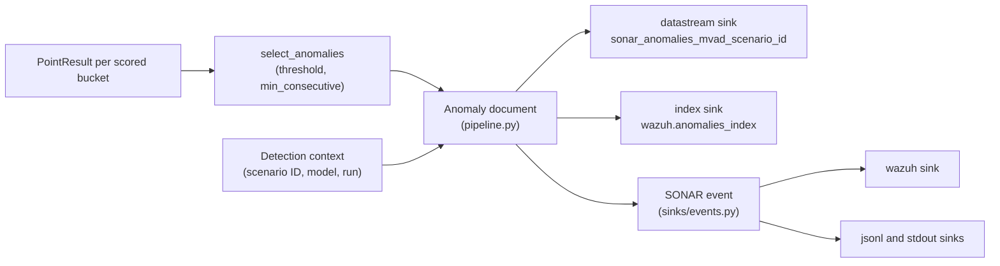

# SONAR anomaly document schema

The detection pipeline ([LARC-020](../larc/LARC-020.md)) turns every reported bucket into one **anomaly document**. The document is the single record of an anomaly inside SONAR: the indexer sinks store it, and the other sinks send the SONAR event derived from it. This item specifies its fields, how they are filled, and the index mapping that must follow them.

**Implementation**: `sonar/pipeline.py` (`MVADPostProcessor.build_wazuh_anomaly_docs`, the only builder of the document), `sonar/cli.py` (`_detection_context`, which fills the run and model fields), `sonar/watermark.py` (`anomaly_id`), `sonar/shipper/wazuh_base_template.py` (mappings), `sonar/shipper/wazuh_data_shipper.py` (template installation, stream names), `sonar/sinks/` (consumers).

## Flow



## Fields

One document per reported bucket. Names prefixed `mvad_` hold any backend's values: MVAD was the first backend, and the names are kept so existing mappings and dashboards stay valid.

| Field | Mapped type | Content |
|---|---|---|
| `anomaly_id` | keyword | SHA-256 (hex) of the scenario ID and the bucket start (UTC, ISO 8601), joined by a vertical bar; the document `_id` in the indexer sinks |
| `timestamp`, `@timestamp` | data stream time field (`timestamp`) | Start of the bucket |
| `is_anomaly` | boolean | Always `true`: only reported buckets become documents |
| `anomaly_score` | float | The bucket's severity, 0–1 ([SWD-043](SWD-043.md)) |
| `anomaly_confidence` | float | The scenario's measured precision (`detection.anomaly_confidence`), 0.5 when not set |
| `threshold` | float | The minimum severity applied, or null |
| `scenario_name` | keyword | The scenario ID ([SWD-044](SWD-044.md)), not the scenario's display name |
| `model_name` | keyword | The model's name |
| `detection_timestamp` | date | When the detection run built the document (UTC) |
| `alert_count` | integer | Alerts the run fetched, context included |
| `feature_count` | integer | Number of model columns |
| `mvad_score` | float | The backend's raw score, on its own scale |
| `mvad_severity` | float | Same value as `anomaly_score` |
| `mvad_threshold` | float | Same value as `threshold` |
| `sliding_window` | integer | MVAD's sliding window; 0 for backends without one |
| `bucket_minutes` | integer | Bucket length |
| `context.model_path`, `context.feature_names`, `context.training_samples` | keyword, keyword, integer | The model's directory, its columns, and its number of training buckets |
| `data.lookback_minutes` | integer | The detection window |
| `data.mvad_score`, `data.mvad_severity`, `data.mvad_threshold`, `data.bucket_minutes` | dynamic | Copies of the top-level values |
| `mvad_interpretation[]` | object: `variable` keyword, `contribution` float, `value` float | Up to three largest contributors, with the feature's value in that bucket (null if unavailable); absent when the backend gives no contributors |

Example (`sonar/pipeline.py`, abridged):

```json
{
  "anomaly_id": "<sha256 hex>", "timestamp": "2026-01-01T12:05:00+00:00", "@timestamp": "2026-01-01T12:05:00+00:00",
  "is_anomaly": true, "anomaly_score": 0.62, "anomaly_confidence": 0.86, "threshold": 0.25,
  "scenario_name": "linux_resource_monitoring", "model_name": "linux_resource_monitoring",
  "detection_timestamp": "2026-01-01T12:11:02+00:00", "alert_count": 1840, "feature_count": 29,
  "mvad_score": 1.07, "mvad_severity": 0.62, "mvad_threshold": 0.25, "sliding_window": 120, "bucket_minutes": 1,
  "context": {"model_path": "<models_dir>/linux_resource_monitoring", "feature_names": ["alert_count", "..."], "training_samples": 1440},
  "data": {"mvad_score": 1.07, "mvad_severity": 0.62, "mvad_threshold": 0.25, "bucket_minutes": 1, "lookback_minutes": 10},
  "mvad_interpretation": [{"variable": "data.cpu_usage_%__max", "contribution": 0.71, "value": 98.4}]
}
```

**Rules.**

- Every detection command (`sonar detect`, with or without a scenario, and `sonar scenario`) fills the document from the loaded model and the scenario ID, so all documents have the same shape.
- A threshold outside [0, 1], or verdicts that are not `PointResult`s, is an error; no placeholder document is ever produced. The document carries no Wazuh `rule` block: Wazuh alerts for anomalies are raised by the manager from the SONAR event.
- Before a document is written to the indexer it is made JSON-safe: timestamps and numpy values converted, NaN and infinity as null ([SRS-086](../srs/SRS-086.md)).

## Index templates

Training with the data stream enabled (the `datastream` sink, `--ship` or `shipping.enabled`, outside debug mode) installs, through `WazuhDataShipper`, the per-scenario template and, with `shipping.install_templates`, the generic templates and the retention policy ([SWD-024](SWD-024.md)):

| Template | Index pattern | Priority | Composition |
|---|---|---|---|
| `sonar_stream_template` | `sonar_anomalies_*` | 1 | Base mapping of the top-level fields `anomaly_id`, `is_anomaly`, `anomaly_score`, `anomaly_confidence`, `threshold`, `scenario_name`, `detection_timestamp`, `alert_count`, `feature_count`; data stream on `timestamp`; one shard, no replica, 30 s refresh |
| `sonar_stream_template_mvad` | `sonar_anomalies_*` | 2 | Base plus the component `component_template_sonar_mvad` |
| `sonar_stream_template_mvad_<scenario_id>` | `sonar_anomalies_mvad_<scenario_id>` (the exact stream name) | 3 | Base plus the component; `_meta.scenario_name` |

The component maps `model_name`, the `mvad_*` fields, `sliding_window`, `bucket_minutes`, `mvad_interpretation`, `data.lookback_minutes` and `context.*`. It is put again on every installation, so a cluster with an older mapping picks up the new one on its next backing index. Template and stream names come from one helper (`get_template_name_and_pattern`), and the per-scenario priority stays above the generic templates, because OpenSearch rejects overlapping templates of equal priority. The plain index of the `index` sink has no SONAR template and is mapped dynamically.

## SONAR event

The `wazuh`, `jsonl` and `stdout` sinks send a single-line JSON event derived from the document ([SWD-037](SWD-037.md)): `integration: sonar`, `anomaly_grade` (= `anomaly_score`), `anomaly_confidence`, and a `sonar` object with `anomaly_id`, `scenario` (= `scenario_name`), `model`, `bucket_start`, `bucket_minutes`, `severity`, `severity_band`, `score` (= `mvad_score`) and `top_contributors` (= `mvad_interpretation`).

## Design rationale

- **One owner.** The post-processor is the only place that builds the document; the templates and the event follow it. A mapping that names a field the document does not carry maps nothing, and a document field without mapping is typed dynamically. `tests/sonartests/test_shipper.py` checks that every field the component maps exists in a built document; change the template together with the document.
- **Deterministic identity.** `anomaly_id` depends only on the scenario and the bucket, so a bucket scored by many overlapping runs is stored once (create-only, an existing id counts as delivered) and the delivery watermarks can refer to it ([SWD-024](SWD-024.md)).
- **Severity, not raw score, at the top level.** `anomaly_score` is comparable across backends and scenarios; the raw score's scale depends on the backend and the feature list.